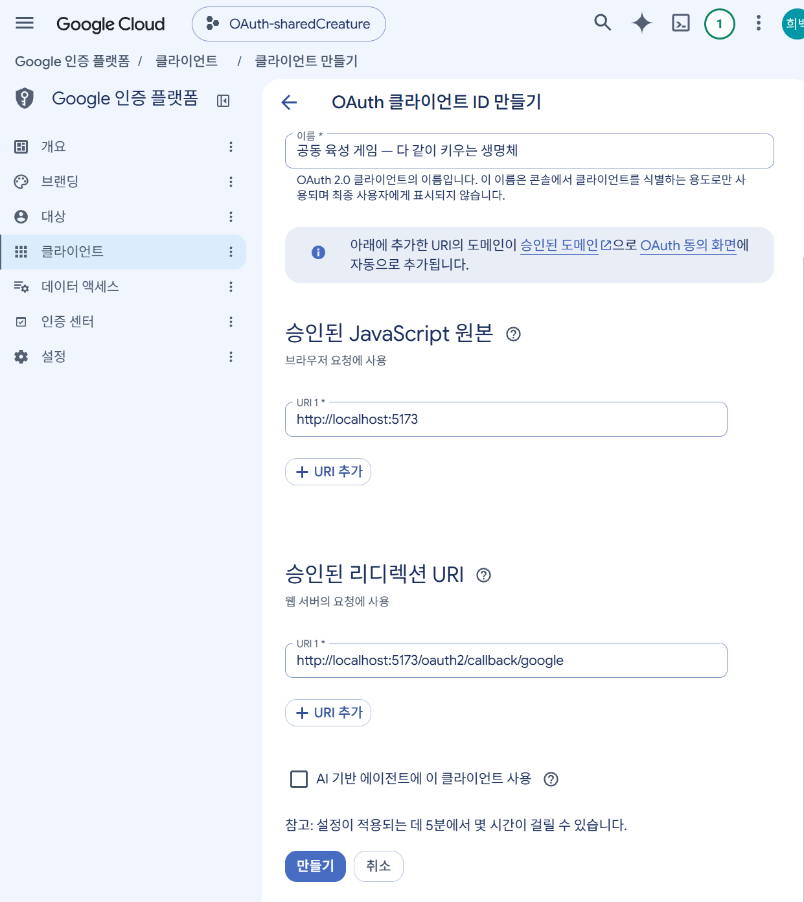
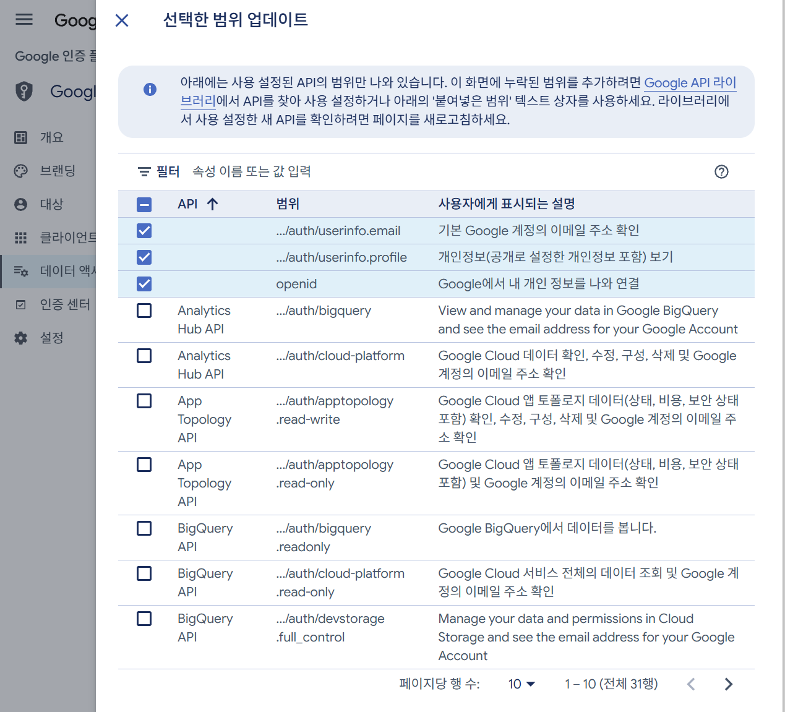

# 공동 육성 게임 — 다 같이 키우는 생명체

- [프로젝트 설계 문서 보기](docs/index.md)
- [GitHub Projects 보기](https://github.com/heebaek200/shared-creature-game/projects)
- [팀 프로젝트 일일 리포트 보기](https://github.com/heebaek200/shared-creature-game/discussions)

## 주요 기술 스택

| 분류 | 기술 | 프로젝트에서의 역할 |
|---|---|---|
| 언어·빌드 | Java 21, JavaScript ES Modules, Gradle, npm | Spring Boot 서버와 브라우저 애플리케이션 구현, 의존성·빌드 관리 |
| 백엔드 | Spring Boot 4.1.1, Spring MVC, Spring Security, Spring Data JPA | REST API, 세션 인증·역할 인가, 트랜잭션과 영속성 관리 |
| 프론트엔드 | Vite 7, Vanilla JavaScript, Bootstrap 5, HTML/CSS | History API 기반 CSR/SPA, 반응형 화면과 공통 테마 구성 |
| 데이터베이스·세션 | MySQL 8, Spring Session JDBC | 업무 데이터와 로그인 세션 영속화, UNIQUE·락 기반 정합성 보장 |
| 인증 | OAuth 2.0 Authorization Code, OpenID Connect | Google·Naver 소셜 인증, 공급자 신원 검증과 서버 세션 로그인 |
| 실시간 | WebSocket, STOMP | 그룹별 상태 이벤트·Presence·아바타 동기화와 Snapshot 복구 신호 전달 |
| 외부 서비스 | PortOne V2, Gemini API, Metadata Extractor | 테스트 결제·환불, 그룹 소개 교정, JPEG EXIF 추출 |
| 정기 작업 | Spring Scheduler | 시즌·퀘스트·부화, 결제·환불 복구, 사진 보존 기한 정리 |
| 테스트 | JUnit 5, Spring Boot Test, Spring Security Test | 단위·통합·동시성·보안 경계 검증 |

핵심 특징은 DB Commit을 최종 상태로 삼고 WebSocket은 결과 전달에만 사용하는 점, 비관적·낙관적 락과 UNIQUE 제약·멱등성 키를 함께 사용해 중복 처리를 막는 점, 외부 PG 호출과 DB 트랜잭션을 분리하고 Webhook·Scheduler로 결과 불명 상태를 복구하는 점입니다. 사진 인증은 JPEG Signature와 EXIF를 서버에서 다시 검증하고 제한된 Worker와 Timeout으로 작업량을 제어합니다.

> 일부 영역은 최종 확정 설계를 기준으로 먼저 문서화했습니다. 발표·배포 전에는 실제 통합 코드와 테스트 결과를 다시 대조합니다.

**[기술 스택 및 아키텍처 설계·구현 해설](docs/tech-stack.md)**

## 로컬 구동 방법

### 1. 준비물

- Java 21
- MySQL 8
- Node.js 20 이상과 npm

Docker, H2, Flyway와 Liquibase는 사용하지 않습니다. 일반 업무 테이블·컬럼과 일반 제약은 JPA `ddl-auto=update`로 만들고, Spring Session 테이블과 MySQL STORED 생성 컬럼·조건부 UNIQUE는 `db/special-schema.sql`로 관리합니다.

### 2. 데이터베이스 준비

로컬 MySQL 관리자 계정으로 다음 데이터베이스와 개발 계정을 준비합니다. 비밀번호는 예시를 그대로 사용하지 않습니다.

```sql
CREATE DATABASE shared_creature_game CHARACTER SET utf8mb4 COLLATE utf8mb4_0900_ai_ci;
CREATE DATABASE shared_creature_game_test CHARACTER SET utf8mb4 COLLATE utf8mb4_0900_ai_ci;

CREATE USER 'shared_creature'@'localhost' IDENTIFIED BY 'replace-with-local-password';
GRANT ALL PRIVILEGES ON shared_creature_game.* TO 'shared_creature'@'localhost';
GRANT ALL PRIVILEGES ON shared_creature_game_test.* TO 'shared_creature'@'localhost';
```

`.env.example`을 `.env`로 복사한 뒤 `LOCAL_DB_*`, `TEST_DB_*`를 자신의 로컬 계정에 맞게 설정합니다. `.env`는 Git에 포함하지 않습니다.

### 3. Backend 실행

Windows PowerShell 기준입니다.

```powershell
.\gradlew.bat bootRun
```

기본 주소는 `http://localhost:8080`입니다. 최초 실행 시 JPA가 업무 테이블을 생성한 뒤 `data.sql`이 시즌·크리처 종·퀘스트·상품의 기본 샘플 데이터를 넣습니다.

이미 이전 스키마로 실행했던 로컬 DB는 `ddl-auto=update`가 기존 `NOT NULL` 완화를 자동 반영하지 않습니다. 데이터를 삭제하거나 DB를 재생성하지 말고 Backend를 중지한 상태에서 다음 보정 SQL을 한 번 실행합니다.

```powershell
mysql -u shared_creature -p shared_creature_game < docs/sql/local-schema-repair.sql
```

신규 DB에는 이 보정이 필요하지 않습니다. STORED 생성 컬럼과 조건부 UNIQUE는 애플리케이션 시작 시 `special-schema.sql`이 멱등 적용합니다.

테스트는 별도 `shared_creature_game_test` 데이터베이스를 사용합니다.

```powershell
.\gradlew.bat test
```

### 4. Frontend 실행

```powershell
cd frontend
npm install
npm run dev
```

브라우저에서 `http://localhost:5173`에 접속합니다. Vite가 `/api`, `/oauth2`, `/ws`를 Backend로 Proxy합니다.

Backend 없이 화면 견본을 확인할 때에는 `frontend/.env.local`에 다음 값을 설정합니다.

```properties
VITE_USE_MOCK_API=true
```

Production Build에서는 목 모드를 켤 수 없습니다.

```powershell
npm run build
```

### 5. Google OAuth 로컬 설정

1. [Google Cloud Console](https://console.cloud.google.com/)에서 Web Application OAuth Client를 만듭니다.
2. 승인된 JavaScript Origin에 `http://localhost:5173`을 등록합니다.
3. 승인된 Redirect URI에 `.env`의 `GOOGLE_REDIRECT_URI`와 정확히 같은 `http://localhost:5173/oauth2/callback/google`을 등록합니다.

[](https://github.com/heebaek200/shared-creature-game/blob/main/docs/images/google_oauth.png)

4. Client ID와 Client Secret을 각각 `GOOGLE_CLIENT_ID`, `GOOGLE_CLIENT_SECRET`에 설정합니다. 최초 전체 관리자로 사용할 Google 계정의 OpenID Connect `sub` 값을 `INITIAL_SUPER_ADMIN_PROVIDER_USER_ID`에 설정하고 `INITIAL_SUPER_ADMIN_PROVIDER=GOOGLE`을 유지합니다.
5. Google Scope는 `openid profile email`만 사용합니다.

[](https://github.com/heebaek200/shared-creature-game/blob/main/docs/images/google_oauth_scope.png)

6. 로그인 시작·`state`·`nonce`·시작 세션 결속과 가입 대기·내부 사용자 연결은 구현되어 있습니다.
7. Backend는 Authorization Code를 Token으로 교환하고 ID Token과 nonce를 검증한 뒤 UserInfo를 조회합니다. 공급자 Token은 Browser나 DB에 저장하지 않습니다.

Google 공식 구현 기준은 [Web Server OAuth 2.0](https://developers.google.com/identity/protocols/oauth2/web-server)과 [OpenID Connect](https://developers.google.com/identity/openid-connect/openid-connect)를 확인합니다.

### 6. Naver OAuth 로컬 설정

1. [Naver Developers](https://developers.naver.com/)에서 **Application → 애플리케이션 등록**으로 이동하여 애플리케이션을 생성합니다.
2. 사용 API에서 **네이버 로그인**을 선택하고, 제공 정보에 **이메일 주소**를 포함합니다. 현재 구현에서는 사용자 식별자(`id`)와 이메일(`email`)이 필수이며, 닉네임(`nickname`) 또는 이름(`name`)을 추천 닉네임으로 사용합니다.
3. 로그인 오픈 API 서비스 환경에서 **PC 웹**을 선택하고 다음 주소를 등록합니다.
   - 서비스 URL: `http://localhost:5173`
   - Callback URL: `http://localhost:5173/oauth2/callback/naver`
4. 발급받은 Client ID와 Client Secret을 프로젝트 루트 `.env`에 설정합니다. `NAVER_REDIRECT_URI`는 개발자센터에 등록한 Callback URL과 정확히 일치해야 합니다.

   ```properties
   NAVER_CLIENT_ID=your_naver_client_id
   NAVER_CLIENT_SECRET=your_naver_client_secret
   NAVER_REDIRECT_URI=http://localhost:5173/oauth2/callback/naver
   ```

5. **개발 중** 상태의 애플리케이션은 등록자 및 관리자·테스터로 등록된 계정만 로그인할 수 있습니다. 다른 팀원이 테스트하려면 개발자센터의 **멤버관리**에서 해당 네이버 계정을 테스터로 추가합니다.
6. Backend와 Frontend를 실행한 뒤 `http://localhost:5173/login`에서 **Naver로 계속하기** 버튼으로 로그인합니다. 신규 사용자는 닉네임 설정을 거쳐 회원가입을 완료합니다.
7. 로그인 시작·`state` 검증·시작 세션 결속과 가입 대기·내부 사용자 연결은 구현되어 있습니다. Backend는 Authorization Code를 Access Token으로 교환한 뒤 네이버 사용자 정보 API(`/v1/nid/me`)를 호출하여 사용자 식별자와 이메일을 확인합니다. 공급자 Token은 Browser나 DB에 저장하지 않습니다.

Naver 공식 구현 기준은 [네이버 로그인 개발가이드](https://developers.naver.com/docs/login/devguide)와 [네이버 로그인 API 명세](https://developers.naver.com/docs/login/api/api.md)를 확인합니다. 일반 사용자에게 서비스를 공개하려면 별도의 사전 검수가 필요합니다.

### 7. Android 실기기 실행 및 사진 EXIF 인증 테스트

이 프로젝트는 Android 스마트폰의 Chrome 브라우저에서 접속하여 사진 인증 퀘스트를 테스트할 수 있도록 구성되어 있습니다.

로컬 PC에서 Spring Boot와 Vite를 실행하고, **ngrok을 통해 HTTPS 주소를 발급받아 스마트폰에서 접속**하는 방식입니다. 별도의 Android 앱 설치나 APK 빌드는 필요하지 않습니다.

#### 7.1. 준비물

- Spring Boot와 Vite를 실행할 개발 PC
- Android 스마트폰 및 Chrome 브라우저
- GPS 위치 정보를 기록할 수 있는 카메라 앱
- [ngrok](https://ngrok.com/) 계정 및 CLI
- Google 또는 Naver OAuth 테스트용 계정

PC에는 앞서 설명한 [로컬 구동 환경](#로컬-구동-방법)이 준비되어 있어야 합니다.

이번 테스트에서는 스마트폰과 개발 PC가 같은 Wi-Fi에 연결되어 있을 필요는 없습니다. 스마트폰은 ngrok이 제공하는 HTTPS 주소를 통해 개발 PC의 Vite 서버에 접근합니다.

#### 7.2. ngrok HTTPS 주소 확보

ngrok을 설치한 뒤 계정의 인증 토큰을 등록합니다. 인증 토큰 등록 방법은 [ngrok 공식 문서](https://ngrok.com/docs)를 참고합니다.

터미널에서 다음 명령을 실행합니다.

```powershell
ngrok http 5173
```

실행 후 다음과 비슷한 주소가 표시됩니다.

```text
Forwarding  https://example.ngrok-free.dev -> http://localhost:5173
```

여기서 `https://example.ngrok-free.dev`은 설명을 위한 예시입니다. **실제로 발급받은 주소를 이후 설정에 사용해야 합니다.**

ngrok은 테스트를 진행하는 동안 종료하지 않습니다.

#### 7.3. 환경변수 및 OAuth 설정

프로젝트 루트의 `.env` 파일에서 ngrok 주소와 OAuth Callback URL을 설정합니다.

```dotenv
NGROK_DOMAIN_URI=https://example.ngrok-free.dev

GOOGLE_REDIRECT_URI=https://example.ngrok-free.dev/oauth2/callback/google
NAVER_REDIRECT_URI=https://example.ngrok-free.dev/oauth2/callback/naver
```

기존 OAuth Client ID와 Client Secret은 유지합니다.

Google Cloud Console의 OAuth 클라이언트 설정에는 다음 주소를 추가합니다.

| 설정 항목 | 등록 주소 |
|---|---|
| 승인된 JavaScript Origin | `https://example.ngrok-free.dev` |
| 승인된 Redirect URI | `https://example.ngrok-free.dev/oauth2/callback/google` |

Naver Developers를 사용하는 경우에도 서비스 URL과 Callback URL을 다음과 같이 설정합니다.

| 설정 항목 | 등록 주소 |
|---|---|
| 서비스 URL | `https://example.ngrok-free.dev` |
| Callback URL | `https://example.ngrok-free.dev/oauth2/callback/naver` |

두 소셜 로그인 공급자를 모두 설정할 필요는 없습니다. 테스트에 사용할 공급자만 설정해도 됩니다.

OAuth 서비스가 개발·테스트 상태라면 해당 계정이 테스트 사용자로 등록되어 있어야 합니다.

> **주의:** OAuth Callback URL은 `.env` 설정과 공급자 개발자 콘솔에 등록된 주소가 정확히 일치해야 합니다. ngrok 주소가 변경되면 관련 설정도 함께 갱신해야 합니다.

#### 7.4. Backend 및 Frontend 실행

환경변수 설정을 완료한 다음 프로젝트 루트에서 Backend를 실행합니다.

```powershell
.\gradlew.bat bootRun
```

별도의 터미널을 열어 Frontend를 실행합니다.

```powershell
cd frontend
npm install
npm run dev
```

각 서버의 기본 주소는 다음과 같습니다.

| 구분 | 로컬 주소 |
|---|---|
| Spring Boot | `http://localhost:8080` |
| Vite | `http://localhost:5173` |
| Android 접속 | ngrok에서 발급받은 HTTPS 주소 |

Vite가 `/api`, `/oauth2`, `/ws` 요청을 Spring Boot로 프록시하므로, ngrok은 Vite의 `5173` 포트만 연결하면 됩니다.

`frontend/.env.local`에 `VITE_USE_MOCK_API=true`가 설정되어 있다면 해당 설정을 제거하거나 `false`로 변경합니다. **실제 사진 인증에는 Mock API가 아닌 Backend API를 사용해야 합니다.**

#### 7.5. Android Chrome에서 로그인

Android 스마트폰의 Chrome 브라우저를 실행한 뒤 ngrok HTTPS 주소로 접속합니다.

1. 프로젝트 로그인 화면이 표시되는지 확인합니다.
2. Google 또는 Naver 로그인을 진행합니다.
3. 신규 사용자라면 회원가입을 완료합니다.
4. 그룹을 생성하거나 기존 그룹에 가입합니다.
5. 현재 시즌의 그룹 상태가 `ACTIVE`이고 크리처가 준비되어 있는지 확인합니다.
6. `/quests` 화면으로 이동합니다.

사진 인증 API를 호출하려면 로그인한 사용자에게 활성 그룹 멤버십이 필요합니다. 또한 퀘스트 보상까지 확인하려면 활성 시즌과 활성 그룹 시즌 등 보상 지급 조건을 충족해야 합니다.

#### 7.6. 사진 인증용 퀘스트 데이터 준비

현재 프로젝트에는 사진 인증 테스트를 위한 SQL 파일이 포함되어 있습니다.

`src/main/resources/db/testdata_photo_exif.sql`

이 SQL은 현재 활성 시즌을 기준으로 **`사진 EXIF 테스트`라는 일일 퀘스트 배정**을 생성하거나 기존 배정을 재사용합니다.

먼저 Backend 실행으로 필요한 DB 테이블이 준비된 상태인지 확인합니다.

개발 PC에서 MySQL에 접속합니다.

```powershell
mysql -u shared_creature -p shared_creature_game
```

프로젝트 루트에서 MySQL 클라이언트를 실행했다면 다음 명령으로 테스트 SQL을 적용할 수 있습니다.

```sql
SOURCE src/main/resources/db/testdata_photo_exif.sql;
```

실행 마지막에 반환되는 `assignment_id`와 배정 기간을 확인합니다.

해당 SQL은 다음 조건을 만족해야 테스트 배정을 생성할 수 있습니다.

- 현재 시각에 유효한 `ACTIVE` 시즌 존재
- 현재 일일 퀘스트 기간이 활성 시즌 범위 안에 있음
- 테스트용 일일 퀘스트 배정 생성 가능

결과가 비어 있다면 시즌 및 퀘스트 기간 상태를 먼저 확인합니다. 테스트를 위해 기존 시즌이나 다른 사용자의 업무 데이터를 임의로 변경하지 않습니다.

> 이 SQL은 로컬 개발 DB에서만 실행합니다. 사진 인증에 성공하면 테스트 계정에도 실제 퀘스트 보상이 반영될 수 있습니다.

SQL 적용 후 Android의 `/quests` 화면을 새로고침하여 `사진 EXIF 테스트` 퀘스트가 표시되는지 확인합니다.

#### 7.7. Android에서 사진 촬영 및 제출

사진 인증은 JPEG 파일에 포함된 **GPS 위치 정보와 EXIF 촬영 시각**을 서버에서 검사합니다.

먼저 Android의 카메라 설정에서 위치 태그 또는 위치 정보 저장 기능을 활성화하고, 카메라 앱의 위치 권한을 허용합니다.

이후 다음 순서로 테스트합니다.

1. 사진 퀘스트의 유효 기간 안에 새로운 사진을 촬영합니다.
2. 사진이 JPEG 형식으로 저장되었는지 확인합니다.
3. Android Chrome의 `/quests` 화면에서 `사진 EXIF 테스트` 퀘스트를 찾습니다.
4. `JPEG 사진 선택`에서 방금 촬영한 원본 사진을 선택합니다.
5. `사진 제출` 버튼을 누릅니다.
6. 화면에 표시되는 인증 결과와 퀘스트 완료 상태를 확인합니다.

현재 API의 주요 제한은 다음과 같습니다.

| 항목 | 조건 |
|---|---|
| 파일 형식 | JPEG (`image/jpeg`) |
| 파일 크기 | 최대 10 MiB |
| EXIF | GPS 위치·촬영 시각 필요 |
| 촬영 시각 | 퀘스트 배정 기간 안 |
| 제출 횟수 | 사용자·배정별 최대 5회 |
| 요청 제한 | 사용자별 분당 최대 5회 |

카카오톡 등 메신저로 전송하거나 편집한 사진은 EXIF 정보가 제거될 수 있으므로, 가능하면 카메라에서 촬영한 원본 파일을 선택합니다.

또한 GPS 데이터의 존재 여부와 좌표 범위는 검증하지만, 사용자가 실제 특정 장소를 방문했는지까지 증명하는 기능은 아닙니다.

#### 7.8. 인증 결과 확인

사진 제출 API는 EXIF 검증 결과와 보상 처리 결과를 반환합니다.

| 결과 | 의미 |
|---|---|
| `VALID` | 사진 검증과 퀘스트 완료 처리 성공 |
| `INVALID` | EXIF 누락, 촬영 기간 불일치 등으로 인증 실패 |
| `PENDING` | 판정이 아직 확정되지 않은 상태 |

정상 인증 시에는 API 응답의 `verificationStatus`가 `VALID`이고 `completionId`가 존재해야 합니다.

화면에서도 퀘스트가 완료 상태로 변경되고 보상이 반영되는지 확인합니다. 새로고침한 뒤에도 완료 상태가 유지되어야 합니다.

DB에서 최근 사진 제출 판정을 확인하려면 다음 SQL을 사용할 수 있습니다.

```sql
SELECT id
     , quest_assignment_id
     , attempt_number
     , verification_status
     , failure_reason
     , captured_at
     , uploaded_at
  FROM photo_submissions
 ORDER BY id DESC
 LIMIT 5;
```

이 테이블은 사진 판정 이력을 저장합니다. 실제 보상 지급 여부는 화면의 완료·보상 표시와 `quest_completions` 등 관련 완료 기록을 함께 확인합니다.

#### 7.9. 자주 발생하는 문제

| 증상 | 확인할 내용 |
|---|---|
| 스마트폰에서 사이트 접속 불가 | Vite 실행 여부, ngrok 주소 및 연결 상태 |
| `Blocked request` 등 Vite 접근 오류 | `.env`의 `NGROK_DOMAIN_URI`와 실행 중인 ngrok 주소 일치 여부 |
| Google/Naver 로그인 오류 | Redirect URI 등록값, 테스트 계정, 서버 재시작 여부 |
| 로그인 후 세션 오류 | 동일한 ngrok 주소에서 로그인 시작·Callback이 이루어졌는지 확인 |
| 사진 퀘스트가 표시되지 않음 | 테스트 SQL 실행 결과, 활성 시즌, 일일 퀘스트 기간 |
| GPS 정보 누락 | 카메라 위치 태그와 위치 권한, 원본 사진 여부 |
| 촬영 기간 오류 | 촬영 시각이 퀘스트 배정 기간에 포함되는지 확인 |
| 사진 검증은 진행됐지만 보상 실패 | 활성 그룹 멤버십, 그룹 시즌 상태, 기존 퀘스트 완료 여부 |
| 제출 버튼 비활성화 | 제출 횟수 소진, 퀘스트 완료 또는 기간 만료 여부 |

사진 인증에 반복 실패했다면 먼저 원인을 확인합니다. 무조건 재제출하면 배정별 최대 5회 제한에 도달할 수 있습니다.

#### 7.10. 테스트 종료 및 결과 기록

ngrok을 통해 로컬 개발 서버를 외부에 공개하는 동안에는 테스트 계정과 개발 데이터만 사용합니다.

테스트를 마치면 ngrok을 종료하고, 필요하지 않은 외부 접속을 차단합니다.

개인 GPS 좌표가 포함된 원본 사진과 OAuth 인증 정보는 GitHub 저장소에 업로드하지 않습니다.
