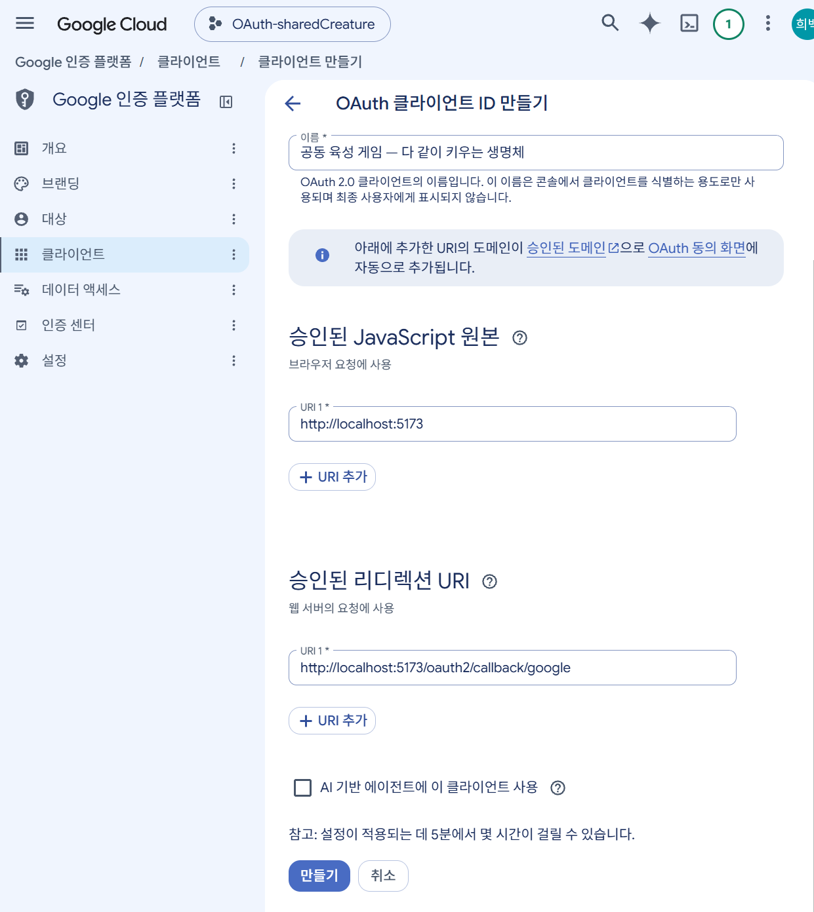
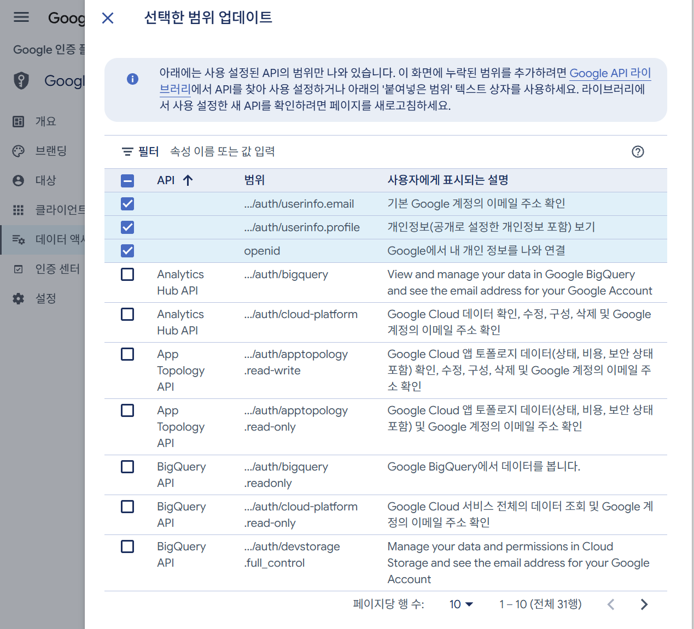

# 공동 육성 게임 — 다 같이 키우는 생명체

- [프로젝트 설계 문서 보기](docs/index.md)
- [GitHub Projects 보기](https://github.com/heebaek200/shared-creature-game/projects)
- [팀 프로젝트 일일 리포트 보기](https://github.com/heebaek200/shared-creature-game/discussions)
- [일일 리포트 게시글 템플릿](docs/daily-report-template.md)

## 로컬 구동 방법

### 1. 준비물

- Java 21
- MySQL 8
- Node.js 20 이상과 npm

Docker, H2, Flyway와 Liquibase는 사용하지 않습니다. 일반 업무 테이블·컬럼과 일반 제약은 JPA `ddl-auto=update`로 만들고, Spring Session 테이블과 MySQL STORED 생성 컬럼·조건부 UNIQUE는 `db/special-schema.sql`로 관리합니다.

### 2. 데이터베이스 준비

로컬 MySQL 관리자 계정으로 다음 데이터베이스와 개발 계정을 준비합니다. 비밀번호는 예시를 그대로 사용하지 않습니다.

```sql
CREATE DATABASE shared_creature_game CHARACTER SET utf8mb4 COLLATE utf8mb4_0900_ai_ci;
CREATE DATABASE shared_creature_game_test CHARACTER SET utf8mb4 COLLATE utf8mb4_0900_ai_ci;

CREATE USER 'shared_creature'@'localhost' IDENTIFIED BY 'replace-with-local-password';
GRANT ALL PRIVILEGES ON shared_creature_game.* TO 'shared_creature'@'localhost';
GRANT ALL PRIVILEGES ON shared_creature_game_test.* TO 'shared_creature'@'localhost';
```

`.env.example`을 `.env`로 복사한 뒤 `LOCAL_DB_*`, `TEST_DB_*`를 자신의 로컬 계정에 맞게 설정합니다. `.env`는 Git에 포함하지 않습니다.

### 3. Backend 실행

Windows PowerShell 기준입니다.

```powershell
.\gradlew.bat bootRun
```

기본 주소는 `http://localhost:8080`입니다. 최초 실행 시 JPA가 업무 테이블을 생성한 뒤 `data.sql`이 시즌·크리처 종·퀘스트·상품의 기본 샘플 데이터를 넣습니다.

이미 이전 스키마로 실행했던 로컬 DB는 `ddl-auto=update`가 기존 `NOT NULL` 완화를 자동 반영하지 않습니다. 데이터를 삭제하거나 DB를 재생성하지 말고 Backend를 중지한 상태에서 다음 보정 SQL을 한 번 실행합니다.

```powershell
mysql -u shared_creature -p shared_creature_game < docs/sql/local-schema-repair.sql
```

신규 DB에는 이 보정이 필요하지 않습니다. STORED 생성 컬럼과 조건부 UNIQUE는 애플리케이션 시작 시 `special-schema.sql`이 멱등 적용합니다.

테스트는 별도 `shared_creature_game_test` 데이터베이스를 사용합니다.

```powershell
.\gradlew.bat test
```

### 4. Frontend 실행

```powershell
cd frontend
npm install
npm run dev
```

브라우저에서 `http://localhost:5173`에 접속합니다. Vite가 `/api`, `/oauth2`, `/ws`를 Backend로 Proxy합니다.

Backend 없이 화면 견본을 확인할 때에는 `frontend/.env.local`에 다음 값을 설정합니다.

```properties
VITE_USE_MOCK_API=true
```

Production Build에서는 목 모드를 켤 수 없습니다.

```powershell
npm run build
```

## Google OAuth 로컬 설정

1. [Google Cloud Console](https://console.cloud.google.com/)에서 Web Application OAuth Client를 만듭니다.
2. 승인된 JavaScript Origin에 `http://localhost:5173`을 등록합니다.
3. 승인된 Redirect URI에 `.env`의 `GOOGLE_REDIRECT_URI`와 정확히 같은 `http://localhost:5173/oauth2/callback/google`을 등록합니다.

[](https://github.com/heebaek200/shared-creature-game/blob/main/docs/images/google_oauth.png)

4. Client ID와 Client Secret을 각각 `GOOGLE_CLIENT_ID`, `GOOGLE_CLIENT_SECRET`에 설정합니다. 최초 전체 관리자로 사용할 Google 계정의 OpenID Connect `sub` 값을 `INITIAL_SUPER_ADMIN_PROVIDER_USER_ID`에 설정하고 `INITIAL_SUPER_ADMIN_PROVIDER=GOOGLE`을 유지합니다.
5. Google Scope는 `openid profile email`만 사용합니다.

[](https://github.com/heebaek200/shared-creature-game/blob/main/docs/images/google_oauth_scope.png)

6. 로그인 시작·`state`·`nonce`·시작 세션 결속과 가입 대기·내부 사용자 연결은 구현되어 있습니다.
7. Backend는 Authorization Code를 Token으로 교환하고 ID Token과 nonce를 검증한 뒤 UserInfo를 조회합니다. 공급자 Token은 Browser나 DB에 저장하지 않습니다.

Google 공식 구현 기준은 [Web Server OAuth 2.0](https://developers.google.com/identity/protocols/oauth2/web-server)과 [OpenID Connect](https://developers.google.com/identity/openid-connect/openid-connect)를 확인합니다. Naver Adapter는 후속 구현 범위입니다.
