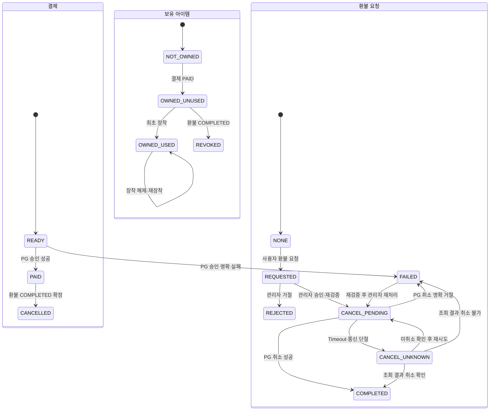

# 사용자 시나리오 및 업무 규칙

## 0. 요청 식별 번호와 추적 기준

요청 식별 번호는 `REQ-{영역}-{3자리 번호}` 형식을 사용합니다. 문서의 절이나 화면 배치가 바뀌어도 기존 번호를 재사용하거나 변경하지 않습니다. 하나의 화면·API가 여러 요청을 구현할 수 있고, 백그라운드 Scheduler처럼 직접 화면이 없는 요청은 결과를 확인하는 관리 화면을 연결합니다.

| 요청 ID | 사용자 시나리오·업무 결과 | 주요 규칙 위치 | 연결 화면 |
|---|---|---|---|
| `REQ-AUTH-001` | 사용자가 Google 또는 Naver로 로그인한다. | 1.1절 | `/login` |
| `REQ-AUTH-002` | 최초 로그인 사용자가 닉네임을 확정해 계정을 만든다. | 1.1절, 2절 | `/signup`, `/groups/select` |
| `REQ-AUTH-003` | 이메일 미제공 또는 동일 이메일의 다른 공급자를 자동 연결하지 않고 안내한다. | 1.1절 | `/login`, `/signup` |
| `REQ-AUTH-004` | 세션·현재 사용자 상태에 따라 올바른 온보딩 화면으로 이동한다. | 1.1절 | 공통 Route Guard, `/login` |
| `REQ-INV-001` | 사용자가 초대 정보를 확인하고 수락 또는 거절한다. | 2절 | `/invite/:token`, `/signup` |
| `REQ-INV-002` | 주 관리자가 만료 없는 초대 링크를 조회하고 재발급한다. | 2절 | `/group-admin` |
| `REQ-GRP-001` | 그룹 없는 사용자가 공개 그룹에 가입하거나 새 그룹을 만든다. | 2절 | `/groups/select` |
| `REQ-GRP-002` | 사용자당 활성 그룹 1개, 정원 20명과 24시간 가입 제한을 지킨다. | 2절, 7.3절 | `/groups/select`, `/group` |
| `REQ-GRP-003` | 일반·부 관리자가 자진 탈퇴하고 기여 이력은 이전 그룹에 남긴다. | 2절 | `/group` |
| `REQ-GRP-004` | 주 관리자가 부 관리자 권한을 관리·이전하고, 전체 관리자가 보호 상황에서 주 관리자를 재지정한다. | 1절, 2절 | `/group-admin`, `/admin/operations` |
| `REQ-GRP-005` | 주·부 관리자가 권한 범위 안에서 72시간 미접속 일반 회원을 강퇴한다. | 1절, 2절 | `/group-admin` |
| `REQ-GRP-006` | 그룹원이 다른 회원을 신고하고 전체 관리자가 검토해 강퇴하거나 기각한다. | 1절, 2절 | `/group`, `/admin/reports` |
| `REQ-SEA-001` | 시스템이 KST 월요일 0시에 4주 시즌을 시작·종료한다. | 3절, 7.6절 | `/creature`, `/admin/operations` |
| `REQ-SEA-002` | 주·부 관리자가 첫 72시간에 종을 선택하고 미선택 시 무작위 부화한다. | 3절 | `/group-admin`, `/creature` |
| `REQ-SEA-003` | 알 기간 경험치를 포함해 크리처를 성장시키고 종료 상태를 보존한다. | 3절 | `/creature` |
| `REQ-QST-001` | 시스템이 개발자 정의 템플릿에서 일일 3개·주간 7개를 순회 배정한다. | 4절, 7.6절 | `/quests`, `/admin/operations` |
| `REQ-QST-002` | 사용자가 퀘스트를 기간당 한 번 완료하고 경험치·기여도를 받는다. | 4절, 7.2절 | `/quests`, `/creature` |
| `REQ-QST-003` | 사용자가 하루 한 번 서비스 체크인을 기록한다. | 4.2절 | `/quests` |
| `REQ-QST-004` | 기능 활성 환경에서 GPS·촬영 시각이 있는 사진 퀘스트를 제출한다. | 4.1절 | `/quests` |
| `REQ-RNK-001` | 그룹 구성원이 시즌 개인 기여도와 탈퇴 회원 표시를 조회한다. | 5절 | `/rankings` |
| `REQ-RNK-002` | 로그인 사용자가 시즌 그룹 랭킹과 종료 Snapshot을 조회한다. | 5절 | `/rankings` |
| `REQ-AVA-001` | 사용자가 상품·보유 아이템을 조회하고 아바타 슬롯에 장착한다. | 6절 | `/shop`, `/avatar` |
| `REQ-AVA-002` | 그룹원이 접속 중인 다른 사용자의 장착 아바타와 기여 정보를 본다. | 6.2절 | `/creature` |
| `REQ-PAY-001` | 사용자가 PortOne 테스트 결제를 진행하고 서버 검증 결과를 확인한다. | 6절, 7.5절 | `/shop`, `/payments` |
| `REQ-PAY-002` | 사용자가 미사용 아이템 환불을 요청하고 처리 결과를 확인한다. | 6절, 7.4~7.5절 | `/payments`, `/admin/refunds` |
| `REQ-RT-001` | 그룹 홈이 Commit된 크리처·기여·장착·접속 상태를 실시간 동기화한다. | 6.2절, 7.1절 | `/creature`, 공통 헤더 |
| `REQ-ADM-001` | 전체 관리자가 주요 운영 지표와 차트를 조회한다. | 8절 | `/admin` |
| `REQ-ADM-002` | 전체 관리자가 신고 목록·상세·처리 이력을 관리한다. | 2절, 8절 | `/admin/reports` |
| `REQ-ADM-003` | 전체 관리자가 환불 요청을 승인·거절·정합성 복구한다. | 6절, 7.5절, 8절 | `/admin/refunds` |
| `REQ-ADM-004` | 전체 관리자가 Scheduler·배정 실패·정합성 경고를 확인한다. | 7.6절, 8절 | `/admin/operations` |
| `REQ-UI-001` | 사용자가 데스크톱과 모바일에서 역할에 맞는 내비게이션을 사용한다. | 전체 | 모든 화면 |
| `REQ-UI-002` | 사용자가 시스템·라이트·다크 테마와 접근성 기능을 사용한다. | 전체 | 모든 화면 |

## 1. 사용자 역할

- 전체 관리자: 여러 그룹과 서비스 전체 운영 현황을 관리합니다. 신고를 확인하여 사용자를 그룹에서 강퇴할 수 있습니다.
- 주 관리자(방장): 그룹 최초 생성자이며 그룹당 1명입니다. 같은 그룹의 일반 사용자에게 부 관리자 권한을 부여하거나 회수할 수 있습니다.
- 부 관리자(부방장): 한 그룹에 여러 명을 둘 수 있고 일반 사용자에 대한 관리 권한을 가집니다. 다른 사용자에게 주·부 관리자 권한을 부여하거나 회수할 수 없습니다.
- 일반 사용자: 하나의 공개 그룹에 참여하고 퀘스트를 수행하며 공동 크리처 육성, 랭킹과 아바타 꾸미기 기능을 이용합니다. 자신의 그룹에서 직접 탈퇴할 수 있습니다.

### 1.1. 소셜 계정 인증

- 회원가입과 로그인은 구글·네이버 소셜 로그인만 지원합니다.
- 서비스는 자체 비밀번호를 입력받거나 저장하지 않습니다.
- 회원 식별의 기준은 이메일이 아니라 `소셜 공급자 + 공급자 사용자 식별자`입니다.
- 동일 이메일로 다른 공급자 계정이 이미 존재하면 두 계정을 자동으로 연결하지 않습니다.
- 이 경우 신규 가입을 중단하고 기존에 가입한 공급자로 로그인하도록 안내합니다.
- 소셜 공급자의 액세스 토큰은 브라우저 저장소에 전달하지 않으며, 로그인에 필요한 사용자 정보를 조회한 뒤 서버에서만 처리합니다.
- 애플리케이션 인증은 서버 세션을 사용하고 세션 쿠키에는 `HttpOnly`, `Secure`, `SameSite=Lax`를 적용합니다.
- 세션은 마지막 인증된 요청부터 7일 동안 활동이 없으면 만료합니다.
- 한 사용자는 최대 3개의 동시 세션을 유지할 수 있고 네 번째 로그인에 성공하면 가장 오래 생성된 세션을 종료합니다.
- 신규 가입에는 공급자 이메일이 필요하며 이메일 제공 동의를 받지 못하거나 이메일 값이 없으면 계정을 생성하지 않습니다.
- 기존 회원은 `소셜 공급자 + 공급자 사용자 식별자`가 일치하면 현재 응답에서 이메일이 누락되어도 로그인할 수 있습니다.
- 로그인 이후 공급자 API를 사용하지 않으므로 공급자 액세스·리프레시 토큰을 영구 저장하지 않습니다.
- 네이버 개발 애플리케이션에는 팀원 4명의 네이버 계정을 관리자 또는 테스터로 등록합니다.
- 네이버 사전 검수 전 시연은 등록된 계정으로만 수행하고, 불특정 사용자를 대상으로 공개 운영하기 전에 사전 검수를 통과해야 합니다.

그룹 없는 사용자는 그룹을 생성할 수 있고 생성과 동시에 주 관리자가 됩니다. 주·부 관리자의 상세 권한은 아래 역할 규칙과 화면·API 권한표를 따릅니다.

## 2. 그룹 생성과 가입

- 그룹을 최초 생성한 사용자가 해당 그룹의 주 관리자가 됩니다.
- 일반 회원가입이 완료되면 별도의 그룹 선택 페이지로 이동합니다.
- 그룹 선택 페이지에서 그룹을 선택해야 일반 사용자 온보딩이 완료됩니다.
- 그룹 선택 페이지는 신규 가입 직후와 탈퇴·강퇴 후 24시간 가입 제한이 끝난 시점에 공통으로 사용합니다.
- 그룹이 없는 사용자는 그룹 선택 페이지에서 기존 공개 그룹에 가입하거나 새 그룹을 생성할 수 있습니다.
- 새 그룹을 생성한 사용자는 해당 그룹의 주 관리자가 됩니다.
- 일반 사용자는 공개 그룹 목록을 조회할 수 있습니다.
- 정원이 남아 있는 공개 그룹에는 별도 승인 없이 가입할 수 있습니다.
- 그룹 정원은 최대 20명입니다.
- 정원에 도달한 그룹은 신규 가입을 받을 수 없습니다.
- 자동 배정은 사용하지 않으며 사용자가 가입할 그룹을 직접 선택합니다.
- 그룹을 생성하면 회원가입과 해당 그룹 가입을 함께 처리하는 공유 링크를 자동 생성합니다.
- 링크의 사용 횟수는 제한하지 않으며 그룹 정원 자리를 예약하지 않습니다.
- 링크는 자동 만료되지 않습니다.
- 링크를 재발급하면 기존 링크는 즉시 무효화됩니다.
- 링크 재발급 권한은 주 관리자만 가집니다.
- 링크를 받은 미가입자가 초대를 수락하면 계정 생성과 해당 그룹 가입을 함께 완료합니다.
- 초대를 거절하면 계정을 생성하지 않고 일반 소셜 로그인·회원가입 화면으로 이동합니다.
- 링크 수락 시점에 그룹 정원 20명, 기존 그룹 소속 여부와 탈퇴 후 24시간 가입 제한을 다시 검사합니다.
- OAuth 콜백에서 계정을 생성하기 직전에 링크 유효성, 그룹 정원, 기존 그룹 소속 여부와 탈퇴 후 24시간 가입 제한을 다시 검사합니다.
- 수락 조건을 충족하면 계정 생성과 그룹 가입을 함께 완료합니다.
- 링크 무효화, 정원 초과 등으로 그룹 가입 조건을 충족하지 못하면 계정 생성은 완료하고 그룹에는 가입시키지 않습니다.
- 그룹 가입 실패 이유를 표시하고 그룹 선택 페이지로 이동합니다.
- 기존 가입자가 링크를 열면 새 계정을 생성하지 않습니다.
- 기존 가입자에게 현재 그룹이 있으면 링크 가입을 차단하고, 그룹이 없으면 24시간 제한을 검사한 뒤 그룹 선택 페이지로 안내합니다.
- 사용자는 동시에 하나의 그룹에만 소속될 수 있습니다.
- 사용자가 그룹을 탈퇴하면 서버가 탈퇴 시각을 기록합니다.
- 탈퇴 시각부터 24시간이 지나기 전에는 기존 그룹을 포함한 어떤 그룹에도 가입할 수 없습니다.
- 탈퇴 시각부터 24시간이 되는 시점부터 다시 그룹에 가입할 수 있습니다.
- 탈퇴 전에 해당 그룹에 반영된 크리처 경험치와 그룹 점수는 이전 그룹에 남으며 새 그룹으로 이전하지 않습니다.
- 탈퇴 후에도 개인의 퀘스트 수행과 기여 활동 이력은 보존합니다.
- 진행 중인 그룹 개인 랭킹에는 탈퇴 회원의 기존 기여도를 `탈퇴` 상태로 유지합니다.
- 탈퇴한 사용자는 이전 그룹에 추가로 기여할 수 없으며 현재 그룹 구성원 목록에서는 제외합니다.
- 전체 관리자는 접수된 신고를 근거로 해당 사용자를 그룹에서 강퇴할 수 있습니다.
- 주 관리자와 부 관리자는 일반 사용자 관리 권한을 가집니다.
- 부 관리자는 마지막 접속 시각부터 72시간 이상 지난 일반 사용자만 강퇴할 수 있습니다.
- 부 관리자는 주 관리자나 다른 부 관리자를 강퇴할 수 없습니다.
- 주 관리자도 마지막 접속 시각부터 72시간 이상 지난 일반 사용자를 강퇴할 수 있습니다.
- 주 관리자는 부 관리자의 권한을 회수하거나 부 관리자를 강퇴할 수 있습니다. 부 관리자 대상 작업에는 72시간 미접속 조건을 적용하지 않습니다.
- 주 관리자는 자신을 강퇴할 수 없으며 자진 탈퇴 전 다른 활성 회원에게 주 관리자 권한을 이전해야 합니다.
- 일반 사용자는 자신의 의사로 그룹에서 탈퇴할 수 있습니다.
- 주 관리자는 대체 주 관리자를 지정하기 전까지 권한 해제나 자진 탈퇴를 할 수 없습니다.
- 전체 관리자는 주 관리자를 재지정할 수 있습니다.
- 자진 탈퇴와 모든 강퇴에는 탈퇴·강퇴 시각부터 동일한 24시간 그룹 가입 제한을 적용합니다.

## 3. 공동 크리처

- 각 그룹은 한 번에 활성 크리처 1마리만 육성합니다.
- 공동 크리처는 4주 단위 시즌마다 교체합니다.
- 모든 시즌 기준 시각은 `Asia/Seoul` 시간대를 사용합니다.
- 첫 시즌은 서비스 개시 후 처음 도래하는 월요일 0시에 시작하고 이후 4주마다 월요일 0시에 새 시즌을 시작합니다.
- 시즌 시작 후 첫 3일 동안 공동 크리처는 알 상태입니다.
- 주 관리자와 부 관리자는 첫 3일 안에 시작 크리처를 선택하거나 변경할 수 있습니다.
- 시즌 시작 후 72시간이 되는 시점의 최종 선택 크리처로 부화합니다.
- 선택 기한까지 관리자가 결정하지 않으면 같은 시점에 무작위 크리처로 부화합니다.
- 시즌 종료 시 기존 크리처의 최종 상태와 시즌 랭킹을 보존합니다.
- 새 시즌에는 크리처 경험치, 시즌 기여도와 시즌 그룹 점수를 초기화합니다.
- 회원, 그룹, 아이템과 누적 활동 기록은 시즌이 바뀌어도 유지합니다.
- 크리처 성장 단계는 `알 → 유년기 → 성장기 → 성숙기 → 완전체`입니다.
- 알은 시즌 시작 후 첫 72시간에만 적용되는 시간 기반 상태입니다.
- 부화 시 유년기가 되고 그룹 누적 경험치 45,000 이상이면 성장기, 97,500 이상이면 성숙기, 150,000 이상이면 완전체가 됩니다.
- 서버가 유효하게 판정한 일일·주간 퀘스트 완료만 크리처 경험치를 지급합니다.
- 각 퀘스트에는 크리처 경험치와 개인 기여도 점수를 별도로 설정합니다.
- 결제, 그룹 가입 링크 공유·수락과 관리자 조작으로는 크리처 경험치를 지급하지 않습니다.
- 퀘스트 보상 반영 트랜잭션에서 경험치를 갱신한 뒤 도달한 가장 높은 단계로 진화시킵니다.
- 같은 시즌 안에서는 성장 단계가 낮아지지 않습니다.
- 크리처 경험치는 완전체 기준을 넘어서도 제한 없이 누적합니다.
- 완전체 도달 후에도 유효한 퀘스트의 개인 기여도와 그룹 점수는 계속 누적합니다.
- 시즌 종료 시 완전체에 도달하지 못했으면 실제 최종 단계와 경험치를 그대로 시즌 기록에 보존합니다.
- 사용자의 유효한 퀘스트 성과는 소속 그룹의 활성 크리처 성장에 반영합니다.
- 개인별 크리처는 MVP 범위에 포함하지 않습니다.
- 모든 크리처는 같은 성장 임계값을 사용하며 종류별 차등 적용은 MVP에 포함하지 않습니다.

## 4. 퀘스트 갱신 시각

- 일일 퀘스트는 `Asia/Seoul` 기준 매일 0시에 갱신합니다.
- 주간 퀘스트는 `Asia/Seoul` 기준 매주 월요일 0시에 갱신합니다.
- 시스템은 개발자가 정의한 순회 규칙에 따라 퀘스트 템플릿에서 일일 퀘스트 3개와 주간 퀘스트 7개를 선정합니다.
- 활성 일일 템플릿은 하 5개, 중 4개, 상 3개 이상 유지합니다.
- 활성 주간 템플릿은 하 6개, 중 4개, 상 4개 이상 유지합니다.
- 같은 기간에는 모든 사용자에게 동일한 퀘스트 목록을 배정합니다.
- 일일 퀘스트는 하·중·상 난이도를 각 1개씩 배정합니다.
- 주간 퀘스트는 하 3개, 중 2개, 상 2개를 배정합니다.
- 주 관리자, 부 관리자와 전체 관리자는 배정 목록을 수동으로 선택하지 않습니다.
- 같은 일일·주간 기간에는 동일한 퀘스트 템플릿을 중복 배정하지 않습니다.
- 다음 기간에는 개발자가 정의한 순회 순서에 따라 이전 템플릿을 다시 배정할 수 있습니다.
- 순회 기준은 첫 시즌 시작 시각부터의 `Asia/Seoul` 누적 일수와 누적 주차이며 새 시즌에도 인덱스를 초기화하지 않습니다.
- 일일 퀘스트는 난이도별 목록에서 `(누적 일수 + 오프셋) % 활성 템플릿 수` 위치의 템플릿 하나를 선택합니다.
- 주간 퀘스트는 난이도별 목록에서 `(누적 주차 + 오프셋) % 활성 템플릿 수`를 시작점으로 하여 필요한 개수만큼 원형으로 선택합니다.
- 일일·주간 오프셋은 모두 하 0, 중 1, 상 2입니다.
- 각 퀘스트는 사용자당 해당 일일 또는 주간 기간에 한 번만 완료할 수 있습니다.
- 완료하지 않은 퀘스트는 다음 갱신 기간으로 이월하지 않습니다.
- 일일 퀘스트 하나는 크리처 경험치 100, 주간 퀘스트 하나는 크리처 경험치 300을 지급합니다.
- 사용자 한 명의 주간 최대 크리처 경험치는 일일 `3 × 7 × 100 = 2,100`, 주간 `7 × 300 = 2,100`을 합한 4,200입니다.
- 난이도는 크리처 경험치에 영향을 주지 않고 개인 기여도 점수에만 반영합니다.
- 일일 퀘스트 기여도는 하 10, 중 20, 상 30입니다.
- 주간 퀘스트 기여도는 하 30, 중 60, 상 90입니다.
- 알 상태에서도 퀘스트 경험치와 개인 기여도를 누적합니다.
- 부화 시점에 알 상태에서 누적한 경험치를 적용하고 도달한 가장 높은 성장 단계로 즉시 전환합니다.
- 필요한 난이도별 템플릿 수가 부족하면 해당 기간의 배정 생성을 실패 처리합니다.
- 배정 실패 시 관리자 대시보드 경고 목록에 부족한 난이도와 개수를 표시하고, 개발자가 순회 구성을 보완한 뒤 다시 생성합니다.
- 배정 결과에는 템플릿 ID와 버전, 제목, 설명, 난이도, 완료 조건·파라미터, 경험치와 기여도 값을 Snapshot으로 저장합니다.
- 템플릿 수정과 새 버전은 이미 생성된 배정에 영향을 주지 않고 다음 갱신부터 적용합니다.
- `EXPERIMENTAL` 템플릿은 기술 검증과 활성화 결정이 끝나기 전까지 활성 템플릿 수와 순회 대상에서 제외합니다.

### 4.1. 퀘스트 검증 유형

| 유형 | 판정 방식 | 적용 범위 |
|---|---|---|
| `SELF_CHECK` | 사용자가 완료를 확인하면 서버가 기간·중복·자격 조건을 검사해 확정 | 스트레칭, 독서, 정리 등 외부 센서 없이 수행하는 생활 활동 |
| `SERVER_EVENT` | 서버가 기록한 서비스 행동 이벤트와 템플릿 조건을 비교 | 기상 체크인, 아바타 저장 등 |
| `AGGREGATE` | 기간 내 완료·체크인 이벤트를 집계해 목표값 도달 여부 판정 | 주간 참여 일수, 일일 퀘스트 누적 완료 수 등 |
| `PHOTO_EXIF` | 업로드 사진의 GPS와 촬영 시각을 기간·위치 조건과 비교 | 야외 활동 사진 인증 |

- 일반 생활 활동에는 `SELF_CHECK`를 허용하되 같은 사용자·배정 조합은 한 번만 완료할 수 있습니다.
- 서비스 안에서 확인 가능한 행동은 사용자의 완료 버튼보다 `SERVER_EVENT`를 우선합니다.
- 주간 누적 목표는 원본 이벤트를 기준으로 `AGGREGATE` 판정하고 클라이언트가 전달한 누적값을 신뢰하지 않습니다.
- `PHOTO_EXIF`는 실제 모바일 파일 검증을 마치기 전까지 `EXPERIMENTAL`로 유지하고 활성 순회에서 제외합니다.
- 관리자 수동 승인, 사후 증빙 제출과 완료 취소는 MVP 범위에 포함하지 않습니다.
- 서버는 활성 배정, 수행 기간, 사용자·그룹 상태와 중복 완료를 검사한 후 배정 Snapshot의 경험치·기여도를 지급합니다.

### 4.2. 서비스 체크인

- 서비스 체크인은 사용자가 체크인 버튼을 명시적으로 실행했을 때 서버가 기록하는 `SERVER_EVENT`입니다.
- 단순 로그인, 페이지 조회와 새로고침은 서비스 체크인으로 인정하지 않습니다.
- 사용자당 `Asia/Seoul` 날짜별 1회만 기록합니다.
- 05:00 이상 09:00 미만에 기록된 서비스 체크인을 오전 기상 체크인으로 분류합니다.

### 4.3. 일일 템플릿 카탈로그

| 코드 | 난이도 | 내용 | 검증 유형 | 조건 |
|---|---|---|---|---|
| `D-L-01` | 하 | 물 한 잔 마시기 | `SELF_CHECK` | 사용자 완료 확인 |
| `D-L-02` | 하 | 5분 스트레칭 | `SELF_CHECK` | 사용자 완료 확인 |
| `D-L-03` | 하 | 주변 5분 정리 | `SELF_CHECK` | 사용자 완료 확인 |
| `D-L-04` | 하 | 10분 독서 | `SELF_CHECK` | 사용자 완료 확인 |
| `D-L-05` | 하 | 3분 호흡·휴식 | `SELF_CHECK` | 사용자 완료 확인 |
| `D-M-01` | 중 | 오전 기상 체크인 | `SERVER_EVENT` | 05:00 이상 09:00 미만 서비스 체크인 |
| `D-M-02` | 중 | 15분 걷기 | `SELF_CHECK` | 사용자 완료 확인 |
| `D-M-03` | 중 | 25분 집중 활동 | `SELF_CHECK` | 사용자 완료 확인 |
| `D-M-04` | 중 | 10분 운동 | `SELF_CHECK` | 사용자 완료 확인 |
| `D-H-01` | 상 | 30분 걷기·운동 | `SELF_CHECK` | 사용자 완료 확인 |
| `D-H-02` | 상 | 50분 집중 활동 | `SELF_CHECK` | 사용자 완료 확인 |
| `D-H-03` | 상 | 오늘의 하·중 퀘스트 모두 완료 | `AGGREGATE` | 같은 날짜에 배정된 하·중 퀘스트 완료 |
| `D-X-01` | 실험 | 야외 위치 사진 인증 | `PHOTO_EXIF` | 수행일에 촬영되고 GPS가 포함된 사진 1건 |

`D-H-03`은 자기 자신을 완료 조건에 포함하지 않으며 같은 날짜에 배정된 하·중 퀘스트 완료가 확정된 뒤 자동 완료합니다. `D-X-01`은 활성 일일 템플릿 수에 포함하지 않습니다.

### 4.4. 주간 템플릿 카탈로그

| 코드 | 난이도 | 내용 | 검증 조건 |
|---|---|---|---|
| `W-L-01` | 하 | 3일 이상 서비스 체크인 | 서로 다른 KST 날짜 3일 |
| `W-L-02` | 하 | 일일 퀘스트 3회 완료 | 현재 주 완료 3건 |
| `W-L-03` | 하 | 서로 다른 2일에 일일 퀘스트 완료 | 완료가 존재하는 KST 날짜 2일 |
| `W-L-04` | 하 | 하 난이도 일일 퀘스트 2회 완료 | 현재 주 하 난이도 완료 2건 |
| `W-L-05` | 하 | 자기 확인 퀘스트 2회 완료 | 현재 주 `SELF_CHECK` 완료 2건 |
| `W-L-06` | 하 | 오전 기상 체크인 2회 | 서로 다른 KST 날짜의 오전 체크인 2건 |
| `W-M-01` | 중 | 5일 이상 서비스 체크인 | 서로 다른 KST 날짜 5일 |
| `W-M-02` | 중 | 일일 퀘스트 7회 완료 | 현재 주 완료 7건 |
| `W-M-03` | 중 | 서로 다른 4일에 일일 퀘스트 완료 | 완료가 존재하는 KST 날짜 4일 |
| `W-M-04` | 중 | 중 난이도 일일 퀘스트 3회 완료 | 현재 주 중 난이도 완료 3건 |
| `W-H-01` | 상 | 7일 모두 서비스 체크인 | 현재 주 7개 KST 날짜 체크인 |
| `W-H-02` | 상 | 일일 퀘스트 14회 완료 | 현재 주 완료 14건 |
| `W-H-03` | 상 | 서로 다른 3일에 일일 퀘스트 3개 모두 완료 | 하루의 일일 배정 3개를 모두 완료한 KST 날짜 3일 |
| `W-H-04` | 상 | 오전 기상 체크인 5회 | 서로 다른 KST 날짜의 오전 체크인 5건 |
| `W-X-01` | 실험 | 서로 다른 2일에 야외 위치 사진 인증 | 유효한 `PHOTO_EXIF` 완료가 존재하는 KST 날짜 2일 |

- 주간 템플릿은 모두 `AGGREGATE`로 판정합니다.
- 주간 집계는 현재 주간 배정의 시작 시각 이상, 종료 시각 미만에 발생한 서버 기록만 사용합니다.
- `W-X-01`은 활성 주간 템플릿 수에 포함하지 않습니다.

## 5. 랭킹

- 개인 기여도 점수는 서버가 유효하게 판정한 퀘스트별 기여도 점수의 시즌 합계입니다.
- 그룹 점수는 해당 그룹에 반영된 사용자들의 시즌 기여도 점수 합계입니다.
- 결제 금액, 아이템 구매와 환불은 개인 기여도 및 그룹 점수에 반영하지 않습니다.
- 그룹 내 개인 랭킹과 그룹 간 랭킹은 시즌 단위로 집계합니다.
- 새 시즌이 시작되면 현재 시즌 개인 기여도와 그룹 점수를 0으로 초기화합니다.
- 종료된 시즌의 개인·그룹 랭킹은 조회 가능한 기록으로 보존합니다.
- 점수가 같으면 해당 점수에 먼저 도달한 사용자 또는 그룹을 상위로 정합니다.
- 점수 도달 시각까지 같으면 사용자 ID 또는 그룹 ID 오름차순으로 순서를 고정합니다.
- 탈퇴 회원의 시즌 개인 랭킹은 앞서 확정한 대로 `탈퇴` 상태로 유지하며 해당 그룹 점수도 차감하지 않습니다.

## 6. 결제·아이템 사용·환불

- 현재 결제 공급자는 포트원 V2이며 테스트 채널을 사용합니다. 내부 구매·환불 상태와 정책은 포트원 상태값에 직접 의존하지 않고 Adapter의 표준 결과로 변환합니다.
- 결제 한 건에는 아바타 꾸미기 아이템 하나만 포함합니다.
- 결제 성공만으로 아이템을 사용한 것으로 보지 않습니다.
- 아이템을 아바타에 처음 장착한 시각을 `used_at`으로 기록하고 이 시점부터 사용된 아이템으로 판정합니다.
- 장착을 해제해도 `used_at`을 지우지 않으며 환불 가능 상태로 돌아가지 않습니다.
- 사용자는 구매 내역에서 미사용 아이템의 환불을 요청할 수 있습니다.
- 환불 요청 상태는 `REQUESTED`, `REJECTED`, `CANCEL_PENDING`, `CANCEL_UNKNOWN`, `COMPLETED`, `FAILED`로 관리합니다.
- 전체 관리자가 환불을 승인하거나 거절합니다.
- 승인 시 최신 구매, 보유 아이템과 환불 상태를 다시 검사합니다.
- PG 취소 성공 후에만 환불을 `COMPLETED`로 변경하고 보유 아이템을 회수합니다.
- PG 취소 실패 시 환불을 `FAILED`로 기록하고 결제와 아이템 소유 상태는 유지합니다.
- 실패한 환불을 다시 처리할 때에도 미사용 여부와 현재 상태를 다시 검사합니다.
- PG Timeout이나 통신 단절처럼 취소 결과를 알 수 없으면 `CANCEL_UNKNOWN`으로 기록하고 즉시 취소를 재요청하지 않습니다.
- `CANCEL_UNKNOWN`은 PG 조회 결과에 따라 `COMPLETED`, `CANCEL_PENDING` 또는 `FAILED`로 전환합니다.

### 6.1. 결제·아이템·환불 상태 전이

- 환불 승인은 결제가 `PAID`, 아이템이 `OWNED_UNUSED`이고 진행 중인 다른 환불이 없을 때만 가능합니다.
- 환불이 `REQUESTED`, `CANCEL_PENDING` 또는 `CANCEL_UNKNOWN`이면 최초 장착을 차단합니다.
- `REJECTED`는 해당 요청의 종료 상태이고 `FAILED`는 명확한 PG 실패 후 재검증을 거쳐 재처리할 수 있는 상태입니다.
- `COMPLETED`가 확정된 뒤에만 결제를 `CANCELLED`, 아이템을 `REVOKED`로 함께 변경합니다.

## 6.2. 아바타 과시와 접속 Presence

- 크리처 홈은 공동 크리처 주변을 현재 접속한 그룹 구성원의 아바타가 산책하는 그룹 전용 공간입니다.
- 그룹 정원과 같은 최대 20명의 아바타를 표시하고 자신의 아바타에는 `나` 상태를 표시합니다.
- 아바타에는 현재 장착 중인 `HEAD`, `FACE`, `BODY`, `ACCESSORY` 외형만 적용합니다.
- 다른 아바타를 선택하면 닉네임, 현재 시즌 기여도·그룹 내 순위와 장착 아이템 정보를 확인할 수 있습니다.
- 장착 아이템 상품이 현재 판매 중이면 해당 상품의 상점 상세로 이동할 수 있고, 판매 중이 아니면 외형과 이름만 표시합니다.
- 접속·퇴장과 장착 변경만 WebSocket으로 전파하며 이동 위치와 애니메이션은 클라이언트가 담당합니다.
- 여러 세션으로 접속한 같은 사용자는 아바타 한 명으로 표시하고 마지막 연결이 종료된 뒤 15초 유예시간이 지나야 퇴장 처리합니다.
- 영구 접속 이력 테이블은 만들지 않으며 MVP는 단일 애플리케이션 인스턴스의 메모리 Presence를 사용합니다. 다중 인스턴스 확장 시 Redis Presence와 Message Broker를 도입합니다.
- 위치정보, 이메일과 소셜 공급자는 노출하지 않고 같은 그룹의 인증된 사용자만 Presence와 아바타 정보를 조회할 수 있습니다.
- 채팅, 사용자의 직접 이동, 충돌 물리와 자유 Emote는 MVP 범위에서 제외합니다.

## 7. 동시성 제어

### 7.1. 공통 원칙

- 클라이언트 응답이나 WebSocket 메시지가 아니라 서버의 데이터베이스 트랜잭션 결과를 최종 상태로 사용합니다.
- 같은 업무 요청의 재전송에는 멱등 키와 데이터베이스 UNIQUE 제약을 사용합니다.
- 경합하는 행은 항상 같은 순서로 잠그고 트랜잭션을 짧게 유지합니다.
- Deadlock이나 낙관적 충돌은 제한된 횟수만 재시도하고 최종 실패를 사용자에게 알립니다.
- 외부 PG 호출과 메일 발송은 데이터베이스 잠금을 보유한 상태에서 실행하지 않습니다.
- 트랜잭션 Commit 이후에만 WebSocket으로 확정 결과를 전파합니다.

### 7.2. 퀘스트 완료와 보상

- 사용자와 배정 퀘스트 조합에는 완료 기록을 하나만 허용하는 UNIQUE 제약을 둡니다.
- 퀘스트 완료, 보상 원장, 개인 시즌 기여도, 그룹 시즌 점수와 크리처 경험치 반영을 하나의 데이터베이스 트랜잭션으로 처리합니다.
- 같은 요청이 동시에 들어오면 하나만 완료 기록 생성에 성공하고 나머지는 기존 완료 결과를 반환합니다.
- 그룹 시즌 점수와 크리처 경험치 행을 잠근 뒤 증가시켜 Lost Update를 방지합니다.
- 보상 반영 후 성장 단계와 점수 도달 시각을 같은 트랜잭션에서 갱신합니다.

### 7.3. 그룹 가입과 정원

- 그룹 가입 시 사용자와 그룹을 잠근 뒤 현재 소속, 24시간 제한과 정원 20명을 다시 검사합니다.
- 한 사용자에게 활성 그룹 소속을 하나만 허용하는 데이터베이스 제약을 둡니다.
- 그룹 정원 확인과 멤버십 생성을 같은 트랜잭션으로 처리해 동시 가입으로 20명을 초과하지 않게 합니다.
- 초대 링크를 통한 가입도 동일한 가입 트랜잭션을 사용합니다.

### 7.4. 아이템 장착과 환불

- 환불 요청이 `REQUESTED`, `CANCEL_PENDING` 또는 `CANCEL_UNKNOWN`인 동안 해당 아이템의 신규 장착을 차단합니다.
- 장착과 환불 승인은 구매, 보유 아이템과 환불 요청을 같은 고정 순서로 잠급니다.
- 장착이 먼저 `used_at`을 기록하면 환불 승인을 거절합니다.
- 환불 승인이 먼저 `CANCEL_PENDING`을 기록하면 장착을 거절합니다.
- 구매 건당 활성 환불 요청을 하나만 허용하고 상태 조건부 갱신으로 두 관리자의 동시 승인을 하나만 성공시킵니다.

### 7.5. PG 취소 단계

1. 첫 번째 짧은 트랜잭션에서 관련 행을 잠그고 미사용·중복 환불 여부를 재검사한 뒤 `CANCEL_PENDING`으로 선점합니다.
2. Commit 후 환불 요청 ID를 멱등 키로 사용하여 PG 취소 API를 호출합니다.
3. 두 번째 짧은 트랜잭션에서 관련 행을 다시 잠그고 PG 성공이면 `COMPLETED`와 아이템 회수를, 명확한 실패면 `FAILED`를 반영합니다.
4. Timeout·통신 단절이면 `CANCEL_UNKNOWN`을 기록하고 동일 멱등 키로 PG 조회 API를 호출해 실제 결과를 확인합니다.
5. PG 취소 성공 후 DB 반영이 실패하면 같은 멱등 키로 조회·재시도하는 정합성 복구 작업에서 완료 상태를 맞춥니다.

### 7.6. 시즌·퀘스트 스케줄

- 시즌 시작 시각과 일일·주간 배정 기간에는 각각 하나의 실행 결과만 허용하는 UNIQUE 제약을 둡니다.
- Scheduler가 중복 실행되어도 동일 시즌 생성, 크리처 부화, 퀘스트 배정과 점수 초기화가 한 번만 반영되게 멱등 처리합니다.
- 여러 애플리케이션 인스턴스가 실행되면 데이터베이스 기반 실행권 선점 또는 동등한 분산 잠금을 사용합니다.

## 8. 관리자 운영

- 전체 관리자만 전체 관리자 화면과 집계 API를 사용할 수 있으며 그룹 관리자 역할만으로는 접근할 수 없습니다.
- 대시보드는 오늘 활동 사용자, 활성 그룹·정원 사용률, 퀘스트 완료율, 테스트 결제 금액, 환불·신고·운영 경고를 서버 집계 결과로 제공합니다.
- 신고는 `RECEIVED → RESOLVED|REJECTED`로 처리하고 신고 접수만으로 대상 회원을 자동 강퇴하지 않습니다. 동시에 처리하면 신고 행 잠금을 먼저 얻은 명령만 성공합니다.
- 신고 기반 강퇴는 처리 시점의 대상 활성 멤버십을 재검사하고 강퇴와 24시간 가입 제한, 처리 이력과 감사 로그를 함께 기록합니다.
- 환불 승인·거절은 6절의 상태머신과 미사용 조건을 다시 검사하며 PG 결과 불명 상태는 성공·실패로 추정하지 않습니다.
- 운영 경고는 Scheduler 실패, 퀘스트 템플릿 부족, 그룹 정원 카운터 불일치, 결제·환불 결과 불명과 사진 삭제 실패를 원본 상태에서 조회합니다.
- 별도 알림 테이블이나 읽음 상태는 MVP에 만들지 않으며 경고가 해소되면 원본 상태를 기준으로 목록에서 제외합니다.

## 9. 후속 설계 항목

- 요청 식별 번호는 [화면 설계서의 경로 표](screen-design.md#2-화면-경로)와 [REST API 설계서의 Operation 표](api-design.md#9-endpoint별-요청응답-계약)에서 추적합니다.
- 실제 PG 공급자 확정 후 공급자 오류 코드를 현재 상태머신에 매핑
