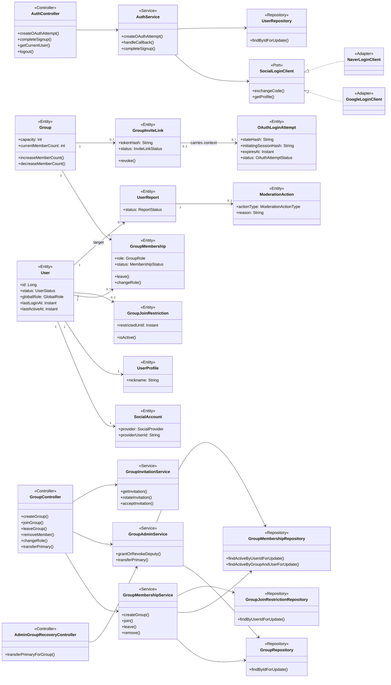
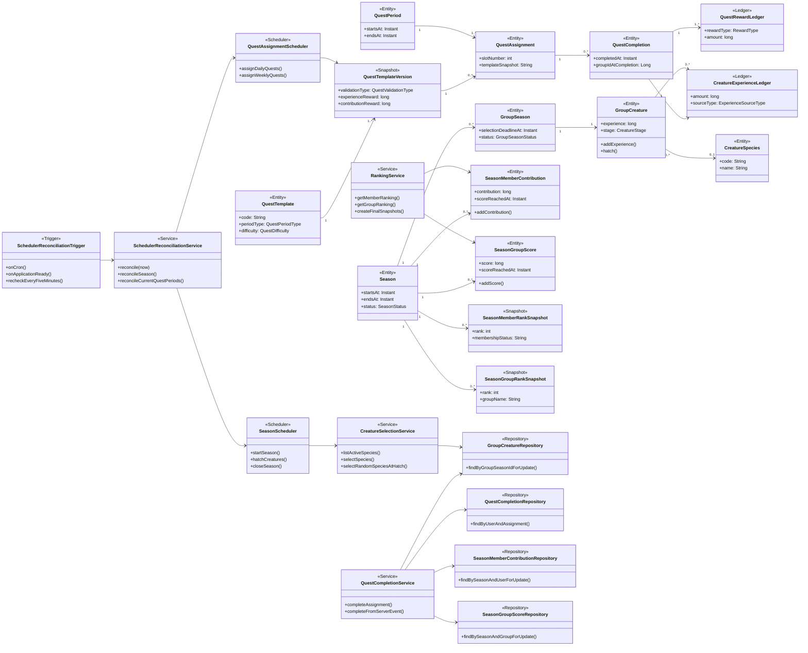
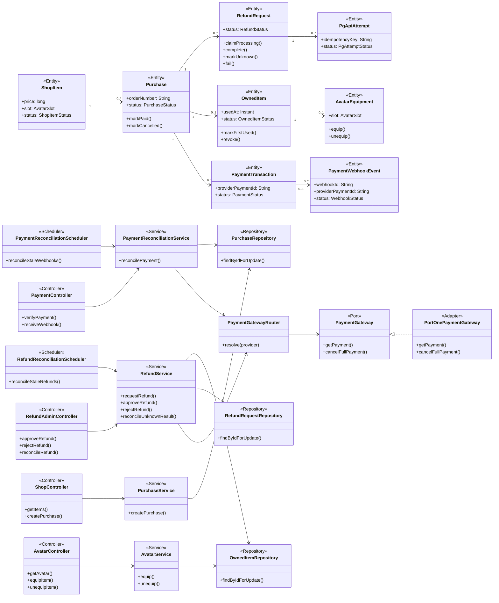
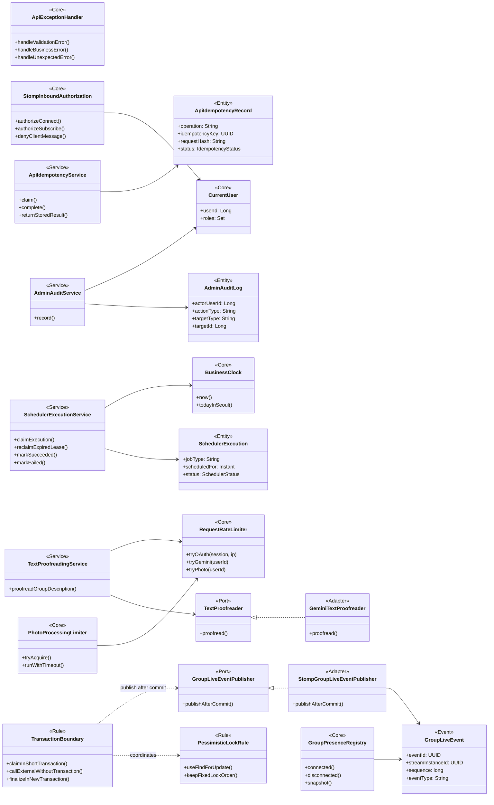

# 클래스 다이어그램

## 1. 문서 목적과 읽는 법

이 문서는 구현할 Java 클래스의 책임과 의존 방향을 보여줍니다. 40개 업무 테이블의 모든 컬럼을 한 그림에 넣지 않고, 팀원이 기능별 흐름을 찾기 쉽도록 네 영역으로 나눕니다.

- `Controller`는 HTTP 요청과 응답만 담당합니다.
- `Service`는 권한, 상태 전이, 동시성 및 트랜잭션 같은 업무 규칙을 담당합니다.
- `Repository`는 Entity 조회와 저장을 담당합니다.
- `Entity`는 데이터와 자기 상태에 관한 작은 규칙을 가집니다.
- `Port`는 외부 시스템에 종속되지 않는 내부 인터페이스이고, `Adapter`가 실제 공급자 API를 호출합니다.
- 화살표 `A --> B`는 A가 B를 호출하거나 의존한다는 뜻이며, `1`, `0..1`, `*`는 관계 개수를 나타냅니다.

다이어그램의 클래스명은 구현 책임을 합의하기 위한 기준입니다. 파일 수가 적으면 같은 기능 패키지에 단순하게 두고, 구현 중 책임이 지나치게 커질 때만 확정된 컨벤션에 따라 하위 계층으로 나눕니다. 요청·응답 DTO는 이 그림에서 생략하며 `class` 또는 `record` 중 팀원이 읽기 쉬운 형태를 선택합니다.

처음 구현하는 팀원은 [구현 시작 안내서](implementation-guide.md)의 고정 순서와 기능별 백엔드 시작점에서 Operation을 찾은 뒤 이 문서에서 담당 Service와 의존 방향을 확인합니다. 클래스명보다 [REST API 설계서](api-design.md)의 Operation ID와 [데이터베이스 설계서](database-design.md)의 테이블·제약조건이 상세 구현 계약입니다.

## 2. 인증·사용자·그룹·권한

사용자는 소셜 계정으로 로그인하고 동시에 하나의 활성 그룹에만 속합니다. 가입·탈퇴·강퇴·역할 변경은 현재 멤버십, 그룹 정원과 가입 제한을 Service가 같은 트랜잭션에서 다시 검사합니다.

`AuthService.handleCallback()`은 신규 사용자에게 가입 대기 세션만 만들고, `completeSignup()`이 닉네임 확정과 계정 생성 및 가능한 초대 그룹 가입을 담당합니다.

### 구현 시 핵심 확인점

- `GroupMembershipService`와 `GroupAdminService`는 모든 멤버십 변경에서 영향 사용자 ID 오름차순 → 그룹 → 멤버십 ID 오름차순 → 가입 제한의 공통 잠금 순서를 사용합니다.
- 주 관리자 이전은 기존·신규 사용자 행을 ID 오름차순으로 먼저 잠근 뒤 그룹과 두 멤버십을 잠그고 기존 주 관리자를 `MEMBER`, 대상을 `PRIMARY`로 변경합니다.
- 주 관리자가 유일한 구성원이면 자기 탈퇴 흐름이 그룹 `INACTIVE`, 초대 링크 무효화, 그룹 시즌 `ENDED`와 크리처 `ARCHIVED`까지 같은 트랜잭션에서 처리하고 기존 기록은 보존합니다.
- 일반·부 관리자 회원의 강퇴 권한과 저장된 `lastActiveAt` 기준 72시간 10분 미활동 조건은 Controller가 아닌 Service가 판정합니다. 부 관리자 강퇴도 미접속 강퇴 흐름을 재사용합니다.
- 전체 관리자의 신고 기반 강퇴도 최종적으로 같은 멤버십 종료·24시간 제한 생성 흐름을 재사용합니다.

## 3. 시즌·크리처·퀘스트·랭킹

퀘스트 완료 한 건이 경험치 원장, 개인 기여도와 그룹 점수를 함께 변경합니다. 중복 완료는 사용자와 배정의 UNIQUE 제약으로 막고, 합계 Entity는 잠근 뒤 갱신합니다.

### 구현 시 핵심 확인점

- 알 상태에서도 `GroupCreature.addExperience()`를 호출하며 부화할 때 누적 경험치로 도달 단계를 즉시 계산합니다.
- 시즌 중 그룹 생성 트랜잭션은 현재 시즌의 `GroupSeason`, 알 상태 `GroupCreature`와 0점 `SeasonGroupScore`를 함께 만들며 부화 기한은 생성 시각부터 72시간입니다.
- `QuestCompletionService`는 완료 존재 여부만 먼저 조회해 믿지 않고 DB UNIQUE 충돌도 이미 완료된 요청으로 안전하게 해석합니다.
- 퀘스트 완료 잠금 순서는 시즌 공유 잠금 → 사용자 → 그룹 → 활성 멤버십 → 그룹 시즌 → 완료 UNIQUE → 개인 기여도 → 그룹 점수 → 크리처로 고정하고, 잠금 아래에서 시즌·멤버십과 배정의 귀속을 다시 검사합니다.
- 탈퇴·강퇴와 완료가 경합하면 사용자·멤버십 잠금을 먼저 얻은 흐름이 선행합니다. 완료가 선행하면 보상 Commit 후 종료하고, 멤버십 종료가 선행하면 완료를 거절합니다.
- `AGGREGATE`는 완료 시점과 같은 `membershipId`, `groupSeasonId`의 활동 Event만 집계해 이전 그룹 활동이 새 그룹 보상으로 이동하지 않게 합니다.
- 사진 완료는 촬영·업로드 접수 시각이 모두 배정 기간 안이고 판정·보상 Commit이 마감과 시즌 `CLOSING` 전에 끝난 경우만 허용합니다.
- 시즌 종료 Snapshot은 이후 닉네임·그룹명·멤버십 변경과 무관하게 당시 결과를 보존합니다.
- `SeasonScheduler.closeSeason()`은 시즌 배타 잠금으로 진행 중 완료의 공유 잠금 해제를 기다린 뒤 `CLOSING`으로 선점하고, Snapshot UNIQUE를 이용해 중단 후 누락 결과만 보완한 뒤 `ENDED`로 확정합니다. 같은 시각의 `startSeason()`은 이전 시즌 종료 뒤 실행합니다.
- `SchedulerReconciliationTrigger`는 정시 Cron, 초기화 완료 뒤 기동 이벤트와 5분 점검을 전달만 하고, `SchedulerReconciliationService`가 DB 상태와 `BusinessClock`으로 누락 업무를 판정합니다.
- 정상화는 종료 전 기한이 지난 부화, 잔여 `CLOSING` Snapshot, 시즌 종료, 현재 4주 구간 시즌 생성, 현재 일일·주간 배정 순으로 실행합니다. 중단 중 만료된 퀘스트와 중간 시즌은 생성하지 않습니다.
- 시즌 의존 Service는 `ACTIVE` 상태와 함께 `startAt <= now < endAt`을 검사하고 정상화 전에는 기존 `CONCURRENT_MODIFICATION`을 반환합니다.

## 4. 아바타·상품·결제·환불

브라우저의 결제 성공 표시는 신뢰하지 않습니다. 서버가 `PaymentGateway`로 최신 결제 상태를 확인한 뒤에만 구매 완료와 아이템 지급을 확정합니다.

### 구현 시 핵심 확인점

- 결제 동기화는 주문 처리권 선점 트랜잭션 → 트랜잭션 없는 PG 조회 → 결과 확정 트랜잭션으로 나눕니다.
- 결제 검증은 상태뿐 아니라 Store ID, 주문 번호, 금액과 통화까지 비교합니다.
- 주문 `paymentId`는 `Purchase.orderNumber`에 유지하고 승인 거래 ID와 취소 `cancellation.id`는 `PaymentTransaction.providerTransactionId`에 공급자 코드와 함께 저장합니다.
- 최초 장착은 `OwnedItem.usedAt`을 한 번만 설정하며 이후 장착 해제해도 되돌리지 않습니다.
- 환불 승인은 환불 요청과 소유 아이템을 잠가 미사용 상태를 재검사한 뒤 처리권을 선점합니다.
- PG 취소 Timeout이나 연결 단절은 실패로 추정하지 않고 `CANCEL_UNKNOWN`으로 보존한 뒤 조회로 복구합니다.
- `RefundReconciliationScheduler`는 5분 이상 고착된 `CANCEL_PENDING`을 PortOne 조회부터 복구하고, `PaymentReconciliationScheduler`는 오래된 Webhook `PENDING`과 `FAILED`를 같은 결제 정합성 Service로 재처리합니다.

## 5. 공통 기반·실시간·동시성 경계

공통 기반은 업무 Entity를 소유하지 않습니다. 인증 사용자, 시간, 감사 기록, Scheduler 실행권과 실시간 발행처럼 여러 기능이 함께 사용하는 기술 책임만 제공합니다.

### 구현 시 핵심 확인점

- `BusinessClock`을 주입하여 시즌, KST 자정, 24시간 제한과 72시간 미접속 규칙을 고정 시각으로 테스트합니다.
- 같은 Scheduler 작업은 `(jobType, scheduledFor)` 논리 키로 한 실행만 처리권을 얻습니다.
- `scheduledFor`는 업무 논리 경계이며 실제 실행 시각이 아닙니다. 실행 이력이 없어도 업무 테이블의 상태·기한으로 누락을 찾고 `FAILED`와 Lease 만료 `RUNNING`만 재선점합니다.
- 부화·사진·결제처럼 대상이 많은 상태 기반 작업은 100건씩 처리하며, 다음 5분 점검이 남은 대상을 이어서 처리합니다. 지나간 5분 틱 자체는 재생하지 않습니다.
- WebSocket 이벤트는 DB Commit 이후에만 발행하고 명령 처리는 REST API가 담당합니다.
- `StompInboundAuthorization`은 세션·Origin·CSRF와 활성 그룹 구독만 허용하고 클라이언트 애플리케이션 메시지는 기본 거부합니다.
- Presence는 MVP에서 단일 애플리케이션 인스턴스 메모리만 사용하며 영속 Entity로 만들지 않습니다.
- 중요 권한 변경, 강퇴, 환불 판단과 운영 복구는 `AdminAuditService`로 감사 이력을 남깁니다.
- 외부 효과 명령은 `ApiIdempotencyService`가 사용자·Operation·Key를 선점한 뒤 같은 요청에는 최초 결과를 반환합니다.
- Gemini 교정은 `TextProofreader` Port 뒤에 격리하고 DB 트랜잭션 밖에서 한 번 호출합니다. 테스트는 외부 API 대신 단순 Fake를 사용합니다.
- `RequestRateLimiter`와 `PhotoProcessingLimiter`는 단일 인스턴스 메모리·고정 동시 처리 수를 사용하고 애플리케이션 재시작 시 제한 Window 초기화를 허용합니다.

## 6. 패키지 배치 기준

| 영역 | 기본 패키지 | 주요 클래스 예시 |
|---|---|---|
| 인증·사용자 | `auth`, `user` | `AuthService`, `SocialLoginClient`, `User`, `UserProfile` |
| 그룹·권한 | `group` | `GroupMembershipService`, `GroupAdminService`, `GroupInvitationService` |
| 시즌·크리처 | `season` | `SeasonScheduler`, `CreatureSelectionService`, `GroupCreature` |
| 퀘스트 | `quest` | `QuestAssignmentScheduler`, `QuestCompletionService` |
| 랭킹 | `ranking` | `RankingService`, 종료 시즌 Snapshot Entity |
| 아바타 | `avatar` | `AvatarService`, `OwnedItem`, `AvatarEquipment` |
| 결제·환불 | `payment` | `PaymentReconciliationService`, `RefundService`, `PaymentGateway` |
| 전체 관리자 | `admin` | 신고 처리, 대시보드 조회, 운영 복구 Controller·Service |
| AI 문장 교정 | `ai` | `TextProofreadingService`, `TextProofreader`, `GeminiTextProofreader` |
| 공통 기술 | `_core` | 오류, 보안, 시간, 동시성, WebSocket 설정·공통 구현 |

복잡한 기능만 `api`, `application`, `domain`, `infrastructure` 하위 패키지로 나눕니다. 단순 기능은 Controller·Service·Repository·Entity를 기능 패키지 바로 아래에 둘 수 있으며, 다이어그램의 인터페이스를 형식적으로 모두 만들 필요는 없습니다. `PaymentGateway`, `SocialLoginClient`, `GroupLiveEventPublisher`처럼 실제 외부 구현을 교체하거나 격리해야 하는 경계에만 Port 인터페이스를 둡니다.

## 7. 설계 문서 연결

- 테이블, 컬럼, 인덱스와 FK는 [데이터베이스 설계서](database-design.md)를 기준으로 합니다.
- Endpoint, DTO와 업무 오류는 [REST API 설계서](api-design.md)를 기준으로 합니다.
- 권한, 상태 전이와 동시성 규칙은 [사용자 시나리오 및 업무 규칙](business-rules.md)을 기준으로 합니다.
- 패키지, 트랜잭션과 문서화 방식은 [코드 컨벤션](convention.md)을 기준으로 합니다.
