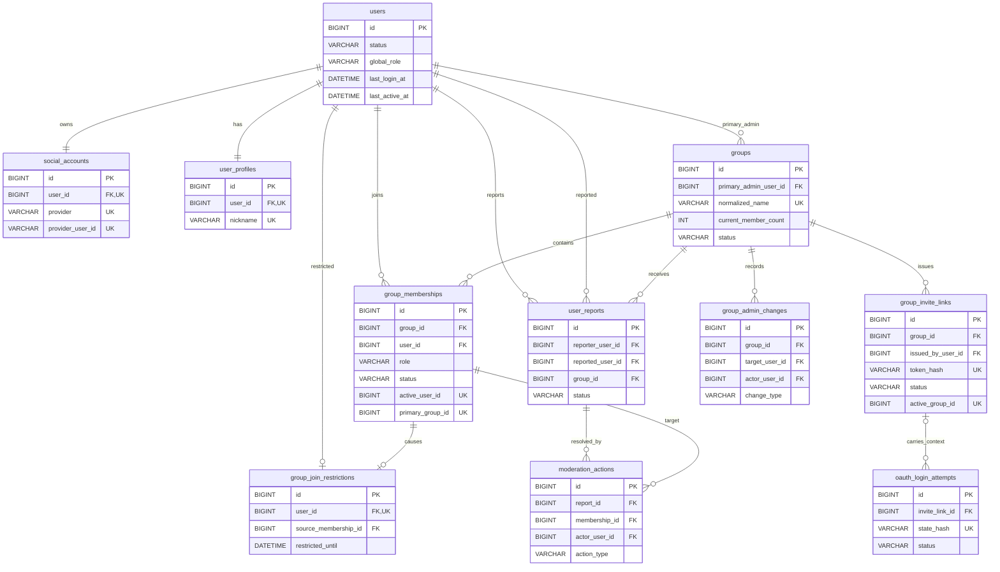
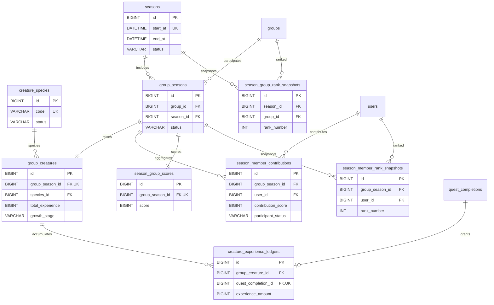
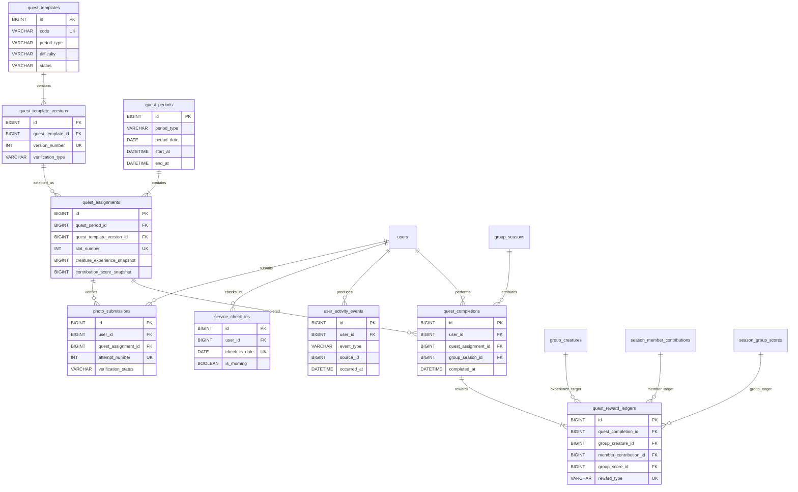
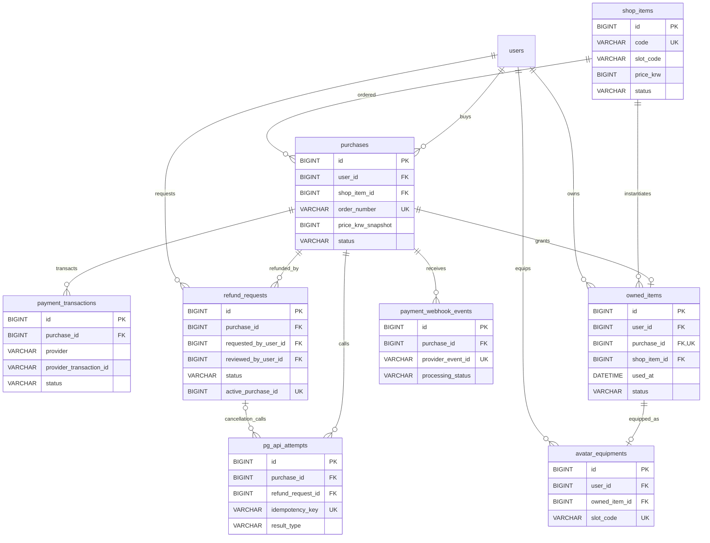
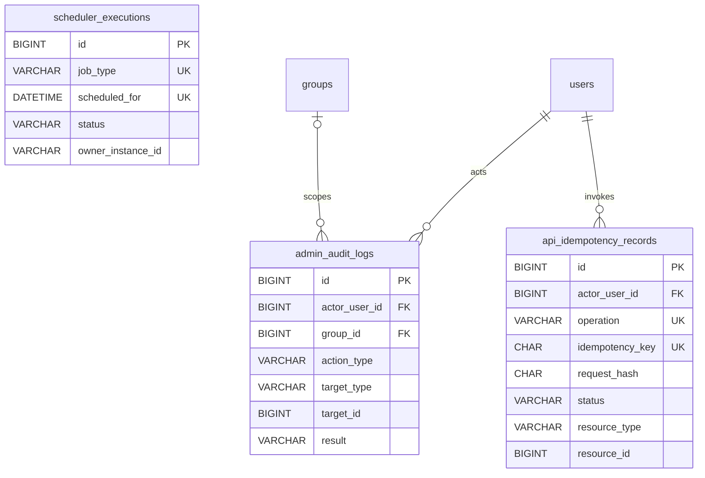

# 데이터베이스 설계서 및 ERD

## 1. 설계 상태

프로젝트 기간의 업무 테이블은 필수 `photo_submissions`를 포함한 40개로 구성합니다. 추후 알림 기능을 구현하면 `notifications`를 추가합니다. Spring Session, 데이터베이스 마이그레이션과 같은 기술 인프라 테이블은 업무 테이블 수에서 제외합니다.

## 2. 테이블 집계 기준

- 업무 개념, 상태, 이력 또는 정합성 경계를 독립적으로 책임지는 테이블만 업무 테이블로 집계합니다.
- 단순히 테이블 수를 늘리기 위한 코드·상세 테이블 분리는 사용하지 않습니다.
- `spring_session`, `spring_session_attributes`와 스키마 마이그레이션 이력 테이블은 인프라 테이블로 별도 관리합니다.
- JPA 내부 조인 테이블을 암묵적으로 생성하지 않고 필요한 관계는 아래 업무 테이블로 명시합니다.

## 3. 업무 테이블 카탈로그

### 3.1. 계정·인증 — 4개

| 테이블 | 책임 |
|---|---|
| `users` | 회원 상태, 전체 관리자 여부, 마지막 로그인 시각과 계정 생명주기 관리 |
| `social_accounts` | `provider + provider_user_id` 외부 식별자, 가입 당시 이메일과 공급자 연결 정보 관리 |
| `user_profiles` | 서비스 닉네임과 아바타 기본 프로필 관리 |
| `oauth_login_attempts` | 일회용 OAuth `state`, 만료 시각, 공급자와 초대 링크 문맥 관리 |

### 3.2. 그룹·운영 — 7개

| 테이블 | 책임 |
|---|---|
| `groups` | 공개 그룹, 정원, 주 관리자와 운영 상태 관리 |
| `group_memberships` | 가입·탈퇴·강퇴 이력과 당시 역할 관리 |
| `group_invite_links` | 현재·폐기된 초대 링크와 재발급 이력 관리 |
| `group_join_restrictions` | 탈퇴·강퇴 후 24시간 가입 제한의 현재 종료 시각 관리 |
| `user_reports` | 전체 관리자에게 접수된 사용자 신고와 처리 상태 관리 |
| `moderation_actions` | 신고 기반 강퇴와 미접속 강퇴의 실행 주체·근거·결과 관리 |
| `group_admin_changes` | 주 관리자 이전과 부 관리자 부여·회수 이력 관리 |

### 3.3. 시즌·크리처·랭킹 — 9개

| 테이블 | 책임 |
|---|---|
| `seasons` | 4주 시즌의 시작·종료, KST 기준과 상태 관리 |
| `creature_species` | 선택 가능한 크리처 종류와 표시 정보 관리 |
| `group_seasons` | 그룹별 시즌 참여, 선택 기한과 시즌 상태 관리 |
| `group_creatures` | 그룹 시즌 크리처, 선택 출처, 경험치, 성장 단계와 최종 상태 관리 |
| `creature_experience_ledgers` | 퀘스트 완료로 발생한 크리처 경험치 원장 관리 |
| `season_member_contributions` | 회원별 시즌 기여도와 점수 도달 시각 관리 |
| `season_group_scores` | 그룹별 시즌 점수와 점수 도달 시각 관리 |
| `season_member_rank_snapshots` | 시즌 종료 시 개인 랭킹과 탈퇴 상태 Snapshot 보존 |
| `season_group_rank_snapshots` | 시즌 종료 시 그룹 랭킹 Snapshot 보존 |

### 3.4. 퀘스트·활동 — 9개

| 테이블 | 책임 |
|---|---|
| `quest_templates` | 퀘스트 코드, 기간 유형, 난이도와 활성·실험 상태 관리 |
| `quest_template_versions` | 문구, 검증 유형·파라미터와 보상 규칙의 불변 버전 관리 |
| `quest_periods` | 일일·주간 배정의 시작·종료 시각과 생성 상태 관리 |
| `quest_assignments` | 기간별 선택 슬롯과 템플릿 Snapshot 관리 |
| `quest_completions` | 사용자별 배정 완료와 완료 시각 관리 |
| `quest_reward_ledgers` | 완료별 경험치·기여도 지급 원장 관리 |
| `user_activity_events` | 서버 행동과 주간 집계의 원본 이벤트 관리 |
| `service_check_ins` | 사용자별 KST 날짜의 명시적 체크인과 오전 여부 관리 |
| `photo_submissions` | 필수 EXIF GPS·촬영 시각 검증 결과 관리 |

### 3.5. 결제·아바타 — 8개

| 테이블 | 책임 |
|---|---|
| `shop_items` | 판매 가능한 아바타 아이템, 가격과 판매 상태 관리 |
| `purchases` | 사용자별 단일 아이템 구매 주문과 현재 상태 관리 |
| `payment_transactions` | PG 승인·취소 거래 식별자와 결제 상태 관리 |
| `owned_items` | 사용자의 아이템 소유, 최초 사용 시각과 회수 상태 관리 |
| `avatar_equipments` | 사용자별 아바타 슬롯의 현재 장착 아이템 관리 |
| `refund_requests` | 환불 요청, 관리자 판단과 상태머신 관리 |
| `pg_api_attempts` | 승인·취소·조회 요청의 멱등 키, 응답과 재시도 이력 관리 |
| `payment_webhook_events` | PG Webhook 원문 식별자, 처리 상태와 중복 수신 방지 관리 |

### 3.6. 운영 공통 — 3개

| 테이블 | 책임 |
|---|---|
| `scheduler_executions` | 시즌, 부화, 퀘스트 배정과 정합성 복구 작업의 실행권·결과 관리 |
| `admin_audit_logs` | 전체·그룹 관리자의 중요 관리 작업 감사 이력 관리 |
| `api_idempotency_records` | 외부 효과 명령의 요청 Hash, 처리 상태와 최초 결과 재사용 관리 |

`notifications`는 추후 확장 테이블로 분류하고 프로젝트 기간에는 구현하지 않습니다. 템플릿 부족, Scheduler 실패와 카운터 불일치는 관리자 대시보드의 운영 경고 목록에서 조회합니다.

### 3.7. ERD

ERD는 가독성을 위해 업무 영역별로 분리합니다. 각 표에는 PK, 주요 FK, 상태와 UNIQUE 판단에 필요한 핵심 컬럼만 표시하며 전체 컬럼·자료형·인덱스는 10~14절의 상세 정의를 기준으로 합니다. 실선 관계는 FK를 의미하고, 부모 상태 종료 시에도 자식 이력을 보존하므로 핵심 관계에 Cascade 삭제를 사용하지 않습니다.

#### 계정·인증·그룹·운영 ERD



#### 시즌·크리처·랭킹 ERD



`groups`, `users`와 `quest_completions`는 다른 영역의 기준 테이블이며 이 ERD에 관계 확인을 위해 함께 표시합니다.

#### 퀘스트·활동 ERD



#### 상품·아바타·결제·환불 ERD



#### 운영 공통 ERD



`scheduler_executions`는 특정 업무 부모에 종속되지 않고 `(job_type, scheduled_for)` 논리 키로 시즌·부화·퀘스트 배정·정리 작업의 실행권을 관리합니다.

## 4. 주요 영역 경계와 관계

- `users`는 서비스 회원의 기준 Aggregate이고 공급자별 자격은 `social_accounts`가 소유합니다.
- 현재 소속과 과거 소속은 모두 `group_memberships`에 남기며, 활성 소속은 사용자당 하나만 허용합니다.
- 24시간 가입 제한은 과거 멤버십을 매번 탐색하지 않고 `group_join_restrictions`의 현재 종료 시각을 잠금 검증합니다.
- 그룹별 시즌 상태는 `group_seasons`가 연결하고 실제 육성 상태는 `group_creatures`가 소유합니다.
- 경험치와 기여도 변경의 근거는 원장에 남기고 현재 합계는 `group_creatures`, `season_member_contributions`, `season_group_scores`에 유지합니다.
- `quest_assignments`는 모든 사용자에게 공통인 기간별 배정이고 사용자별 결과는 `quest_completions`이 관리합니다.
- 결제 주문, PG 거래, 아이템 소유와 환불은 서로 다른 상태머신이므로 `purchases`, `payment_transactions`, `owned_items`, `refund_requests`로 분리합니다.
- Gemini 그룹 소개 교정 요청과 결과는 업무 데이터로 저장하지 않으며 사용자가 적용한 최종 `groups.description`만 그룹 생성 시 저장합니다.

## 5. 관계 Cardinality와 FK 정책

### 5.1. 주요 Cardinality

| 부모·기준 | 자식·대상 | 관계와 제약 |
|---|---|---|
| `users` | `social_accounts` | 1:1, `social_accounts.user_id` UNIQUE |
| `users` | `user_profiles` | 1:1, `user_profiles.user_id` UNIQUE |
| `users` | `group_memberships` | 1:N, 활성 멤버십은 최대 1건 |
| `groups` | `group_memberships` | 1:N, 활성 멤버십은 `capacity` 이하 |
| `groups` | `group_invite_links` | 1:N, 활성 링크는 최대 1건 |
| `groups` | `group_seasons` | 1:N |
| `seasons` | `group_seasons` | 1:N |
| `group_seasons` | `group_creatures` | 1:1, `group_season_id` UNIQUE |
| `quest_periods` | `quest_assignments` | 1:N |
| `quest_template_versions` | `quest_assignments` | 1:N |
| `users` + `quest_assignments` | `quest_completions` | 조합당 0..1 |
| `purchases` | `payment_transactions` | 1:N, 승인·재시도·취소 거래 이력 |
| `purchases` | `owned_items` | 1:0..1 |
| `purchases` | `refund_requests` | 1:N, 진행 중 요청은 최대 1건 |
| `users` + 아바타 슬롯 | `avatar_equipments` | 조합당 0..1 |
| `users` | `api_idempotency_records` | 1:N, 사용자·Operation·Key 조합은 한 건 |

### 5.2. 주 관리자 관계

- `groups.primary_admin_user_id`는 `users.id`를 참조합니다.
- 활성 주 관리자 멤버십에는 `status = 'ACTIVE' AND role = 'PRIMARY'`일 때만 `group_id`가 생성되는 `primary_group_id` STORED 생성 컬럼을 둡니다.
- `primary_group_id` UNIQUE로 그룹당 활성 주 관리자 멤버십을 한 건만 허용합니다.
- 그룹 생성 시 그룹, 주 관리자 멤버십과 `group_admin_changes` 최초 이력을 같은 트랜잭션에서 생성합니다.
- 주 관리자 이전 시 기존·신규 사용자 행을 사용자 ID 오름차순 → 그룹 → 두 멤버십 ID 오름차순으로 잠그고 대상 역할을 `PRIMARY`, 기존 주 관리자 역할을 `MEMBER`로 변경합니다. `groups.primary_admin_user_id`와 `group_admin_changes` 이력을 같은 트랜잭션에서 함께 반영합니다.

### 5.3. FK 삭제 정책

- 핵심 업무 FK는 기본적으로 `ON DELETE RESTRICT`를 사용합니다.
- 회원, 그룹, 시즌, 퀘스트, 랭킹, 결제와 환불은 부모 상태가 종료되어도 자식 이력을 보존합니다.
- 핵심 업무 관계에는 `ON DELETE CASCADE`를 사용하지 않습니다.
- OAuth·PG 공급자 식별자는 외부 시스템 값이므로 내부 FK가 아닌 UNIQUE 문자열 컬럼으로 저장합니다.
- `oauth_login_attempts`처럼 명시된 임시 데이터만 Scheduler가 물리 삭제합니다.
- 물리 삭제 작업도 Repository의 암묵적 Cascade에 의존하지 않고 대상과 범위를 명시합니다.

## 6. 공통 컬럼과 생명주기 정책

### 6.1. 식별자와 자료형

- 기본키는 `BIGINT AUTO_INCREMENT`의 `id`를 사용합니다.
- 외래키는 참조 대상 단수명에 `_id`를 붙입니다. 예: `user_id`, `group_id`, `quest_assignment_id`.
- 금액은 원 단위 `BIGINT`, 경험치와 점수도 `BIGINT`로 저장합니다.
- 위도와 경도는 `DECIMAL(10, 7)`을 사용합니다.
- 상태값은 `VARCHAR(30)`에 저장하고 Java에서는 `EnumType.STRING`으로 매핑합니다.

### 6.2. 시간과 감사 컬럼

- 변경 가능한 업무 테이블은 `created_at`, `updated_at`을 사용합니다.
- 불변 원장·Snapshot·이벤트 테이블은 `created_at`을 기본으로 하고 실제 수정 요구가 있을 때만 `updated_at`을 둡니다.
- 시각은 UTC 기준 `DATETIME(6)`에 저장하고 JDBC와 애플리케이션 기본 저장 시간대도 UTC로 통일합니다.
- 일일·주간·시즌 경계와 사용자 노출 시간은 `Asia/Seoul`로 계산합니다.
- 체크인 기준일, 퀘스트 기간 기준일처럼 KST 날짜 자체가 업무 키이면 별도 `DATE` 컬럼으로 저장합니다.

### 6.3. 상태 보존과 삭제

- 회원 탈퇴는 물리 삭제하지 않고 `users.status = 'WITHDRAWN'`과 `withdrawn_at`으로 기록합니다.
- 그룹, 상품, 크리처 종류와 퀘스트 템플릿은 삭제 대신 상태 또는 `active` 값으로 비활성화합니다.
- 멤버십, 신고·제재, 시즌·랭킹, 완료·보상 원장과 결제·환불 기록은 물리 삭제하지 않습니다.
- `admin_audit_logs`는 프로젝트 운영 정책에 따라 1년 보관 후 배치 삭제하고, 보관 기간 안에는 수정하지 않습니다.
- 모든 테이블에 공통 `deleted` 컬럼을 추가하지 않고 실제 삭제 요구가 있는 임시 데이터만 만료 후 정리합니다.
- `oauth_login_attempts`는 종료 상태 전환 후 24시간, 성공한 Scheduler 실행은 90일, 실패한 Scheduler 실행과 관리자 감사 로그는 1년 보관합니다.

### 6.4. 버전과 JSON

- `version BIGINT`는 동시 수정 충돌을 감지할 필요가 있는 Aggregate에만 둡니다.
- 퀘스트 검증 파라미터와 외부 응답의 비핵심 보조 정보에는 JSON을 사용할 수 있습니다.
- 검색, 조인, UNIQUE 제약, 상태 전이와 정산에 사용하는 값은 JSON이 아닌 명시적 컬럼으로 저장합니다.
- 공급자 토큰, Client Secret과 PG Secret은 저장하지 않습니다.
- PG 응답은 거래 식별자, 결과 코드와 정합성 복구에 필요한 최소 필드만 구조화하여 저장합니다.

## 7. 동시성 제어를 위한 데이터 무결성 기준

### 7.1. 활성 행 UNIQUE 생성 컬럼

MySQL UNIQUE 인덱스가 여러 `NULL`을 허용하는 특성을 이용해 활성 상태인 행에만 값이 생성되는 STORED 생성 컬럼을 둡니다.

```sql
ALTER TABLE group_memberships
    ADD COLUMN active_user_id BIGINT
        GENERATED ALWAYS AS (
            CASE
                WHEN status = 'ACTIVE' THEN user_id
                ELSE NULL
            END
        ) STORED
  , ADD CONSTRAINT uq_group_memberships_active_user UNIQUE (active_user_id);
```

| 테이블 | 생성 컬럼 | 값 생성 조건 | UNIQUE 목적 |
|---|---|---|---|
| `group_memberships` | `active_user_id` | `status = 'ACTIVE'` | 사용자당 활성 그룹 소속 1건 |
| `group_memberships` | `primary_group_id` | `status = 'ACTIVE' AND role = 'PRIMARY'` | 그룹당 활성 주 관리자 1명 |
| `refund_requests` | `active_purchase_id` | 상태가 `REQUESTED`, `CANCEL_PENDING`, `CANCEL_UNKNOWN` 중 하나 | 구매당 진행 중 환불 1건 |
| `group_invite_links` | `active_group_id` | `status = 'ACTIVE'` | 그룹당 활성 초대 링크 1건 |

- 종료·거절·완료된 이력 행의 생성 컬럼은 `NULL`이므로 동일 사용자·구매·그룹의 과거 이력을 여러 건 보존할 수 있습니다.
- 그룹 시즌당 크리처 한 마리는 `group_creatures.group_season_id` 일반 UNIQUE로 보장합니다.
- 사용자당 KST 날짜별 체크인 한 건은 `service_check_ins(user_id, check_in_date)` 복합 UNIQUE로 보장합니다.

### 7.2. 그룹 정원 카운터

- `groups.capacity`의 기본값과 MVP 최대값은 20입니다.
- `groups.current_member_count`는 활성 멤버십 수를 나타내는 비정규화 카운터입니다.
- `0 <= current_member_count AND current_member_count <= capacity` CHECK 제약을 적용합니다.
- 가입 시 아래 조건부 갱신이 1건 성공한 경우에만 활성 멤버십을 생성합니다.

```sql
UPDATE groups
   SET current_member_count = current_member_count + 1
 WHERE id = :group_id
   AND current_member_count < capacity;
```

- 조건부 인원 증가와 멤버십 생성은 같은 트랜잭션에서 처리하고 어느 한쪽이 실패하면 모두 Rollback합니다.
- 탈퇴·강퇴는 활성 멤버십 종료와 `current_member_count - 1`을 같은 트랜잭션에서 처리합니다.
- 모든 멤버십 변경 흐름은 영향 사용자 ID 오름차순 → 그룹 → 멤버십 ID 오름차순 → 가입 제한 순으로 잠그고 사용자 잠금 아래에서 가입 제한과 활성 멤버십을 다시 검사합니다.
- 정합성 점검 Scheduler는 실제 활성 멤버십 수와 카운터를 비교하고 불일치 시 자동 수정하지 않습니다.
- 불일치는 관리자 대시보드 경고와 감사 로그를 남긴 뒤 별도의 명시적 복구 작업으로 처리합니다.

### 7.3. UNIQUE 제약 후보

- 소셜 계정: 공급자와 공급자 사용자 식별자 조합당 1건
- 사용자별 배정 퀘스트 완료: 사용자와 퀘스트 배정 조합당 1건
- 보상 원장: 퀘스트 완료 건과 보상 종류 조합당 1건
- 서비스 체크인: 사용자와 KST 기준일 조합당 1건
- 활성 그룹 소속: 생성 컬럼 `active_user_id`당 1건
- PG 거래 식별자: 결제 공급자 거래 ID당 1건
- PG Webhook: 공급자 이벤트 ID당 1건
- 구매별 활성 환불 요청: 생성 컬럼 `active_purchase_id`당 1건
- 시즌: 시즌 시작 시각당 1건
- 일일·주간 퀘스트 배정: 기간, 구분과 배정 순번 조합당 1건
- 퀘스트 템플릿 버전: 템플릿 코드와 버전 조합당 1건

MySQL의 부분 UNIQUE 인덱스를 전제로 하지 않고 위 생성 컬럼 방식으로 활성 행의 유일성을 데이터베이스에서 강제합니다.

이메일은 소셜 계정 자동 연결 키로 사용하지 않습니다. 신규 소셜 가입 과정에서 같은 이메일의 다른 공급자 계정이 발견되면 자동 연결이나 별도 계정 생성을 진행하지 않고 기존 공급자 로그인 안내 상태를 반환합니다.

퀘스트 배정은 템플릿을 직접 참조하는 것에 그치지 않고 배정 당시의 버전, 문구, 난이도, 검증 조건·파라미터, 경험치와 기여도를 Snapshot으로 보존합니다. 템플릿 변경으로 진행 중이거나 종료된 퀘스트의 판정·보상이 바뀌지 않게 합니다.

퀘스트 원본 행동은 완료 기록과 구분해 저장합니다. `SERVER_EVENT`와 `AGGREGATE`는 서버가 생성한 이벤트·집계값만 사용하고 클라이언트가 전달한 누적 횟수를 저장값으로 신뢰하지 않습니다. `SELF_CHECK`도 사용자와 배정 조합의 UNIQUE 제약으로 중복 완료를 차단합니다.

### 7.4. 행 잠금 대상

- 그룹 가입·탈퇴·강퇴·역할 변경: 영향 사용자 ID 오름차순 → 그룹 → 관련 멤버십 ID 오름차순 → 가입 제한
- 퀘스트 보상: 완료 UNIQUE 확보 → 사용자 시즌 기여도 → 그룹 시즌 점수 → 활성 크리처 → 보상 원장 생성
- 아이템 장착·환불: 구매 → 보유 아이템 → 환불 요청
- 주 관리자 교체: 기존·신규 사용자 ID 오름차순 → 그룹 → 두 멤버십 ID 오름차순

각 흐름은 위 순서를 일관되게 사용해 교착 상태 가능성을 줄입니다. 실제 JPA 구현에서는 필요한 변경 행에 `PESSIMISTIC_WRITE` 또는 동등한 조건부 갱신을 적용하고, 읽기 전용 조회에는 불필요한 잠금을 사용하지 않습니다.

## 8. PG 취소와 트랜잭션 경계

PG 네트워크 요청 동안 데이터베이스 트랜잭션과 행 잠금을 유지하지 않습니다.

1. 상태 선점 트랜잭션: 환불 가능 여부를 잠금 검증하고 `CANCEL_PENDING`으로 변경
2. 외부 처리: 환불 요청 ID를 멱등 키로 PG 취소 호출
3. 결과 확정 트랜잭션: 성공 시 환불 완료·아이템 회수, 명확한 실패 시 실패 상태 기록, 결과 불명 시 `CANCEL_UNKNOWN` 기록
4. 결과 조회: `CANCEL_UNKNOWN`은 중복 취소를 호출하지 않고 PG 조회 API로 실제 취소 여부 확인
5. 정합성 복구: PG 성공과 DB 상태가 다르면 멱등 조회·재시도로 보정

## 9. 트랜잭션 이후 이벤트

WebSocket 알림과 후속 이벤트는 데이터베이스 Commit 이후 발행합니다. Rollback된 경험치, 점수, 장착 또는 환불 상태가 사용자 화면에 확정 결과로 전파되지 않게 합니다.

## 10. 계정·그룹 상세 컬럼

### 10.1. 식별 문자열 정책

- 서비스 닉네임은 2~20자이고 전체 서비스에서 중복을 허용하지 않습니다.
- 그룹 이름은 2~30자이고 전체 서비스에서 중복을 허용하지 않으며 MVP에서는 생성 후 변경하지 않습니다.
- 표시값과 별도로 Unicode NFKC 정규화, 앞뒤 공백 제거와 소문자 변환을 적용한 `normalized_nickname`, `normalized_name`을 저장합니다.
- 소셜 이메일은 가입 당시 값을 Snapshot으로 저장하고 이후 로그인 응답으로 자동 변경하지 않습니다.
- `normalized_email`은 앞뒤 공백 제거와 소문자 변환을 적용하며 공급자와 관계없이 UNIQUE로 관리합니다.
- 탈퇴 회원과 비활성 그룹의 현재 닉네임·이름은 행에 남으므로 재사용할 수 없습니다.
- OAuth `state`와 초대 링크 토큰은 원문을 저장하지 않고 SHA-256 Hash의 16진수 문자열만 저장합니다.

### 10.2. 계정·인증 테이블

#### `users`

| 컬럼 | 형식 | 제약·설명 |
|---|---|---|
| `id` | BIGINT | PK, AUTO_INCREMENT |
| `status` | VARCHAR(30) | `ACTIVE`, `SUSPENDED`, `WITHDRAWN` |
| `global_role` | VARCHAR(30) | `USER`, `SUPER_ADMIN` |
| `last_login_at` | DATETIME(6) | 최근 로그인 성공 UTC 시각 |
| `last_active_at` | DATETIME(6) | 최근 인증 활동 UTC 시각, 로그인 성공 시 초기화하고 이후 최대 10분 간격으로 갱신 |
| `withdrawn_at` | DATETIME(6) | 탈퇴 시각, 탈퇴 전에는 NULL |
| `version` | BIGINT | 계정 상태 동시 변경 감지 |
| `created_at` | DATETIME(6) | 생성 시각 |
| `updated_at` | DATETIME(6) | 수정 시각 |

`last_login_at`은 로그인 감사·세션 운영 정보로 사용하고 강퇴 가능 여부는 `last_active_at`으로 판정합니다. `(status, last_active_at)` 인덱스로 72시간 미활동 관리자 조회를 지원합니다. 인증된 요청마다 쓰기 부하가 발생하지 않도록 마지막 영속화 후 10분 이상 지난 경우에만 조건부 갱신합니다.

#### `social_accounts`

| 컬럼 | 형식 | 제약·설명 |
|---|---|---|
| `id` | BIGINT | PK, AUTO_INCREMENT |
| `user_id` | BIGINT | FK → `users.id`, UNIQUE |
| `provider` | VARCHAR(30) | `GOOGLE`, `NAVER` |
| `provider_user_id` | VARCHAR(255) | 공급자 불변 사용자 식별자 |
| `email` | VARCHAR(320) | 가입 당시 표시 이메일 |
| `normalized_email` | VARCHAR(320) | 공급자 간 중복 검사용, UNIQUE |
| `email_verified` | BOOLEAN | Google 검증 여부, Naver는 NULL 가능 |
| `created_at` | DATETIME(6) | 연결 시각 |

`(provider, provider_user_id)`에 복합 UNIQUE를 적용합니다. 공급자 토큰은 저장하지 않습니다.

#### `user_profiles`

| 컬럼 | 형식 | 제약·설명 |
|---|---|---|
| `id` | BIGINT | PK, AUTO_INCREMENT |
| `user_id` | BIGINT | FK → `users.id`, UNIQUE |
| `nickname` | VARCHAR(20) | 화면 표시값 |
| `normalized_nickname` | VARCHAR(20) | 전역 중복 검사용, UNIQUE |
| `version` | BIGINT | 닉네임·프로필 동시 변경 감지 |
| `created_at` | DATETIME(6) | 생성 시각 |
| `updated_at` | DATETIME(6) | 수정 시각 |

#### `oauth_login_attempts`

| 컬럼 | 형식 | 제약·설명 |
|---|---|---|
| `id` | BIGINT | PK, AUTO_INCREMENT |
| `state_hash` | CHAR(64) | OAuth state SHA-256 Hash, UNIQUE |
| `provider` | VARCHAR(30) | `GOOGLE`, `NAVER` |
| `intent` | VARCHAR(30) | `LOGIN`, `SIGNUP`, `INVITED_SIGNUP` |
| `invite_link_id` | BIGINT | FK → `group_invite_links.id`, 선택 |
| `return_route` | VARCHAR(100) | 서버가 허용한 CSR Route 식별자 |
| `status` | VARCHAR(30) | `PENDING`, `CONSUMED`, `EXPIRED`, `FAILED` |
| `expires_at` | DATETIME(6) | 사용 만료 시각 |
| `consumed_at` | DATETIME(6) | 사용 완료 시각 |
| `created_at` | DATETIME(6) | 생성 시각 |

`(status, expires_at)` 인덱스로 만료 조회·정리를 지원합니다. 임의 URL 대신 허용 목록의 Route 식별자만 저장합니다.

`oauth_login_attempts`는 로그인 이력이나 로그인 세션이 아닙니다. 사용자가 소셜 로그인 버튼을 누른 시점부터 공급자 콜백이 돌아올 때까지 `state` 검증, 공급자 구분과 초대 링크 문맥을 잠시 보관하는 1회성 인증 트랜잭션입니다. 콜백이 성공하면 `CONSUMED`, 제한 시간 안에 돌아오지 않으면 `EXPIRED`가 되며 장기 업무 이력으로 보존할 필요가 없습니다.

신규 사용자의 콜백 성공 시에도 `users`, `social_accounts`, `user_profiles`를 생성하지 않습니다. 검증된 공급자 사용자 정보와 초대 문맥은 서버의 가입 대기 세션으로 옮기고 `/signup` 제출에서 닉네임을 확정할 때 계정 관련 행을 생성합니다. 가입 대기 세션은 콜백 완료 시점부터 고정 30분 동안만 유효하며 만료 시 대기 정보를 제거하고 계정을 만들지 않습니다. 초대 조건이 유효하면 그룹 멤버십도 같은 트랜잭션에서 생성하며, 조건이 실패하면 계정 관련 행만 Commit합니다.

- 생성 후 10분 동안만 유효합니다.
- 정상 콜백 처리가 끝나면 즉시 `CONSUMED`로 변경합니다.
- 10분 안에 콜백이 없으면 `EXPIRED`, 처리 오류가 확정되면 `FAILED`로 변경합니다.
- `CONSUMED`, `EXPIRED`, `FAILED` 전환 시각부터 24시간 보존한 뒤 Scheduler가 물리 삭제합니다.
- 이 삭제는 `users`, `social_accounts`, Spring Session과 로그인 유지 상태에 영향을 주지 않습니다.

### 10.3. 그룹·운영 테이블

#### `groups`

| 컬럼 | 형식 | 제약·설명 |
|---|---|---|
| `id` | BIGINT | PK, AUTO_INCREMENT |
| `name` | VARCHAR(30) | 표시 이름 |
| `normalized_name` | VARCHAR(30) | 전역 중복 검사용, UNIQUE |
| `description` | VARCHAR(500) | 그룹 소개 |
| `visibility` | VARCHAR(30) | MVP는 `PUBLIC` |
| `status` | VARCHAR(30) | `ACTIVE`, `INACTIVE` |
| `capacity` | SMALLINT | 기본값·MVP 최대값 20 |
| `current_member_count` | SMALLINT | 활성 멤버십 카운터 |
| `primary_admin_user_id` | BIGINT | FK → `users.id` |
| `version` | BIGINT | 그룹 상태·카운터 동시 변경 감지 |
| `created_at` | DATETIME(6) | 생성 시각 |
| `updated_at` | DATETIME(6) | 수정 시각 |

공개 목록을 위해 `(status, visibility, current_member_count)` 인덱스를 사용합니다.

#### `group_memberships`

| 컬럼 | 형식 | 제약·설명 |
|---|---|---|
| `id` | BIGINT | PK, AUTO_INCREMENT |
| `group_id` | BIGINT | FK → `groups.id` |
| `user_id` | BIGINT | FK → `users.id` |
| `role` | VARCHAR(30) | `PRIMARY`, `DEPUTY`, `MEMBER` |
| `status` | VARCHAR(30) | `ACTIVE`, `LEFT`, `REMOVED` |
| `joined_at` | DATETIME(6) | 가입 시각 |
| `ended_at` | DATETIME(6) | 탈퇴·강퇴 시각 |
| `ended_by_user_id` | BIGINT | FK → `users.id`, 자기 탈퇴면 본인 |
| `exit_reason` | VARCHAR(30) | `SELF`, `INACTIVE`, `REPORT`, 선택 |
| `active_user_id` | BIGINT | 활성 상태 조건 STORED 생성 컬럼, UNIQUE |
| `primary_group_id` | BIGINT | 활성 PRIMARY 조건 STORED 생성 컬럼, UNIQUE |
| `version` | BIGINT | 역할·종료 동시 변경 감지 |
| `created_at` | DATETIME(6) | 생성 시각 |
| `updated_at` | DATETIME(6) | 수정 시각 |

`(group_id, status, role)`과 `(user_id, joined_at)` 인덱스를 사용합니다.

#### `group_invite_links`

| 컬럼 | 형식 | 제약·설명 |
|---|---|---|
| `id` | BIGINT | PK, AUTO_INCREMENT |
| `group_id` | BIGINT | FK → `groups.id` |
| `token_hash` | CHAR(64) | 링크 토큰 SHA-256 Hash, UNIQUE |
| `status` | VARCHAR(30) | `ACTIVE`, `INVALIDATED` |
| `issued_by_user_id` | BIGINT | FK → `users.id` |
| `issued_at` | DATETIME(6) | 발급 시각 |
| `invalidated_at` | DATETIME(6) | 재발급 무효화 시각 |
| `active_group_id` | BIGINT | 활성 상태 조건 STORED 생성 컬럼, UNIQUE |
| `created_at` | DATETIME(6) | 생성 시각 |

#### `group_join_restrictions`

| 컬럼 | 형식 | 제약·설명 |
|---|---|---|
| `id` | BIGINT | PK, AUTO_INCREMENT |
| `user_id` | BIGINT | FK → `users.id`, UNIQUE |
| `source_membership_id` | BIGINT | FK → `group_memberships.id` |
| `reason` | VARCHAR(30) | `LEFT`, `REMOVED_INACTIVE`, `REMOVED_REPORT` |
| `restricted_from` | DATETIME(6) | 제한 시작 시각 |
| `restricted_until` | DATETIME(6) | 가입 가능 시각 |
| `created_at` | DATETIME(6) | 생성 시각 |
| `updated_at` | DATETIME(6) | 현재 제한 갱신 시각 |

`restricted_until` 인덱스로 만료 제한 조회를 지원합니다.

#### `user_reports`

| 컬럼 | 형식 | 제약·설명 |
|---|---|---|
| `id` | BIGINT | PK, AUTO_INCREMENT |
| `reporter_user_id` | BIGINT | 신고자 FK → `users.id` |
| `reported_user_id` | BIGINT | 피신고자 FK → `users.id` |
| `group_id` | BIGINT | 관련 그룹 FK → `groups.id` |
| `category` | VARCHAR(30) | 신고 분류 |
| `content` | VARCHAR(1000) | 신고 내용 |
| `status` | VARCHAR(30) | `RECEIVED`, `RESOLVED`, `REJECTED` |
| `handled_by_user_id` | BIGINT | 전체 관리자 FK → `users.id` |
| `handled_at` | DATETIME(6) | 처리 시각 |
| `resolution` | VARCHAR(1000) | 처리 결과 |
| `created_at` | DATETIME(6) | 접수 시각 |
| `updated_at` | DATETIME(6) | 수정 시각 |

`(status, created_at)`과 `(reported_user_id, created_at)` 인덱스를 사용합니다.

#### `moderation_actions`

| 컬럼 | 형식 | 제약·설명 |
|---|---|---|
| `id` | BIGINT | PK, AUTO_INCREMENT |
| `report_id` | BIGINT | FK → `user_reports.id`, 미접속 강퇴는 NULL |
| `group_id` | BIGINT | FK → `groups.id` |
| `membership_id` | BIGINT | 종료한 멤버십 FK → `group_memberships.id` |
| `target_user_id` | BIGINT | 대상 FK → `users.id` |
| `actor_user_id` | BIGINT | 실행자 FK → `users.id` |
| `action_type` | VARCHAR(30) | `REMOVE_INACTIVE`, `REMOVE_REPORTED` |
| `reason` | VARCHAR(1000) | 실행 근거 |
| `executed_at` | DATETIME(6) | 실행 시각 |
| `created_at` | DATETIME(6) | 기록 시각 |

`(target_user_id, executed_at)`과 `(group_id, executed_at)` 인덱스를 사용합니다.

#### `group_admin_changes`

| 컬럼 | 형식 | 제약·설명 |
|---|---|---|
| `id` | BIGINT | PK, AUTO_INCREMENT |
| `group_id` | BIGINT | FK → `groups.id` |
| `target_user_id` | BIGINT | 권한 대상 FK → `users.id` |
| `actor_user_id` | BIGINT | 변경자 FK → `users.id` |
| `change_type` | VARCHAR(30) | `INITIAL_PRIMARY`, `TRANSFER_PRIMARY`, `GRANT_DEPUTY`, `REVOKE_DEPUTY` |
| `previous_role` | VARCHAR(30) | 변경 전 역할, 없으면 NULL |
| `new_role` | VARCHAR(30) | 변경 후 역할, 없으면 NULL |
| `created_at` | DATETIME(6) | 변경 확정 시각 |

`(group_id, created_at)`과 `(target_user_id, created_at)` 인덱스를 사용합니다.

## 11. 시즌·크리처·랭킹 상세 컬럼

### 11.1. `seasons`

| 컬럼 | 형식 | 제약·설명 |
|---|---|---|
| `id` | BIGINT | PK, AUTO_INCREMENT |
| `season_number` | INT | 서비스 내 순번, UNIQUE |
| `start_at` | DATETIME(6) | 시즌 시작 UTC 시각, UNIQUE |
| `end_at` | DATETIME(6) | 시작 후 4주가 되는 UTC 시각 |
| `status` | VARCHAR(30) | `SCHEDULED`, `ACTIVE`, `CLOSING`, `ENDED` |
| `version` | BIGINT | 시즌 전환 동시 실행 감지 |
| `created_at` | DATETIME(6) | 생성 시각 |
| `updated_at` | DATETIME(6) | 상태 변경 시각 |

`(status, start_at)` 인덱스로 시작·종료 Scheduler 조회를 지원합니다.

### 11.2. `creature_species`

| 컬럼 | 형식 | 제약·설명 |
|---|---|---|
| `id` | BIGINT | PK, AUTO_INCREMENT |
| `code` | VARCHAR(50) | 개발자 정의 불변 코드, UNIQUE |
| `name` | VARCHAR(50) | 표시 이름 |
| `asset_key` | VARCHAR(255) | 프론트엔드 리소스 식별자 |
| `status` | VARCHAR(30) | `ACTIVE`, `INACTIVE` |
| `display_order` | INT | 선택 화면 표시 순서 |
| `created_at` | DATETIME(6) | 생성 시각 |
| `updated_at` | DATETIME(6) | 수정 시각 |

`(status, display_order)` 인덱스로 활성 선택 목록을 조회합니다.

### 11.3. `group_seasons`

| 컬럼 | 형식 | 제약·설명 |
|---|---|---|
| `id` | BIGINT | PK, AUTO_INCREMENT |
| `group_id` | BIGINT | FK → `groups.id` |
| `season_id` | BIGINT | FK → `seasons.id` |
| `selection_deadline_at` | DATETIME(6) | 그룹의 시즌 참여 행 생성 후 정확히 72시간 |
| `selected_species_id` | BIGINT | 현재 선택 FK → `creature_species.id`, 선택 전 NULL |
| `selected_by_user_id` | BIGINT | 마지막 선택 관리자 FK → `users.id`, 무작위면 NULL |
| `selection_source` | VARCHAR(30) | `ADMIN`, `RANDOM`, 선택 전 NULL |
| `selected_at` | DATETIME(6) | 마지막 선택·무작위 확정 시각 |
| `status` | VARCHAR(30) | `PREPARING`, `ACTIVE`, `ENDED` |
| `version` | BIGINT | 선택 변경·부화 경합 감지 |
| `created_at` | DATETIME(6) | 생성 시각 |
| `updated_at` | DATETIME(6) | 수정 시각 |

`(group_id, season_id)` UNIQUE를 적용합니다. `(status, selection_deadline_at)` 인덱스로 부화 대상 그룹을 조회합니다.

### 11.4. `group_creatures`

| 컬럼 | 형식 | 제약·설명 |
|---|---|---|
| `id` | BIGINT | PK, AUTO_INCREMENT |
| `group_season_id` | BIGINT | FK → `group_seasons.id`, UNIQUE |
| `species_id` | BIGINT | FK → `creature_species.id`, 알 상태에서는 NULL |
| `selection_source` | VARCHAR(30) | 부화 확정 시 `ADMIN`, `RANDOM` |
| `total_experience` | BIGINT | 알 기간 포함 누적 경험치, 기본값 0 |
| `growth_stage` | VARCHAR(30) | `EGG`, `HATCHLING`, `GROWING`, `MATURE`, `COMPLETE` |
| `growth_stage_reached_at` | DATETIME(6) | 현재 단계 최초 도달 시각 |
| `hatched_at` | DATETIME(6) | 부화 확정 시각 |
| `status` | VARCHAR(30) | `ACTIVE`, `ARCHIVED` |
| `version` | BIGINT | 경험치·성장 단계 Lost Update 방지 |
| `created_at` | DATETIME(6) | 시즌 시작 시 생성 시각 |
| `updated_at` | DATETIME(6) | 마지막 변경 시각 |

시즌 시작 시 기존 그룹별 행을 생성하고, 시즌 중 새 그룹을 만들면 그룹·주 관리자 멤버십과 함께 현재 시즌의 `group_seasons`, `group_creatures`, `season_group_scores`를 생성합니다. `selection_deadline_at`은 각 `group_seasons.created_at + 72시간`으로 계산합니다. 알 상태에서도 `total_experience`를 즉시 누적하고 부화 시 최종 선택 종과 누적 경험치로 도달 가능한 최고 성장 단계를 한 번에 기록합니다. 시즌 종료가 먼저 오면 알 상태 그대로 보존하고 종료 후 부화 작업은 실행하지 않습니다.

### 11.5. `creature_experience_ledgers`

| 컬럼 | 형식 | 제약·설명 |
|---|---|---|
| `id` | BIGINT | PK, AUTO_INCREMENT |
| `group_creature_id` | BIGINT | FK → `group_creatures.id` |
| `quest_completion_id` | BIGINT | FK → `quest_completions.id`, UNIQUE |
| `experience_amount` | BIGINT | 지급 경험치 |
| `balance_after` | BIGINT | 반영 후 크리처 누적 경험치 |
| `occurred_at` | DATETIME(6) | 보상 확정 시각 |
| `created_at` | DATETIME(6) | 원장 생성 시각 |

`(group_creature_id, occurred_at)` 인덱스로 경험치 이력 조회를 지원합니다.

### 11.6. `season_member_contributions`

| 컬럼 | 형식 | 제약·설명 |
|---|---|---|
| `id` | BIGINT | PK, AUTO_INCREMENT |
| `group_season_id` | BIGINT | FK → `group_seasons.id` |
| `user_id` | BIGINT | FK → `users.id` |
| `latest_membership_id` | BIGINT | 가장 최근 해당 그룹 멤버십 FK → `group_memberships.id` |
| `contribution_score` | BIGINT | 현재 시즌·그룹 기여도 합계 |
| `score_reached_at` | DATETIME(6) | 현재 점수에 도달한 시각 |
| `participant_status` | VARCHAR(30) | `ACTIVE`, `LEFT`, `REMOVED` |
| `version` | BIGINT | 동시 보상 반영 충돌 감지 |
| `created_at` | DATETIME(6) | 최초 기여 행 생성 시각 |
| `updated_at` | DATETIME(6) | 마지막 점수·상태 변경 시각 |

`(group_season_id, user_id)` UNIQUE를 적용합니다. 같은 시즌에 다른 그룹으로 이동하면 다른 `group_season_id`의 행을 만들고, 같은 그룹에 재가입하면 기존 행의 점수는 유지하면서 최근 멤버십과 상태를 갱신합니다. `(group_season_id, contribution_score, score_reached_at, user_id)` 인덱스로 개인 랭킹을 조회합니다.

### 11.7. `season_group_scores`

| 컬럼 | 형식 | 제약·설명 |
|---|---|---|
| `id` | BIGINT | PK, AUTO_INCREMENT |
| `group_season_id` | BIGINT | FK → `group_seasons.id`, UNIQUE |
| `score` | BIGINT | 그룹 시즌 점수 합계 |
| `score_reached_at` | DATETIME(6) | 현재 점수 도달 시각 |
| `version` | BIGINT | 동시 점수 증가 충돌 감지 |
| `created_at` | DATETIME(6) | 생성 시각 |
| `updated_at` | DATETIME(6) | 마지막 점수 변경 시각 |

그룹 간 실시간 랭킹은 `group_seasons.season_id`와 결합하여 점수 내림차순, 도달 시각 오름차순, 그룹 ID 오름차순으로 조회합니다.

### 11.8. `season_member_rank_snapshots`

| 컬럼 | 형식 | 제약·설명 |
|---|---|---|
| `id` | BIGINT | PK, AUTO_INCREMENT |
| `season_id` | BIGINT | FK → `seasons.id` |
| `group_season_id` | BIGINT | FK → `group_seasons.id` |
| `group_id` | BIGINT | FK → `groups.id` |
| `user_id` | BIGINT | FK → `users.id` |
| `rank_number` | INT | 그룹 내 최종 순위 |
| `contribution_score` | BIGINT | 최종 기여 점수 |
| `score_reached_at` | DATETIME(6) | 동점 판단 시각 |
| `participant_status` | VARCHAR(30) | 종료 시 `ACTIVE`, `LEFT`, `REMOVED` |
| `nickname_snapshot` | VARCHAR(20) | 종료 시 표시 닉네임 |
| `created_at` | DATETIME(6) | Snapshot 생성 시각 |

`(group_season_id, user_id)`와 `(group_season_id, rank_number)`에 각각 UNIQUE를 적용합니다. 생성 후 수정하지 않습니다.

### 11.9. `season_group_rank_snapshots`

| 컬럼 | 형식 | 제약·설명 |
|---|---|---|
| `id` | BIGINT | PK, AUTO_INCREMENT |
| `season_id` | BIGINT | FK → `seasons.id` |
| `group_season_id` | BIGINT | FK → `group_seasons.id` |
| `group_id` | BIGINT | FK → `groups.id` |
| `rank_number` | INT | 전체 그룹 최종 순위 |
| `score` | BIGINT | 최종 그룹 점수 |
| `score_reached_at` | DATETIME(6) | 동점 판단 시각 |
| `group_name_snapshot` | VARCHAR(30) | 종료 시 그룹 이름 |
| `created_at` | DATETIME(6) | Snapshot 생성 시각 |

`(season_id, group_id)`와 `(season_id, rank_number)`에 각각 UNIQUE를 적용합니다. 생성 후 수정하지 않습니다.

## 12. 퀘스트·활동 상세 컬럼

### 12.1. `quest_templates`

| 컬럼 | 형식 | 제약·설명 |
|---|---|---|
| `id` | BIGINT | PK, AUTO_INCREMENT |
| `code` | VARCHAR(30) | 개발자 정의 불변 코드, UNIQUE |
| `period_type` | VARCHAR(30) | `DAILY`, `WEEKLY` |
| `difficulty` | VARCHAR(30) | `LOW`, `MEDIUM`, `HIGH` |
| `status` | VARCHAR(30) | `ACTIVE`, `INACTIVE`, `EXPERIMENTAL` |
| `rotation_order` | INT | 난이도별 순회 순서 |
| `created_at` | DATETIME(6) | 생성 시각 |
| `updated_at` | DATETIME(6) | 활성 상태 변경 시각 |

`(period_type, difficulty, rotation_order)` UNIQUE로 순회 순서를 고정하고 `(status, period_type, difficulty)` 인덱스로 활성 카탈로그를 조회합니다.

### 12.2. `quest_template_versions`

| 컬럼 | 형식 | 제약·설명 |
|---|---|---|
| `id` | BIGINT | PK, AUTO_INCREMENT |
| `quest_template_id` | BIGINT | FK → `quest_templates.id` |
| `version_number` | INT | 템플릿별 증가 버전 |
| `title` | VARCHAR(100) | 사용자 표시 제목 |
| `description` | VARCHAR(500) | 사용자 표시 설명 |
| `verification_type` | VARCHAR(30) | `SELF_CHECK`, `SERVER_EVENT`, `AGGREGATE`, `PHOTO_EXIF` |
| `verification_parameters` | JSON | 시간대·목표 횟수 등 보조 파라미터 |
| `creature_experience` | BIGINT | 완료 지급 경험치 |
| `contribution_score` | BIGINT | 완료 지급 기여도 |
| `created_at` | DATETIME(6) | 버전 생성 시각 |

`(quest_template_id, version_number)` UNIQUE를 적용하고 생성된 버전은 수정하지 않습니다.

### 12.3. `quest_periods`

| 컬럼 | 형식 | 제약·설명 |
|---|---|---|
| `id` | BIGINT | PK, AUTO_INCREMENT |
| `season_id` | BIGINT | FK → `seasons.id` |
| `period_type` | VARCHAR(30) | `DAILY`, `WEEKLY` |
| `period_date` | DATE | KST 일일 기준일 또는 주 시작일 |
| `start_at` | DATETIME(6) | 기간 시작 UTC 시각 |
| `end_at` | DATETIME(6) | 기간 종료 UTC 시각 |
| `status` | VARCHAR(30) | `PENDING`, `ACTIVE`, `FAILED`, `CLOSED` |
| `failure_code` | VARCHAR(50) | 생성 실패 코드 |
| `failure_detail` | VARCHAR(1000) | 부족 난이도·개수 등 운영 정보 |
| `version` | BIGINT | 중복 생성·상태 변경 감지 |
| `created_at` | DATETIME(6) | 생성 시각 |
| `updated_at` | DATETIME(6) | 상태 변경 시각 |

`(period_type, start_at)` UNIQUE를 적용합니다. `(status, start_at)` 인덱스로 생성·종료 Scheduler 대상을 조회합니다.

### 12.4. `quest_assignments`

| 컬럼 | 형식 | 제약·설명 |
|---|---|---|
| `id` | BIGINT | PK, AUTO_INCREMENT |
| `quest_period_id` | BIGINT | FK → `quest_periods.id` |
| `quest_template_id` | BIGINT | FK → `quest_templates.id` |
| `quest_template_version_id` | BIGINT | FK → `quest_template_versions.id` |
| `slot_number` | INT | 기간 내 표시·배정 순서 |
| `title_snapshot` | VARCHAR(100) | 배정 당시 제목 |
| `description_snapshot` | VARCHAR(500) | 배정 당시 설명 |
| `difficulty_snapshot` | VARCHAR(30) | 배정 당시 난이도 |
| `verification_type_snapshot` | VARCHAR(30) | 배정 당시 검증 유형 |
| `verification_parameters_snapshot` | JSON | 배정 당시 검증 파라미터 |
| `creature_experience_snapshot` | BIGINT | 배정 당시 경험치 |
| `contribution_score_snapshot` | BIGINT | 배정 당시 기여도 |
| `created_at` | DATETIME(6) | 배정 생성 시각 |

`(quest_period_id, slot_number)`와 `(quest_period_id, quest_template_id)`에 각각 UNIQUE를 적용합니다.

### 12.5. `quest_completions`

| 컬럼 | 형식 | 제약·설명 |
|---|---|---|
| `id` | BIGINT | PK, AUTO_INCREMENT |
| `user_id` | BIGINT | FK → `users.id` |
| `quest_assignment_id` | BIGINT | FK → `quest_assignments.id` |
| `group_season_id` | BIGINT | 완료 당시 FK → `group_seasons.id` |
| `membership_id` | BIGINT | 완료 당시 FK → `group_memberships.id` |
| `completed_at` | DATETIME(6) | 완료 확정 시각 |
| `created_at` | DATETIME(6) | 행 생성 시각 |

`(user_id, quest_assignment_id)` UNIQUE로 기간당 한 번만 완료합니다. `(group_season_id, completed_at)`과 `(user_id, completed_at)` 인덱스로 그룹·개인 이력을 조회합니다. 완료 후 그룹을 이동해도 이 행의 그룹 귀속은 변경하지 않습니다.

### 12.6. `quest_reward_ledgers`

| 컬럼 | 형식 | 제약·설명 |
|---|---|---|
| `id` | BIGINT | PK, AUTO_INCREMENT |
| `quest_completion_id` | BIGINT | FK → `quest_completions.id` |
| `reward_type` | VARCHAR(30) | `CREATURE_EXPERIENCE`, `CONTRIBUTION` |
| `amount` | BIGINT | 지급량 |
| `group_creature_id` | BIGINT | 경험치 대상 FK → `group_creatures.id`, 선택 |
| `member_contribution_id` | BIGINT | 개인 기여 대상 FK → `season_member_contributions.id`, 선택 |
| `group_score_id` | BIGINT | 그룹 점수 대상 FK → `season_group_scores.id`, 선택 |
| `applied_at` | DATETIME(6) | 보상 반영 확정 시각 |
| `created_at` | DATETIME(6) | 원장 생성 시각 |

`(quest_completion_id, reward_type)` UNIQUE로 보상 종류별 중복 지급을 차단합니다. 대상 FK는 보상 종류에 맞는 컬럼만 사용합니다.

### 12.7. `user_activity_events`

| 컬럼 | 형식 | 제약·설명 |
|---|---|---|
| `id` | BIGINT | PK, AUTO_INCREMENT |
| `user_id` | BIGINT | FK → `users.id` |
| `event_type` | VARCHAR(50) | 서버 정의 행동 유형 |
| `source_type` | VARCHAR(50) | 원본 업무 유형 |
| `source_id` | BIGINT | 원본 업무 행 식별자, 다형 참조 |
| `business_date` | DATE | `Asia/Seoul` 기준 집계일 |
| `occurred_at` | DATETIME(6) | 실제 발생 UTC 시각 |
| `deduplication_key` | VARCHAR(128) | 존재하는 경우 UNIQUE |
| `metadata` | JSON | 판정에 필수적이지 않은 보조 정보 |
| `created_at` | DATETIME(6) | 이벤트 기록 시각 |

이벤트는 서버 업무 처리 결과로만 생성합니다. `(user_id, event_type, business_date)`와 `(event_type, occurred_at)` 인덱스로 기간 집계를 지원합니다.

### 12.8. `service_check_ins`

| 컬럼 | 형식 | 제약·설명 |
|---|---|---|
| `id` | BIGINT | PK, AUTO_INCREMENT |
| `user_id` | BIGINT | FK → `users.id` |
| `activity_event_id` | BIGINT | FK → `user_activity_events.id`, UNIQUE |
| `check_in_date` | DATE | KST 기준일 |
| `checked_in_at` | DATETIME(6) | 체크인 UTC 시각 |
| `is_morning` | BOOLEAN | KST 05:00 이상 09:00 미만 여부 |
| `created_at` | DATETIME(6) | 기록 시각 |

`(user_id, check_in_date)` UNIQUE를 적용하고 `(user_id, is_morning, check_in_date)` 인덱스로 주간 기상 체크인을 집계합니다.

### 12.9. `photo_submissions`

| 컬럼 | 형식 | 제약·설명 |
|---|---|---|
| `id` | BIGINT | PK, AUTO_INCREMENT |
| `user_id` | BIGINT | FK → `users.id` |
| `quest_assignment_id` | BIGINT | FK → `quest_assignments.id` |
| `storage_key` | VARCHAR(500) | 파일 저장소 식별자, 삭제 후 NULL, UNIQUE |
| `attempt_number` | INT | 사용자·배정별 제출 순번 |
| `captured_at` | DATETIME(6) | EXIF 촬영 UTC 시각, 누락 실패이면 NULL |
| `uploaded_at` | DATETIME(6) | 업로드 UTC 시각 |
| `latitude` | DECIMAL(10, 7) | EXIF 위도, 파일 삭제 후 NULL |
| `longitude` | DECIMAL(10, 7) | EXIF 경도, 파일 삭제 후 NULL |
| `verification_status` | VARCHAR(30) | `PENDING`, `VALID`, `INVALID` |
| `failure_reason` | VARCHAR(50) | `EXIF_GPS_MISSING`, `EXIF_GPS_OUT_OF_RANGE`, `EXIF_CAPTURED_AT_MISSING`, `PHOTO_CAPTURED_OUTSIDE_ASSIGNMENT_PERIOD` 등 실패 코드 |
| `file_deleted_at` | DATETIME(6) | 파일과 위치정보 정리 완료 시각 |
| `created_at` | DATETIME(6) | 제출 기록 시각 |
| `updated_at` | DATETIME(6) | 검증 결과 변경 시각 |

`(user_id, quest_assignment_id, attempt_number)` UNIQUE를 적용합니다. 사진 Binary와 원본 EXIF 전체는 DB에 저장하지 않고 필요한 촬영 시각·좌표·검증 결과만 저장합니다. `storage_key`, `captured_at`, `latitude`, `longitude`는 누락 판정 또는 삭제를 위해 NULL을 허용합니다. 위도·경도 범위와 촬영 시각의 배정 기간 포함 여부만 검사하며 사진 위치의 의미나 위변조는 판정하지 않습니다. `PENDING`이 1시간을 넘으면 `INVALID`로 전환하고, 실패 파일은 판정 후 24시간 안에 삭제합니다. 성공 파일은 해당 시즌 종료 후 30일에 삭제합니다. 파일 삭제와 함께 저장 키와 좌표를 NULL 처리하되 판정 상태, 실패 코드, 촬영·업로드·생성 시각은 활동 이력으로 유지합니다. 파일 삭제 실패는 관리자 대시보드 운영 경고에 표시합니다.

## 13. 결제·아바타 상세 컬럼

### 13.1. 아바타 슬롯과 결제 범위

- 아바타 슬롯은 `HEAD`, `FACE`, `BODY`, `ACCESSORY` 네 종류입니다.
- 주문 한 건에는 상품 하나만 포함하고 통화는 `KRW`만 지원합니다.
- 부분 환불은 제공하지 않으며 환불 완료 시 해당 주문의 아이템 한 개를 회수합니다.
- 상품 슬롯과 장착 슬롯이 같아야 하며 서버가 보유자·상태와 함께 검증합니다.

### 13.2. `shop_items`

| 컬럼 | 형식 | 제약·설명 |
|---|---|---|
| `id` | BIGINT | PK, AUTO_INCREMENT |
| `code` | VARCHAR(50) | 상품 불변 코드, UNIQUE |
| `name` | VARCHAR(100) | 표시 이름 |
| `description` | VARCHAR(500) | 상품 설명 |
| `price_krw` | BIGINT | 원 단위 가격, 0 초과 |
| `slot_code` | VARCHAR(30) | `HEAD`, `FACE`, `BODY`, `ACCESSORY` |
| `asset_key` | VARCHAR(255) | 프론트엔드 리소스 식별자 |
| `status` | VARCHAR(30) | `ACTIVE`, `INACTIVE` |
| `created_at` | DATETIME(6) | 생성 시각 |
| `updated_at` | DATETIME(6) | 수정 시각 |

`(status, slot_code)` 인덱스로 판매 목록을 조회합니다.

### 13.3. `purchases`

| 컬럼 | 형식 | 제약·설명 |
|---|---|---|
| `id` | BIGINT | PK, AUTO_INCREMENT |
| `order_number` | CHAR(36) | 외부 노출 UUID 주문 번호, UNIQUE |
| `user_id` | BIGINT | 구매자 FK → `users.id` |
| `shop_item_id` | BIGINT | 상품 FK → `shop_items.id` |
| `item_code_snapshot` | VARCHAR(50) | 주문 당시 상품 코드 |
| `item_name_snapshot` | VARCHAR(100) | 주문 당시 상품 이름 |
| `slot_code_snapshot` | VARCHAR(30) | 주문 당시 슬롯 |
| `price_krw_snapshot` | BIGINT | 주문 당시 원 단위 가격 |
| `currency` | CHAR(3) | `KRW` |
| `status` | VARCHAR(30) | `READY`, `PAID`, `FAILED`, `CANCELLED` |
| `version` | BIGINT | 결제·환불 상태 경합 감지 |
| `created_at` | DATETIME(6) | 주문 생성 시각 |
| `updated_at` | DATETIME(6) | 상태 변경 시각 |

`(user_id, created_at)`과 `(status, created_at)` 인덱스를 사용합니다.

### 13.4. `payment_transactions`

| 컬럼 | 형식 | 제약·설명 |
|---|---|---|
| `id` | BIGINT | PK, AUTO_INCREMENT |
| `purchase_id` | BIGINT | FK → `purchases.id` |
| `provider` | VARCHAR(30) | 현재 `PORTONE`, Adapter 확장용 공급자 코드 |
| `provider_transaction_id` | VARCHAR(255) | 승인 행은 포트원 거래 객체 ID, 취소 행은 `cancellation.id`, 결과 미확정이면 NULL |
| `transaction_type` | VARCHAR(30) | `APPROVAL`, `CANCELLATION` |
| `amount_krw` | BIGINT | 거래 금액 |
| `status` | VARCHAR(30) | `REQUESTED`, `SUCCESS`, `DEFINITIVE_FAILURE`, `UNKNOWN` |
| `provider_result_code` | VARCHAR(100) | 공급자 결과 코드 |
| `processed_at` | DATETIME(6) | 공급자 처리 확인 시각 |
| `created_at` | DATETIME(6) | 거래 행 생성 시각 |
| `updated_at` | DATETIME(6) | 결과 변경 시각 |

`(provider, provider_transaction_id)`에 복합 UNIQUE를 적용해 공급자별 거래 식별자의 중복 반영을 막습니다. 내부 주문번호이자 포트원 `paymentId`는 이 컬럼에 저장하지 않고 `purchases.order_number`에만 유지합니다. `(purchase_id, transaction_type, created_at)`과 `(status, created_at)` 인덱스를 사용합니다.

### 13.5. `owned_items`

| 컬럼 | 형식 | 제약·설명 |
|---|---|---|
| `id` | BIGINT | PK, AUTO_INCREMENT |
| `purchase_id` | BIGINT | FK → `purchases.id`, UNIQUE |
| `user_id` | BIGINT | 소유자 FK → `users.id` |
| `shop_item_id` | BIGINT | 상품 FK → `shop_items.id` |
| `status` | VARCHAR(30) | `OWNED_UNUSED`, `OWNED_USED`, `REVOKED` |
| `used_at` | DATETIME(6) | 최초 장착 시각, 이후 제거 금지 |
| `revoked_at` | DATETIME(6) | 환불 완료 회수 시각 |
| `version` | BIGINT | 장착·환불 경합 감지 |
| `created_at` | DATETIME(6) | 결제 성공 후 생성 시각 |
| `updated_at` | DATETIME(6) | 사용·회수 변경 시각 |

`(user_id, status)`과 `(shop_item_id, status)` 인덱스로 보유 목록과 상품별 현황을 조회합니다.

### 13.6. `avatar_equipments`

| 컬럼 | 형식 | 제약·설명 |
|---|---|---|
| `id` | BIGINT | PK, AUTO_INCREMENT |
| `user_id` | BIGINT | 사용자 FK → `users.id` |
| `slot_code` | VARCHAR(30) | 네 가지 아바타 슬롯 중 하나 |
| `owned_item_id` | BIGINT | 장착 아이템 FK → `owned_items.id`, UNIQUE |
| `version` | BIGINT | 동시 장착 변경 감지 |
| `created_at` | DATETIME(6) | 최초 슬롯 행 생성 시각 |
| `updated_at` | DATETIME(6) | 마지막 장착 변경 시각 |

`(user_id, slot_code)` UNIQUE를 적용합니다. 장착 해제는 슬롯 행을 삭제하지 않고 `owned_item_id`를 NULL로 변경하며 `owned_items.used_at`은 유지합니다.

### 13.7. `refund_requests`

| 컬럼 | 형식 | 제약·설명 |
|---|---|---|
| `id` | BIGINT | PK, AUTO_INCREMENT |
| `purchase_id` | BIGINT | FK → `purchases.id` |
| `requested_by_user_id` | BIGINT | 요청자 FK → `users.id` |
| `reviewed_by_user_id` | BIGINT | 처리 전체 관리자 FK → `users.id` |
| `request_reason` | VARCHAR(500) | 사용자 환불 사유 |
| `decision_reason` | VARCHAR(500) | 승인·거절·실패 안내 사유 |
| `status` | VARCHAR(30) | `REQUESTED`, `REJECTED`, `CANCEL_PENDING`, `CANCEL_UNKNOWN`, `COMPLETED`, `FAILED` |
| `requested_at` | DATETIME(6) | 요청 시각 |
| `reviewed_at` | DATETIME(6) | 관리자 판단 시각 |
| `cancel_claimed_at` | DATETIME(6) | `CANCEL_PENDING` 선점 시각 |
| `completed_at` | DATETIME(6) | 환불 완료 시각 |
| `active_purchase_id` | BIGINT | 진행 상태 조건 STORED 생성 컬럼, UNIQUE |
| `version` | BIGINT | 승인·장착·재처리 경합 감지 |
| `created_at` | DATETIME(6) | 행 생성 시각 |
| `updated_at` | DATETIME(6) | 상태 변경 시각 |

`(status, requested_at)`과 `(purchase_id, created_at)` 인덱스로 관리자 큐와 구매 이력을 조회합니다.

### 13.8. `pg_api_attempts`

| 컬럼 | 형식 | 제약·설명 |
|---|---|---|
| `id` | BIGINT | PK, AUTO_INCREMENT |
| `purchase_id` | BIGINT | FK → `purchases.id` |
| `payment_transaction_id` | BIGINT | FK → `payment_transactions.id`, 선택 |
| `refund_request_id` | BIGINT | FK → `refund_requests.id`, 선택 |
| `operation` | VARCHAR(30) | `APPROVE`, `CANCEL`, `LOOKUP` |
| `idempotency_key` | VARCHAR(128) | 공급자 요청 멱등 키 |
| `attempt_number` | INT | 동일 멱등 키의 시도 순번 |
| `result_type` | VARCHAR(30) | `SUCCESS`, `DEFINITIVE_FAILURE`, `UNKNOWN` |
| `http_status` | INT | HTTP 응답 코드, 응답 전 실패면 NULL |
| `provider_result_code` | VARCHAR(100) | 공급자 결과 코드 |
| `response_summary` | JSON | 비밀·개인정보를 제거한 최소 보조 정보 |
| `started_at` | DATETIME(6) | 호출 시작 시각 |
| `completed_at` | DATETIME(6) | 결과 수신 시각 |
| `created_at` | DATETIME(6) | 기록 시각 |

`(idempotency_key, attempt_number)` UNIQUE를 적용합니다. `(result_type, created_at)`과 `(refund_request_id, created_at)` 인덱스로 결과 불명 복구 대상을 조회합니다.

### 13.9. `payment_webhook_events`

| 컬럼 | 형식 | 제약·설명 |
|---|---|---|
| `id` | BIGINT | PK, AUTO_INCREMENT |
| `provider` | VARCHAR(30) | 현재 `PORTONE`, Adapter 확장용 공급자 코드 |
| `provider_event_id` | VARCHAR(255) | Standard Webhooks의 Webhook ID |
| `purchase_id` | BIGINT | FK → `purchases.id`, 식별 후 설정 |
| `payment_transaction_id` | BIGINT | FK → `payment_transactions.id`, 선택 |
| `event_type` | VARCHAR(100) | 공급자 이벤트 유형 |
| `payload_hash` | CHAR(64) | 수신 Payload SHA-256 Hash |
| `payload_summary` | JSON | 비밀·개인정보를 제거한 최소 필드 |
| `processing_status` | VARCHAR(30) | `PENDING`, `PROCESSED`, `IGNORED`, `FAILED` |
| `failure_detail` | VARCHAR(1000) | 처리 실패 원인 |
| `received_at` | DATETIME(6) | 수신 시각 |
| `processed_at` | DATETIME(6) | 처리 완료 시각 |
| `created_at` | DATETIME(6) | 기록 시각 |

`(provider, provider_event_id)` UNIQUE를 적용합니다. `(processing_status, received_at)` 인덱스로 미처리·실패 이벤트를 조회합니다. 포트원 V2 Webhook `2024-04-25`의 Signature를 원문 Body로 검증하되 전체 원문 Payload와 카드번호·인증정보는 저장하지 않습니다.

## 14. 운영 공통 상세 컬럼과 보존 정책

### 14.1. `scheduler_executions`

한 행은 동일 작업 종류와 기준 실행 시각으로 식별되는 논리적 실행 한 건을 나타냅니다. 재시도와 Lease 인계는 새 행을 만들지 않고 같은 행의 시도 횟수와 실행권 정보를 원자적으로 갱신합니다.

| 컬럼 | 형식 | 제약·설명 |
|---|---|---|
| `id` | BIGINT | PK, AUTO_INCREMENT |
| `job_type` | VARCHAR(50) | `SEASON_START`, `SEASON_CLOSE`, `CREATURE_HATCH`, `DAILY_QUEST_ASSIGNMENT`, `WEEKLY_QUEST_ASSIGNMENT`, `REFUND_RECONCILIATION`, `GROUP_COUNT_RECONCILIATION`, `OAUTH_ATTEMPT_CLEANUP`, `PHOTO_CLEANUP` |
| `scheduled_for` | DATETIME(6) | 논리적 기준 실행 UTC 시각 |
| `status` | VARCHAR(30) | `RUNNING`, `SUCCESS`, `FAILED` |
| `attempt_count` | INT | 최초 실행을 포함한 누적 시도 횟수 |
| `owner_instance_id` | VARCHAR(100) | 현재 실행권을 가진 애플리케이션 인스턴스 식별자 |
| `started_at` | DATETIME(6) | 최초 실행 시작 시각 |
| `heartbeat_at` | DATETIME(6) | 실행권 생존 확인 시각 |
| `lease_expires_at` | DATETIME(6) | 다른 인스턴스가 실행권을 인계할 수 있는 시각 |
| `completed_at` | DATETIME(6) | 성공·최종 실패 확정 시각 |
| `result_summary` | JSON | 개인정보·비밀정보를 제외한 처리 건수 등 결과 요약 |
| `error_code` | VARCHAR(100) | 실패 분류 코드 |
| `error_detail` | VARCHAR(1000) | 비민감 오류 요약 |
| `created_at` | DATETIME(6) | 논리 실행 행 생성 시각 |
| `updated_at` | DATETIME(6) | 상태·Lease 마지막 변경 시각 |

`(job_type, scheduled_for)` UNIQUE로 중복 논리 실행을 막습니다. `(status, lease_expires_at)` 인덱스로 실행권이 만료된 `RUNNING` 작업을 찾고 `(status, completed_at)` 인덱스로 대시보드와 보존 기간 정리 대상을 조회합니다. Lease 인계는 `status = 'RUNNING' AND lease_expires_at < :now` 조건부 갱신으로 선점하며, 각 업무 작업도 고유 키와 상태 조건으로 멱등성을 보장합니다.

`SEASON_CLOSE`는 시즌 행을 잠가 `ACTIVE → CLOSING`으로 선점하고 퀘스트 완료가 더 이상 반영되지 않게 합니다. 개인 Snapshot은 `(group_season_id, user_id)`, 그룹 Snapshot은 `(season_id, group_id)` UNIQUE를 기준으로 누락 행만 생성합니다. 모든 그룹 크리처를 `ARCHIVED`, 그룹 시즌과 시즌을 `ENDED`로 확정한 뒤 같은 경계 시각의 `SEASON_START`가 새 시즌을 생성합니다. 중단 후 재실행은 `CLOSING` 시즌을 이어서 처리합니다.

### 14.2. `admin_audit_logs`

| 컬럼 | 형식 | 제약·설명 |
|---|---|---|
| `id` | BIGINT | PK, AUTO_INCREMENT |
| `actor_user_id` | BIGINT | 작업 관리자 FK → `users.id` |
| `actor_role_snapshot` | VARCHAR(30) | 실행 당시 `SUPER_ADMIN`, `PRIMARY`, `DEPUTY` |
| `action_type` | VARCHAR(100) | 강퇴, 권한 변경, 환불 판단, 운영 복구 등 작업 코드 |
| `target_type` | VARCHAR(50) | 대상 Aggregate 종류 |
| `target_id` | BIGINT | 대상 Aggregate ID |
| `group_id` | BIGINT | 관련 그룹 FK → `groups.id`, 전체 작업이면 NULL |
| `result` | VARCHAR(30) | `SUCCESS`, `REJECTED`, `FAILED` |
| `reason` | VARCHAR(500) | 작업 사유 또는 거절 사유 |
| `detail` | JSON | 비밀·개인정보를 제외한 변경 전후 식별 정보 |
| `created_at` | DATETIME(6) | 작업 발생 시각 |

감사 로그는 보관 기간 안에 수정하지 않는 Append-only 기록입니다. `(actor_user_id, created_at)`, `(target_type, target_id, created_at)`, `(group_id, created_at)`, `(action_type, created_at)` 인덱스를 적용합니다. 업무 트랜잭션 성공과 감사 행 생성을 함께 Commit하고, 거절·실패처럼 업무 변경이 없는 결과도 별도 트랜잭션으로 남깁니다.

### 14.3. `api_idempotency_records`

| 컬럼 | 형식 | 제약·설명 |
|---|---|---|
| `id` | BIGINT | PK, AUTO_INCREMENT |
| `actor_user_id` | BIGINT | 명령 실행 사용자 FK → `users.id` |
| `operation` | VARCHAR(50) | `CREATE_PURCHASE`, `CREATE_REFUND_REQUEST`, `APPROVE_REFUND`, `RECONCILE_REFUND` |
| `idempotency_key` | CHAR(36) | 클라이언트가 보낸 UUID |
| `request_hash` | CHAR(64) | 정규화한 Path·Body의 SHA-256 Hash |
| `status` | VARCHAR(30) | `IN_PROGRESS`, `SUCCEEDED`, `FAILED` |
| `http_status` | SMALLINT | 완료된 최초 응답 상태, 처리 중이면 NULL |
| `resource_type` | VARCHAR(50) | 결과 Aggregate 종류, 생성 전·결과 없음이면 NULL |
| `resource_id` | BIGINT | 결과 Aggregate ID, 생성 전·결과 없음이면 NULL |
| `response_snapshot` | JSON | 비밀·개인정보를 제외한 최초 `data` 또는 오류 응답 Snapshot |
| `completed_at` | DATETIME(6) | 최초 결과 확정 시각 |
| `created_at` | DATETIME(6) | 요청 선점 시각 |
| `updated_at` | DATETIME(6) | 처리 상태 마지막 변경 시각 |

`(actor_user_id, operation, idempotency_key)` UNIQUE로 같은 명령의 중복 실행을 막습니다. 최초 요청은 `IN_PROGRESS` 행 생성을 선점하고, 동일 Hash 재요청은 저장 결과를 반환하며 다른 Hash는 거절합니다. `response_snapshot`에는 세션·Token·PG 원문과 개인정보를 저장하지 않습니다. 환불 승인 중 프로세스가 중단되면 환불 상태와 `pg_api_attempts`를 조회하는 정합성 복구가 최종 상태와 멱등 응답을 확정합니다.

### 14.4. 관리자 대시보드 운영 경고

프로젝트 기간에는 `notifications`를 만들지 않고 다음 상태를 조회해 경고 목록을 구성합니다.

- Lease가 만료된 `RUNNING` 또는 `FAILED` Scheduler 실행
- 생성에 실패한 `quest_periods`
- `CANCEL_UNKNOWN` 상태의 환불 요청과 결과 불명 PG 거래
- 정합성 점검에서 발견되어 감사 로그에 기록된 그룹 인원 카운터 불일치
- 삭제 대상 시각이 지났지만 `file_deleted_at`이 없고 저장 키가 남은 사진 제출

경고 해소는 원본 업무 상태가 정상화됐는지를 기준으로 판단하며 별도 읽음·해제 알림 상태와 해결 이력을 저장하거나 조회하지 않습니다.

### 14.5. 보존 기간

| 데이터 | 보존 정책 |
|---|---|
| 성공한 `scheduler_executions` | 완료 후 90일 |
| 실패한 `scheduler_executions` | 완료 후 1년 |
| `admin_audit_logs` | 생성 후 1년 |
| 결제·환불·PG 정합성 기록 | 프로젝트 범위에서 자동 삭제하지 않음 |
| `api_idempotency_records` | 연결된 결제·환불 이력과 함께 프로젝트 범위에서 자동 삭제하지 않음 |
| 종료된 `oauth_login_attempts` | 종료 상태 전환 후 24시간 |
| 실패한 EXIF 사진 파일·좌표 | 판정 후 24시간 이내 삭제·NULL 처리 |
| 성공한 EXIF 사진 파일·좌표 | 해당 시즌 종료 후 30일에 삭제·NULL 처리 |

보존 기한 정리는 매일 실행되는 Scheduler가 작은 Batch 단위로 물리 삭제합니다. 삭제 작업 자체도 `scheduler_executions`에 기록하며, 운영 정책은 법정 보존 기간을 확정하는 것이 아니므로 실제 상용 배포 전 별도 법률·보안 검토가 필요합니다.
