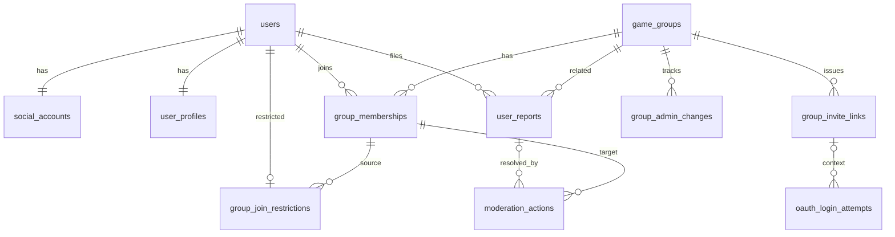
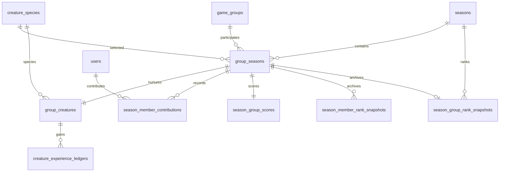
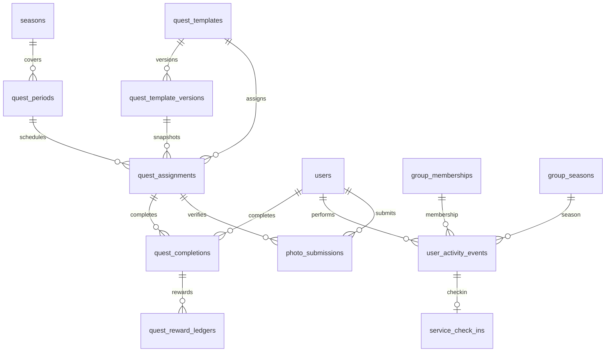
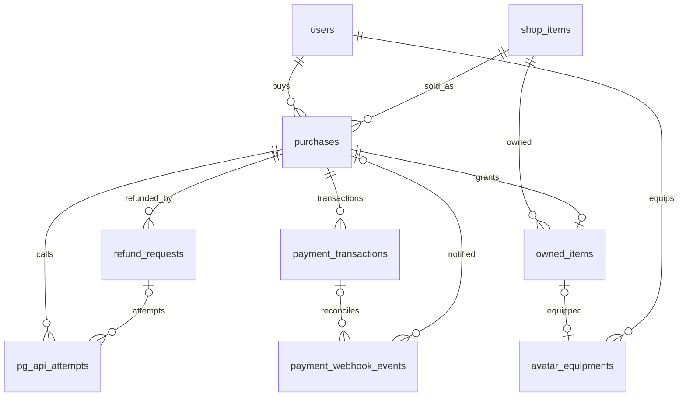
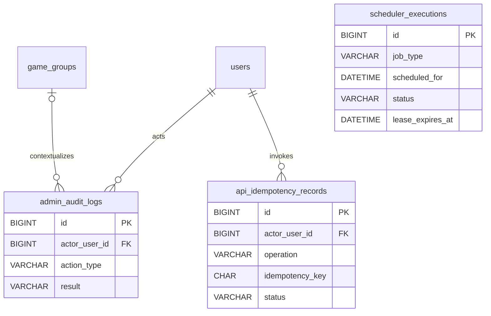

# 데이터베이스 설계서 및 ERD

## 1. 설계 상태

### 구현할 기능

공동 육성 게임의 **업무 테이블 40개**를 Spring Boot/JPA와 MySQL 8로 관리합니다. 사용자·그룹·시즌·퀘스트·결제 기록은 업무 상태와 이력을 분리하여 보존합니다.

### 완료 확인

테이블 관계와 아래 UNIQUE·FK·상태·잠금 정책을 충족하고, 각 API가 자신의 Aggregate만 변경합니다.

## 2. 테이블 집계 기준

| 영역 | 업무 테이블 수 | 기준 |
|---|---:|---|
| 계정·인증 | 4 | 회원·소셜 계정·프로필·OAuth 시도 |
| 그룹·운영 | 7 | 그룹·멤버십·초대·제재·관리 이력 |
| 시즌·크리처·랭킹 | 9 | 시즌·종·크리처·기여·종료 Snapshot |
| 퀘스트·활동 | 9 | 템플릿·배정·완료·보상·사진 |
| 결제·아바타 | 8 | 상품·주문·거래·보유·장착·환불·Webhook |
| 운영 공통 | 3 | Scheduler·감사·멱등 요청 |
| **합계** | **40** | Spring Session 등 인프라 테이블은 제외 |

`notifications`는 추후 구현이며 운영 경고는 원본 상태에서 조회합니다.

## 3. 업무 테이블 카탈로그

### 3.1. 계정·인증 — 4개

| 테이블 | 구현할 기능 |
|---|---|
| `users` | 회원 상태·전체 관리자·활동 시각 |
| `social_accounts` | 공급자·불변 ID·가입 이메일 |
| `user_profiles` | 표시 닉네임·정규화 이름 |
| `oauth_login_attempts` | 일회성 `state`와 시작 세션·초대 문맥 |

### 3.2. 그룹·운영 — 7개

| 테이블 | 구현할 기능 |
|---|---|
| `game_groups` | 그룹·정원·주 관리자 |
| `group_memberships` | 현재·과거 소속과 역할 |
| `group_invite_links` | 초대 링크 발급·폐기 |
| `group_join_restrictions` | 탈퇴·강퇴 후 가입 제한 |
| `user_reports` | 사용자 신고·판단 |
| `moderation_actions` | 강퇴 실행·근거 이력 |
| `group_admin_changes` | 주·부 관리자 역할 변경 이력 |

### 3.3. 시즌·크리처·랭킹 — 9개

| 테이블 | 구현할 기능 |
|---|---|
| `seasons` | 4주 시즌·상태 전이 |
| `creature_species` | 선택 가능한 종·리소스 |
| `group_seasons` | 그룹별 시즌 참여·부화 기한 |
| `group_creatures` | 활성 크리처·경험치·성장 |
| `creature_experience_ledgers` | 퀘스트 기여 경험치 원장 |
| `season_member_contributions` | 개인 시즌 기여도 |
| `season_group_scores` | 그룹 시즌 점수 |
| `season_member_rank_snapshots` | 개인 종료 랭킹 Snapshot |
| `season_group_rank_snapshots` | 그룹 종료 랭킹 Snapshot |

### 3.4. 퀘스트·활동 — 9개

| 테이블 | 구현할 기능 |
|---|---|
| `quest_templates` | 퀘스트 순회 기준 |
| `quest_template_versions` | 불변 검증·보상 버전 |
| `quest_periods` | 일·주 배정 기간·실행 상태 |
| `quest_assignments` | 기간별 템플릿 Snapshot |
| `quest_completions` | 회원별 한 번의 완료 |
| `quest_reward_ledgers` | 경험치·기여 지급 원장 |
| `user_activity_events` | 서버 행동 집계 원본 |
| `service_check_ins` | 일일 체크인 |
| `photo_submissions` | EXIF 검증·파일 정리 기록 |

### 3.5. 결제·아바타 — 8개

| 테이블 | 구현할 기능 |
|---|---|
| `shop_items` | 상품·가격·슬롯 |
| `purchases` | 구매 주문·Snapshot |
| `payment_transactions` | 승인·취소 PG 거래 이력 |
| `owned_items` | 보유·사용·회수 상태 |
| `avatar_equipments` | 현재 슬롯 장착 |
| `refund_requests` | 관리자 승인·취소·복구 상태 |
| `pg_api_attempts` | PG 호출·멱등·결과 불명 기록 |
| `payment_webhook_events` | Webhook 수신·처리·복구 |

### 3.6. 운영 공통 — 3개

| 테이블 | 구현할 기능 |
|---|---|
| `scheduler_executions` | 작업 실행권·시도·Lease·결과 |
| `admin_audit_logs` | 관리자 변경 이력 |
| `api_idempotency_records` | 요청별 멱등 키·결과 재사용 |

### 3.7. ERD

**주요 규칙:** 아래 ERD는 관계를 빠르게 확인하기 위한 영역별 보기입니다. 각 테이블의 정확한 컬럼과 UNIQUE는 10~14절에서 정의합니다. 외부 공급자의 불변 ID는 내부 FK가 아닙니다.

#### 계정·인증·그룹·운영 ERD



#### 시즌·크리처·랭킹 ERD



#### 퀘스트·활동 ERD



#### 상품·아바타·결제·환불 ERD



#### 운영 공통 ERD



## 4. 주요 영역 경계와 관계

| 영역 | 핵심 경계·책임 |
|---|---|
| 인증 | `users`가 기준 회원, `social_accounts`가 공급자 자격을 담당 |
| 그룹 | 현 소속·이력은 `group_memberships`, 24시간 제한은 별도 행 |
| 시즌 | `group_seasons`가 참여, `group_creatures`가 육성 상태 담당 |
| 기여 | 지급 원장과 현재 합계는 별도 관리. 그룹 이동 시 과거 점수는 이전 그룹에 남음 |
| 퀘스트 | 공통 기간별 배정과 사용자별 완료를 분리 |
| 결제 | 주문·PG 거래·보유 아이템·환불을 서로 다른 상태로 관리 |
| AI | Gemini 교정 원본·응답은 저장하지 않고 사용자 확정 그룹 소개만 저장 |

## 5. 관계 Cardinality와 FK 정책

### 5.1. 주요 Cardinality

| 부모·기준 | 대상 | 관계·제약 |
|---|---|---|
| `users` | `social_accounts`, `user_profiles` | 각각 1:1 (`user_id` UNIQUE) |
| `users` | `group_memberships` | 1:N, 활성 소속 최대 1건 |
| `game_groups` | `group_memberships`, `group_invite_links` | 각각 1:N, 활성 링크 최대 1건 |
| `game_groups`, `seasons` | `group_seasons` | 각각 1:N |
| `group_seasons` | `group_creatures`, `season_group_scores` | 각각 1:1 |
| `quest_periods`, `quest_template_versions` | `quest_assignments` | 각각 1:N |
| `users` + `quest_assignments` | `quest_completions` | 조합당 0..1 |
| `group_memberships`, `group_seasons` | `user_activity_events` | 각각 1:N, 발생 당시 귀속 유지 |
| `purchases` | `payment_transactions`, `refund_requests` | 1:N, 진행 중 환불 1건 이하 |
| `purchases` | `owned_items` | 1:0..1 |
| `users` + 슬롯 | `avatar_equipments` | 조합당 0..1 |
| `users` | `api_idempotency_records` | 1:N, 사용자·Operation·Key UNIQUE |

### 5.2. 주 관리자 관계

### 주요 규칙

- 활성 그룹의 `primary_admin_user_id`는 필수이고 비활성화되면 `NULL`로 변경합니다.
- `group_memberships.primary_group_id`는 `ACTIVE + PRIMARY`일 때 그룹 ID를 가진 STORED 생성 컬럼으로 UNIQUE를 적용합니다.
- 그룹 생성 시 최초 관리자·멤버십·변경 이력을 한 트랜잭션에 기록합니다.
- 권한 이전은 **기존·신규 사용자 ID 오름차순 → 그룹 → 관련 멤버십 ID 오름차순** 잠금 후 신규 `PRIMARY`, 기존 `MEMBER`로 확정합니다.

### 완료 확인

그룹당 활성 주 관리자는 정확히 한 명이며 동시 이전 요청이 서로 다른 현재 관리자를 만들지 않습니다.

### 5.3. FK 삭제 정책

| 대상 | 정책 |
|---|---|
| 회원·그룹·시즌·퀘스트·랭킹·결제·환불 | `ON DELETE RESTRICT` 기본, 이력 상태 보존 |
| 핵심 부모·자식 업무 관계 | `ON DELETE CASCADE` 사용하지 않음 |
| 공급자 사용자 ID·거래 ID | 외부 문자열로 UNIQUE, 내부 FK로 취급하지 않음 |
| OAuth 로그인 시도·기타 명시된 임시 데이터 | Scheduler만 정해진 시점에 물리 삭제 |

## 6. 공통 컬럼과 생명주기 정책

### 6.1. 식별자와 자료형

| 구분 | 기준 |
|---|---|
| PK | `id BIGINT AUTO_INCREMENT` |
| FK | `<대상>_id`·`BIGINT` |
| 금액·경험치·점수 | `BIGINT` |
| 위도·경도 | `DECIMAL(10,7)` |
| 상태값 | `VARCHAR(30)` + Java `EnumType.STRING` |

### 6.2. 시간과 감사 컬럼

- 시각은 UTC `DATETIME(6)`에 저장하고 일일·주간·시즌 경계는 `Asia/Seoul`에서 계산합니다.
- 변경 행에는 `created_at`·`updated_at`, 불변 원장·Snapshot에는 주로 `created_at`만 둡니다.
- 체크인·퀘스트의 KST 업무 기준일은 `DATE` 컬럼으로 분리합니다.

### 6.3. 상태 보존과 삭제

- 회원 탈퇴는 `WITHDRAWN`·`withdrawn_at`, 그룹·상품·템플릿은 비활성 상태로 남깁니다.
- 멤버십·제재·완료·원장·결제·환불은 자동 물리 삭제하지 않습니다.
- 일괄 `deleted` 컬럼을 만들지 않으며 명시적 임시 데이터만 정리합니다. 보존 기간은 14.5절을 따릅니다.

### 6.4. 버전과 JSON

- 동시 변경에 필요한 Aggregate에만 `version BIGINT`를 둡니다.
- 검증 파라미터·정제된 외부 보조 정보는 JSON으로 저장할 수 있지만 **조인·인덱스·상태·UNIQUE·금액 판단 값은 별도 컬럼**입니다.
- OAuth/PG Secret·공급자 Token·불필요한 PG 원문 응답은 저장하지 않습니다.

## 7. 동시성 제어를 위한 데이터 무결성 기준

### 7.1. 활성 행 UNIQUE 생성 컬럼

**구현할 기능:** MySQL의 UNIQUE가 `NULL` 중복을 허용하는 특성을 이용해 **활성 행만 조건부 유일성**을 적용합니다.

| 테이블 | STORED 생성 컬럼 | 생성 조건 | UNIQUE 효과 |
|---|---|---|---|
| `group_memberships` | `active_user_id` | `status='ACTIVE'` | 사용자당 활성 소속 1건 |
| `group_memberships` | `primary_group_id` | `status='ACTIVE' AND role='PRIMARY'` | 그룹당 활성 주 관리자 1명 |
| `refund_requests` | `active_purchase_id` | `REQUESTED`, `CANCEL_PENDING`, `CANCEL_UNKNOWN` | 구매당 진행 환불 1건 |
| `group_invite_links` | `active_group_id` | `status='ACTIVE'` | 그룹당 활성 링크 1건 |

```sql
ALTER TABLE group_memberships
    ADD COLUMN active_user_id BIGINT
        GENERATED ALWAYS AS (
            CASE WHEN status = 'ACTIVE' THEN user_id ELSE NULL END
        ) STORED
  , ADD CONSTRAINT uq_group_memberships_active_user UNIQUE (active_user_id);
```

기타 유일성: `group_creatures.group_season_id`, `service_check_ins(user_id, check_in_date)`.

### 7.2. 그룹 정원 카운터

**주요 규칙:** 그룹 정원은 **20명**이며 `0 <= current_member_count <= capacity` CHECK를 둡니다. 가입 인원 증가와 활성 멤버십 생성은 같은 트랜잭션으로 처리합니다.

```sql
UPDATE game_groups
   SET current_member_count = current_member_count + 1
 WHERE id = :group_id
   AND current_member_count < capacity;
```

**처리 순서:** 사용자 → 그룹 → 초대 링크(초대 가입만) → 멤버십 → 가입 제한 행을 잠그고 현재 소속·제한·정원과 초대 유효성을 다시 검사합니다. 초대 링크 재발급은 그룹 → 초대 링크 순서로 잠급니다. 탈퇴·강퇴는 멤버십 종료와 카운터 감소를 같은 트랜잭션에서 처리합니다. 불일치는 Scheduler가 경고·감사 로그로 기록하고 **자동 카운터 수정은 하지 않습니다.**

### 완료 확인

동시 가입 21건 이상을 시도해도 인원 수가 20을 넘지 않고 실패 시 멤버십·카운터가 함께 Rollback됩니다.

### 7.3. UNIQUE 제약 후보

| 대상 | 유일성 기준 |
|---|---|
| 소셜 계정 | `(provider, provider_user_id)`, `normalized_email` |
| 완료 | `(user_id, quest_assignment_id)` |
| 보상 | `(quest_completion_id, reward_type)` |
| 체크인 | `(user_id, check_in_date)` |
| 기간별 배정 | `(quest_period_id, slot_number)`, `(quest_period_id, quest_template_id)` |
| 시즌 | `start_at`, `season_number` |
| 템플릿 버전 | `(quest_template_id, version_number)` |
| PG 거래·Webhook | `(provider, provider_transaction_id)`, `(provider, provider_event_id)` |
| 진행 환불·활성 멤버십 | 7.1절 조건부 생성 컬럼 UNIQUE |

퀘스트 배정 시 문구·난이도·검증 조건·보상을 Snapshot으로 보존해 템플릿 수정이 진행 중 보상을 바꾸지 않게 합니다. 서버에서 확정한 행동만 집계에 사용하고 클라이언트 누적 횟수는 신뢰하지 않습니다.

### 7.4. 행 잠금 대상

| 업무 | 잠금 순서 |
|---|---|
| 그룹 가입·탈퇴·강퇴·권한 변경 | 사용자 ID 오름차순 → 그룹 → 초대 링크(초대 가입만) → 멤버십 ID 오름차순 → 가입 제한 |
| 퀘스트 완료·보상 | 시즌 공유 잠금 → 사용자 → 그룹 → 활성 멤버십 → 그룹 시즌 → 완료 UNIQUE → 개인 기여 → 그룹 점수 → 크리처 → 원장 |
| 장착·환불 | 구매 → 보유 아이템 → 환불 요청 |
| 주 관리자 이전 | 기존·신규 사용자 ID 오름차순 → 그룹 → 관련 멤버십 ID 오름차순 |

`PESSIMISTIC_WRITE`·조건부 UPDATE를 필요할 때만 사용합니다. 시즌 완료의 공유 잠금은 트랜잭션 종료까지 유지하고, 활동 기록의 멤버십·그룹 시즌 귀속을 다시 검사합니다.

## 8. PG 취소와 트랜잭션 경계

### 처리 순서

1. 짧은 DB 트랜잭션에서 최신 미사용·중복 환불 여부를 확인하고 `CANCEL_PENDING`으로 선점합니다.
2. **Commit 후** 환불 요청 ID 기반 멱등 키로 PG 취소 API를 호출합니다.
3. 새 짧은 트랜잭션에서 성공은 `COMPLETED`·아이템 회수, 명확한 실패는 `FAILED`, 결과 불명은 `CANCEL_UNKNOWN`으로 반영합니다.
4. `CANCEL_UNKNOWN`은 다시 취소하지 않고 PG 조회·정합성 복구로 확정합니다.

### 완료 확인

외부 네트워크 호출 중 DB 행 잠금을 보유하지 않고, 취소 여부가 불명확해도 아이템을 먼저 회수하지 않습니다.

## 9. 트랜잭션 이후 이벤트

### 주요 규칙

성장·기여·장착·환불 관련 WebSocket 이벤트는 **DB Commit 이후에만** 발행합니다. Rollback된 결과는 발행하지 않으며 재연결 시 REST Snapshot이 최종 상태를 결정합니다.

## 10. 계정·그룹 상세 컬럼

**읽는 법:** 각 테이블의 표는 구현용 컬럼 계약입니다. `PK`, `FK`, `UNIQUE`, `INDEX` 등은 지정한 제약을 의미하며, 반복적인 기본키·생성 시각 설명은 생략합니다. 작업 대상은 같은 이름의 Entity·Repository와 관련 Service입니다.

### 10.1. 식별 문자열 정책

| 대상 | 주요 규칙 |
|---|---|
| 닉네임 | 2~20자, 전역 UNIQUE, 탈퇴 후 재사용하지 않음 |
| 그룹 이름 | 2~30자, 전역 UNIQUE, MVP 생성 후 변경 없음 |
| 정규화 이름 | NFKC·Trim·소문자로 `normalized_nickname`·`normalized_name` 저장 |
| 이메일 | 가입 당시 Snapshot, Trim·소문자 `normalized_email` 전역 UNIQUE, 공급자 자동 연결 키 아님 |
| `state`·초대 Token | 원문 저장하지 않고 SHA-256 16진수 Hash |

### 10.2. 계정·인증 테이블

#### `users`

**구현할 기능** — 회원 상태·전체 관리자·마지막 인증 활동을 관리합니다.

**주요 규칙**

`status=ACTIVE/SUSPENDED/WITHDRAWN`, `global_role=USER/SUPER_ADMIN`; 강퇴 판단은 `last_active_at` 사용, 활동 갱신 DB 쓰기는 10분 간격; `(status,last_active_at)` INDEX.

| 컬럼 | 자료형 | 역할·제약 |
|---|---|---|
| `id` | `BIGINT` | PK, AUTO_INCREMENT |
| `status` | `VARCHAR(30)` | — |
| `global_role` | `VARCHAR(30)` | — |
| `last_login_at` | `DATETIME(6)` | — |
| `last_active_at` | `DATETIME(6)` | — |
| `withdrawn_at` | `DATETIME(6)` | — |
| `version` | `BIGINT` | 동시 변경 감지 |
| `created_at` | `DATETIME(6)` | — |
| `updated_at` | `DATETIME(6)` | — |

#### `social_accounts`

**구현할 기능** — OAuth 공급자 자격과 가입 당시 이메일을 관리합니다.

**주요 규칙**

`user_id` UNIQUE; `(provider,provider_user_id)` UNIQUE; `normalized_email` 전역 UNIQUE; 공급자 Token은 저장하지 않습니다.

| 컬럼 | 자료형 | 역할·제약 |
|---|---|---|
| `id` | `BIGINT` | PK, AUTO_INCREMENT |
| `user_id` | `BIGINT` | — |
| `provider` | `VARCHAR(30)` | — |
| `provider_user_id` | `VARCHAR(255)` | UNIQUE |
| `email` | `VARCHAR(320)` | — |
| `normalized_email` | `VARCHAR(320)` | — |
| `email_verified` | `BOOLEAN` | — |
| `created_at` | `DATETIME(6)` | — |

#### `user_profiles`

**구현할 기능** — 서비스 표시 닉네임을 관리합니다.

**주요 규칙**

`user_id`·`normalized_nickname` 각각 UNIQUE; 닉네임 정규화는 10.1절 기준.

| 컬럼 | 자료형 | 역할·제약 |
|---|---|---|
| `id` | `BIGINT` | PK, AUTO_INCREMENT |
| `user_id` | `BIGINT` | — |
| `nickname` | `VARCHAR(20)` | — |
| `normalized_nickname` | `VARCHAR(20)` | — |
| `version` | `BIGINT` | 동시 변경 감지 |
| `created_at` | `DATETIME(6)` | — |
| `updated_at` | `DATETIME(6)` | — |

#### `oauth_login_attempts`

**구현할 기능** — 10분 일회용 OAuth 시작 상태를 기록합니다.

**주요 규칙**

`state_hash` UNIQUE; `initiating_session_hash`는 원문이 아닌 SHA-256; Callback 동일 세션 검사; 종료 후 24시간 물리 삭제; `(status,expires_at)` INDEX.

| 컬럼 | 자료형 | 역할·제약 |
|---|---|---|
| `id` | `BIGINT` | PK, AUTO_INCREMENT |
| `state_hash` | `CHAR(64)` | UNIQUE |
| `initiating_session_hash` | `CHAR(64)` | — |
| `provider` | `VARCHAR(30)` | — |
| `intent` | `VARCHAR(30)` | — |
| `invite_link_id` | `BIGINT` | — |
| `return_route` | `VARCHAR(100)` | — |
| `status` | `VARCHAR(30)` | — |
| `expires_at` | `DATETIME(6)` | — |
| `consumed_at` | `DATETIME(6)` | — |
| `created_at` | `DATETIME(6)` | — |

### 10.3. 그룹·운영 테이블

#### `game_groups`

**구현할 기능** — 그룹 정원·주 관리자·활성 상태를 관리합니다.

**주요 규칙**

`normalized_name` UNIQUE, `visibility=PUBLIC`, `capacity=20`; 활성 그룹에는 `primary_admin_user_id` 필수; 카운터 CHECK 0~20.

| 컬럼 | 자료형 | 역할·제약 |
|---|---|---|
| `id` | `BIGINT` | PK, AUTO_INCREMENT |
| `name` | `VARCHAR(30)` | — |
| `normalized_name` | `VARCHAR(30)` | — |
| `description` | `VARCHAR(500)` | — |
| `visibility` | `VARCHAR(30)` | — |
| `status` | `VARCHAR(30)` | — |
| `capacity` | `SMALLINT` | — |
| `current_member_count` | `SMALLINT` | — |
| `primary_admin_user_id` | `BIGINT` | — |
| `version` | `BIGINT` | 동시 변경 감지 |
| `created_at` | `DATETIME(6)` | — |
| `updated_at` | `DATETIME(6)` | — |

#### `group_memberships`

**구현할 기능** — 현재·종료된 그룹 소속과 역할을 보존합니다.

**주요 규칙**

`role=PRIMARY/DEPUTY/MEMBER`; `status=ACTIVE/LEFT/REMOVED`; `active_user_id`·`primary_group_id` 조건부 UNIQUE(7.1절).

| 컬럼 | 자료형 | 역할·제약 |
|---|---|---|
| `id` | `BIGINT` | PK, AUTO_INCREMENT |
| `group_id` | `BIGINT` | — |
| `user_id` | `BIGINT` | — |
| `role` | `VARCHAR(30)` | — |
| `status` | `VARCHAR(30)` | — |
| `joined_at` | `DATETIME(6)` | — |
| `ended_at` | `DATETIME(6)` | — |
| `ended_by_user_id` | `BIGINT` | — |
| `exit_reason` | `VARCHAR(30)` | — |
| `active_user_id` | `BIGINT` | STORED, 조건부 UNIQUE |
| `primary_group_id` | `BIGINT` | STORED, 조건부 UNIQUE |
| `version` | `BIGINT` | 동시 변경 감지 |
| `created_at` | `DATETIME(6)` | — |
| `updated_at` | `DATETIME(6)` | — |

#### `group_invite_links`

**구현할 기능** — 그룹별 초대 링크와 회전 이력을 관리합니다.

**주요 규칙**

`token_hash` UNIQUE, `active_group_id` 조건부 UNIQUE; 기존 링크 재발급 시 즉시 `INVALIDATED`.

- DB의 조건부 UNIQUE 제약은 그룹당 활성 링크를 최대 1건으로 제한합니다.
- 정상적인 활성 그룹은 활성 초대 링크 1건을 유지하는 것을 업무 불변식으로 합니다.
- 기존 링크 무효화와 신규 링크 생성은 동일 트랜잭션에서 처리하며, 기존 링크의 상태 변경을 먼저 Flush합니다.
- 활성 링크가 0건인 경우 일반 재발급 API에서는 자동 생성하지 않고 정합성 오류로 처리합니다.

| 컬럼 | 자료형 | 역할·제약 |
|---|---|---|
| `id` | `BIGINT` | PK, AUTO_INCREMENT |
| `group_id` | `BIGINT` | — |
| `token_hash` | `CHAR(64)` | — |
| `status` | `VARCHAR(30)` | — |
| `issued_by_user_id` | `BIGINT` | — |
| `issued_at` | `DATETIME(6)` | — |
| `invalidated_at` | `DATETIME(6)` | — |
| `active_group_id` | `BIGINT` | STORED, 조건부 UNIQUE |
| `created_at` | `DATETIME(6)` | — |

#### `group_join_restrictions`

**구현할 기능** — 탈퇴·강퇴 후 24시간 재가입 제한 종료 시각을 보유합니다.

**주요 규칙**

`user_id` UNIQUE, `restricted_until` INDEX; 신규 가입 시 사용자 잠금 아래 재검사.

| 컬럼 | 자료형 | 역할·제약 |
|---|---|---|
| `id` | `BIGINT` | PK, AUTO_INCREMENT |
| `user_id` | `BIGINT` | — |
| `source_membership_id` | `BIGINT` | — |
| `reason` | `VARCHAR(30)` | — |
| `restricted_from` | `DATETIME(6)` | — |
| `restricted_until` | `DATETIME(6)` | — |
| `created_at` | `DATETIME(6)` | — |
| `updated_at` | `DATETIME(6)` | — |

#### `user_reports`

**구현할 기능** — 신고 내용과 전체 관리자 처리 결과를 보유합니다.

**주요 규칙**

`status=RECEIVED/RESOLVED/REJECTED`; `(status,created_at)` INDEX; 신고 접수만으로 자동 강퇴하지 않습니다.

| 컬럼 | 자료형 | 역할·제약 |
|---|---|---|
| `id` | `BIGINT` | PK, AUTO_INCREMENT |
| `reporter_user_id` | `BIGINT` | — |
| `reported_user_id` | `BIGINT` | — |
| `group_id` | `BIGINT` | — |
| `category` | `VARCHAR(30)` | — |
| `content` | `VARCHAR(1000)` | — |
| `status` | `VARCHAR(30)` | — |
| `handled_by_user_id` | `BIGINT` | — |
| `handled_at` | `DATETIME(6)` | — |
| `resolution` | `VARCHAR(1000)` | — |
| `created_at` | `DATETIME(6)` | — |
| `updated_at` | `DATETIME(6)` | — |

#### `moderation_actions`

**구현할 기능** — 강퇴의 실행자·대상·근거를 보존합니다.

**주요 규칙**

신고 없는 미접속 강퇴에서는 `report_id=NULL`; `action_type=REMOVE_INACTIVE/REMOVE_REPORTED`.

| 컬럼 | 자료형 | 역할·제약 |
|---|---|---|
| `id` | `BIGINT` | PK, AUTO_INCREMENT |
| `report_id` | `BIGINT` | — |
| `group_id` | `BIGINT` | — |
| `membership_id` | `BIGINT` | — |
| `target_user_id` | `BIGINT` | — |
| `actor_user_id` | `BIGINT` | — |
| `action_type` | `VARCHAR(30)` | — |
| `reason` | `VARCHAR(1000)` | — |
| `executed_at` | `DATETIME(6)` | — |
| `created_at` | `DATETIME(6)` | — |

#### `group_admin_changes`

**구현할 기능** — 방장 이전·부방장 부여와 회수의 감사 이력을 보존합니다.

**주요 규칙**

`change_type=INITIAL_PRIMARY/TRANSFER_PRIMARY/GRANT_DEPUTY/REVOKE_DEPUTY`; 권한 변화와 함께 Commit.

| 컬럼 | 자료형 | 역할·제약 |
|---|---|---|
| `id` | `BIGINT` | PK, AUTO_INCREMENT |
| `group_id` | `BIGINT` | — |
| `target_user_id` | `BIGINT` | — |
| `actor_user_id` | `BIGINT` | — |
| `change_type` | `VARCHAR(30)` | — |
| `previous_role` | `VARCHAR(30)` | — |
| `new_role` | `VARCHAR(30)` | — |
| `created_at` | `DATETIME(6)` | — |

## 11. 시즌·크리처·랭킹 상세 컬럼

### 11.1. `seasons`

**구현할 기능** — 4주 시즌 시작·종료와 현재 상태를 관리합니다.

**주요 규칙**

`season_number`·`start_at` UNIQUE; `status=SCHEDULED/ACTIVE/CLOSING/ENDED`; 시작·종료 Scheduler 재진입 멱등. 장기 중단 뒤에는 최초 시즌의 4주 달력에서 현재 구간을 계산하되 중간 구간 행을 소급 생성하지 않고, 마지막 저장 시즌 번호의 다음 번호로 현재 구간 시즌 하나만 만듭니다. 따라서 `season_number`는 저장된 시즌 사이에서는 연속하지만 모든 과거 4주 구간에 행이 존재함을 뜻하지 않습니다. 현재 구간 시즌은 `SCHEDULED`로 생성하고 기존 활성 그룹의 참여·알·0점 점수 초기화를 전부 완료한 뒤 `ACTIVE`로 전환합니다. 만료된 `SCHEDULED`는 활성화하지 않고 `ENDED`로 종결합니다. `SCHEDULED`와 종료된 과거 시즌에서는 부화하지 않습니다.

| 컬럼 | 자료형 | 역할·제약 |
|---|---|---|
| `id` | `BIGINT` | PK, AUTO_INCREMENT |
| `season_number` | `INT` | — |
| `start_at` | `DATETIME(6)` | — |
| `end_at` | `DATETIME(6)` | — |
| `status` | `VARCHAR(30)` | — |
| `closing_from_status` | `VARCHAR(30) NULL` | CLOSING 진입 직전 상태. ACTIVE 또는 SCHEDULED |
| `version` | `BIGINT` | 동시 변경 감지 |
| `created_at` | `DATETIME(6)` | — |
| `updated_at` | `DATETIME(6)` | — |

### 11.2. `creature_species`

**구현할 기능** — 시작 크리처 종류와 프론트 이미지 키를 제공합니다.

**주요 규칙**

`code` UNIQUE; `status=ACTIVE/INACTIVE`; `(status,display_order)` INDEX.

| 컬럼 | 자료형 | 역할·제약 |
|---|---|---|
| `id` | `BIGINT` | PK, AUTO_INCREMENT |
| `code` | `VARCHAR(50)` | — |
| `name` | `VARCHAR(50)` | — |
| `asset_key` | `VARCHAR(255)` | — |
| `status` | `VARCHAR(30)` | — |
| `display_order` | `INT` | — |
| `created_at` | `DATETIME(6)` | — |
| `updated_at` | `DATETIME(6)` | — |

### 11.3. `group_seasons`

**구현할 기능** — 그룹의 시즌 참여·72시간 선택 기한을 관리합니다.

**주요 규칙**

`(group_id,season_id)` UNIQUE; `status=PREPARING/ACTIVE/ENDED`; `selection_source=ADMIN/RANDOM`. 기존 활성 그룹의 복구 시즌 참여와 시즌 도중 새 그룹 참여 모두 `selection_deadline_at=created_at+72시간`을 사용합니다. 재실행은 최초 생성된 행과 기한을 유지하며 72시간을 다시 시작하지 않습니다. 관리자 선택의 기존 `selected_at`은 보존하고 미선택 무작위 선택의 `selected_at`, 크리처 `hatched_at`과 각 행의 `updated_at`은 실제 `ACTIVE` 부화 처리 시각을 사용합니다. 종료된 시즌의 미부화 크리처는 알 상태로 보존합니다. 만료된 `SCHEDULED`의 기존 행은 값을 유지한 채 `ENDED`로 전환합니다.

| 컬럼 | 자료형 | 역할·제약 |
|---|---|---|
| `id` | `BIGINT` | PK, AUTO_INCREMENT |
| `group_id` | `BIGINT` | — |
| `season_id` | `BIGINT` | — |
| `selection_deadline_at` | `DATETIME(6)` | — |
| `selected_species_id` | `BIGINT` | — |
| `selected_by_user_id` | `BIGINT` | — |
| `selection_source` | `VARCHAR(30)` | — |
| `selected_at` | `DATETIME(6)` | — |
| `status` | `VARCHAR(30)` | — |
| `version` | `BIGINT` | 동시 변경 감지 |
| `created_at` | `DATETIME(6)` | — |
| `updated_at` | `DATETIME(6)` | — |

### 11.4. `group_creatures`

**구현할 기능** — 그룹 시즌별 유일한 크리처와 누적 경험치를 보유합니다.

**주요 규칙**

`group_season_id` UNIQUE; `growth_stage=EGG/HATCHLING/GROWING/MATURE/COMPLETE`; 알 기간에도 경험치 누적, 종료 먼저면 알로 보존.

| 컬럼 | 자료형 | 역할·제약 |
|---|---|---|
| `id` | `BIGINT` | PK, AUTO_INCREMENT |
| `group_season_id` | `BIGINT` | — |
| `species_id` | `BIGINT` | — |
| `selection_source` | `VARCHAR(30)` | — |
| `total_experience` | `BIGINT` | — |
| `growth_stage` | `VARCHAR(30)` | — |
| `growth_stage_reached_at` | `DATETIME(6)` | — |
| `hatched_at` | `DATETIME(6)` | — |
| `status` | `VARCHAR(30)` | — |
| `version` | `BIGINT` | 동시 변경 감지 |
| `created_at` | `DATETIME(6)` | — |
| `updated_at` | `DATETIME(6)` | — |

### 11.5. `creature_experience_ledgers`

**구현할 기능** — 완료마다 크리처 경험치 지급 근거를 보유합니다.

**주요 규칙**

`quest_completion_id` UNIQUE; 지급량과 `balance_after`를 확정 트랜잭션에서 기록.

| 컬럼 | 자료형 | 역할·제약 |
|---|---|---|
| `id` | `BIGINT` | PK, AUTO_INCREMENT |
| `group_creature_id` | `BIGINT` | — |
| `quest_completion_id` | `BIGINT` | — |
| `experience_amount` | `BIGINT` | — |
| `balance_after` | `BIGINT` | — |
| `occurred_at` | `DATETIME(6)` | — |
| `created_at` | `DATETIME(6)` | — |

### 11.6. `season_member_contributions`

**구현할 기능** — 사용자·그룹 시즌별 기여도와 순위 도달 시각을 보유합니다.

**주요 규칙**

`(group_season_id,user_id)` UNIQUE; `participant_status=ACTIVE/LEFT/REMOVED`; 그룹 이동 후 이전 점수 유지.

| 컬럼 | 자료형 | 역할·제약 |
|---|---|---|
| `id` | `BIGINT` | PK, AUTO_INCREMENT |
| `group_season_id` | `BIGINT` | — |
| `user_id` | `BIGINT` | — |
| `latest_membership_id` | `BIGINT` | — |
| `contribution_score` | `BIGINT` | — |
| `score_reached_at` | `DATETIME(6)` | — |
| `participant_status` | `VARCHAR(30)` | — |
| `version` | `BIGINT` | 동시 변경 감지 |
| `created_at` | `DATETIME(6)` | — |
| `updated_at` | `DATETIME(6)` | — |

### 11.7. `season_group_scores`

**구현할 기능** — 그룹 시즌 점수·동점 기준 시각을 보유합니다.

**주요 규칙**

`group_season_id` UNIQUE; 그룹 순위는 점수 내림차순·도달 시각 오름차순·ID 오름차순.

| 컬럼 | 자료형 | 역할·제약 |
|---|---|---|
| `id` | `BIGINT` | PK, AUTO_INCREMENT |
| `group_season_id` | `BIGINT` | — |
| `score` | `BIGINT` | — |
| `score_reached_at` | `DATETIME(6)` | — |
| `version` | `BIGINT` | 동시 변경 감지 |
| `created_at` | `DATETIME(6)` | — |
| `updated_at` | `DATETIME(6)` | — |

### 11.8. `season_member_rank_snapshots`

**구현할 기능** — 종료 시즌 개인 랭킹의 불변 Snapshot을 저장합니다.

**주요 규칙**

`(group_season_id,user_id)`·`(group_season_id,rank_number)` UNIQUE; 생성 후 수정하지 않음.
한 번도 `ACTIVE`가 아니었던 만료 `SCHEDULED` 시즌에는 개인 랭킹 Snapshot을 생성하지 않습니다.

| 컬럼 | 자료형 | 역할·제약 |
|---|---|---|
| `id` | `BIGINT` | PK, AUTO_INCREMENT |
| `season_id` | `BIGINT` | — |
| `group_season_id` | `BIGINT` | — |
| `group_id` | `BIGINT` | — |
| `user_id` | `BIGINT` | — |
| `rank_number` | `INT` | — |
| `contribution_score` | `BIGINT` | — |
| `score_reached_at` | `DATETIME(6)` | — |
| `participant_status` | `VARCHAR(30)` | — |
| `nickname_snapshot` | `VARCHAR(20)` | 확정 시점 값 고정 |
| `created_at` | `DATETIME(6)` | — |

### 11.9. `season_group_rank_snapshots`

**구현할 기능** — 종료 시즌 전체 그룹 랭킹의 불변 Snapshot을 저장합니다.

**주요 규칙**

`(season_id,group_id)`·`(season_id,rank_number)` UNIQUE; 생성 후 수정하지 않음.
한 번도 `ACTIVE`가 아니었던 만료 `SCHEDULED` 시즌에는 그룹 랭킹 Snapshot을 생성하지 않습니다.

| 컬럼 | 자료형 | 역할·제약 |
|---|---|---|
| `id` | `BIGINT` | PK, AUTO_INCREMENT |
| `season_id` | `BIGINT` | — |
| `group_season_id` | `BIGINT` | — |
| `group_id` | `BIGINT` | — |
| `rank_number` | `INT` | — |
| `score` | `BIGINT` | — |
| `score_reached_at` | `DATETIME(6)` | — |
| `group_name_snapshot` | `VARCHAR(30)` | 확정 시점 값 고정 |
| `created_at` | `DATETIME(6)` | — |

## 12. 퀘스트·활동 상세 컬럼

### 12.1. `quest_templates`

**구현할 기능** — 기간·난이도별 순회 기준 템플릿을 관리합니다.

**주요 규칙**

`code` UNIQUE; `(period_type,difficulty,rotation_order)` UNIQUE; `status=ACTIVE/INACTIVE/EXPERIMENTAL`.

| 컬럼 | 자료형 | 역할·제약 |
|---|---|---|
| `id` | `BIGINT` | PK, AUTO_INCREMENT |
| `code` | `VARCHAR(30)` | — |
| `period_type` | `VARCHAR(30)` | — |
| `difficulty` | `VARCHAR(30)` | — |
| `status` | `VARCHAR(30)` | — |
| `rotation_order` | `INT` | — |
| `created_at` | `DATETIME(6)` | — |
| `updated_at` | `DATETIME(6)` | — |

### 12.2. `quest_template_versions`

**구현할 기능** — 퀘스트 검증·보상 기준의 버전을 보존합니다.

**주요 규칙**

`(quest_template_id,version_number)` UNIQUE; 버전은 생성 후 수정하지 않음.

| 컬럼 | 자료형 | 역할·제약 |
|---|---|---|
| `id` | `BIGINT` | PK, AUTO_INCREMENT |
| `quest_template_id` | `BIGINT` | — |
| `version_number` | `INT` | — |
| `title` | `VARCHAR(100)` | — |
| `description` | `VARCHAR(500)` | — |
| `verification_type` | `VARCHAR(30)` | — |
| `verification_parameters` | `JSON` | — |
| `creature_experience` | `BIGINT` | — |
| `contribution_score` | `BIGINT` | — |
| `created_at` | `DATETIME(6)` | — |

### 12.3. `quest_periods`

**구현할 기능** — 일일·주간 배정 기간과 생성 성공·실패를 기록합니다.

**주요 규칙**

`(period_type,start_at)` UNIQUE; `status=PENDING/ACTIVE/FAILED/CLOSED`; KST 날짜는 `period_date`. 현재 유효한 기간만 누락 생성하며 서버 중단 중 이미 만료된 기간은 `FAILED` 행이나 배정 Snapshot을 소급 생성하지 않습니다. 생략 범위와 건수는 해당 정상화의 `scheduler_executions.result_summary`에 남깁니다.

| 컬럼 | 자료형 | 역할·제약 |
|---|---|---|
| `id` | `BIGINT` | PK, AUTO_INCREMENT |
| `season_id` | `BIGINT` | — |
| `period_type` | `VARCHAR(30)` | — |
| `period_date` | `DATE` | — |
| `start_at` | `DATETIME(6)` | — |
| `end_at` | `DATETIME(6)` | — |
| `status` | `VARCHAR(30)` | — |
| `failure_code` | `VARCHAR(50)` | — |
| `failure_detail` | `VARCHAR(1000)` | — |
| `version` | `BIGINT` | 동시 변경 감지 |
| `created_at` | `DATETIME(6)` | — |
| `updated_at` | `DATETIME(6)` | — |

### 12.4. `quest_assignments`

**구현할 기능** — 배정 시점의 제목·조건·보상 Snapshot을 저장합니다.

**주요 규칙**

`(quest_period_id,slot_number)`·`(quest_period_id,quest_template_id)` UNIQUE; 진행 중 템플릿 수정 미반영.

| 컬럼 | 자료형 | 역할·제약 |
|---|---|---|
| `id` | `BIGINT` | PK, AUTO_INCREMENT |
| `quest_period_id` | `BIGINT` | — |
| `quest_template_id` | `BIGINT` | — |
| `quest_template_version_id` | `BIGINT` | — |
| `slot_number` | `INT` | — |
| `title_snapshot` | `VARCHAR(100)` | 확정 시점 값 고정 |
| `description_snapshot` | `VARCHAR(500)` | 확정 시점 값 고정 |
| `difficulty_snapshot` | `VARCHAR(30)` | 확정 시점 값 고정 |
| `verification_type_snapshot` | `VARCHAR(30)` | 확정 시점 값 고정 |
| `verification_parameters_snapshot` | `JSON` | 확정 시점 값 고정 |
| `creature_experience_snapshot` | `BIGINT` | 확정 시점 값 고정 |
| `contribution_score_snapshot` | `BIGINT` | 확정 시점 값 고정 |
| `created_at` | `DATETIME(6)` | — |

### 12.5. `quest_completions`

**구현할 기능** — 회원별 퀘스트 완료를 기간당 한 건 기록합니다.

**주요 규칙**

`(user_id,quest_assignment_id)` UNIQUE; 완료 당시 `membership_id`·`group_season_id` 고정.

| 컬럼 | 자료형 | 역할·제약 |
|---|---|---|
| `id` | `BIGINT` | PK, AUTO_INCREMENT |
| `user_id` | `BIGINT` | — |
| `quest_assignment_id` | `BIGINT` | — |
| `group_season_id` | `BIGINT` | — |
| `membership_id` | `BIGINT` | — |
| `completed_at` | `DATETIME(6)` | — |
| `created_at` | `DATETIME(6)` | — |

### 12.6. `quest_reward_ledgers`

**구현할 기능** — 보상 유형별 실제 지급 원장을 저장합니다.

**주요 규칙**

`(quest_completion_id,reward_type)` UNIQUE; `reward_type=CREATURE_EXPERIENCE/CONTRIBUTION`.

| 컬럼 | 자료형 | 역할·제약 |
|---|---|---|
| `id` | `BIGINT` | PK, AUTO_INCREMENT |
| `quest_completion_id` | `BIGINT` | — |
| `reward_type` | `VARCHAR(30)` | — |
| `amount` | `BIGINT` | — |
| `group_creature_id` | `BIGINT` | — |
| `member_contribution_id` | `BIGINT` | — |
| `group_score_id` | `BIGINT` | — |
| `applied_at` | `DATETIME(6)` | — |
| `created_at` | `DATETIME(6)` | — |

### 12.7. `user_activity_events`

**구현할 기능** — 서버 행동·주간 목표 판정의 원본 기록입니다.

**주요 규칙**

`deduplication_key` UNIQUE(값이 있을 때); 발생 당시 멤버십·그룹 시즌 일치 기록만 현재 집계 사용.

| 컬럼 | 자료형 | 역할·제약 |
|---|---|---|
| `id` | `BIGINT` | PK, AUTO_INCREMENT |
| `user_id` | `BIGINT` | — |
| `event_type` | `VARCHAR(50)` | — |
| `source_type` | `VARCHAR(50)` | — |
| `source_id` | `BIGINT` | — |
| `membership_id` | `BIGINT` | — |
| `group_season_id` | `BIGINT` | — |
| `business_date` | `DATE` | — |
| `occurred_at` | `DATETIME(6)` | — |
| `deduplication_key` | `VARCHAR(128)` | — |
| `metadata` | `JSON` | — |
| `created_at` | `DATETIME(6)` | — |

### 12.8. `service_check_ins`

**구현할 기능** — 사용자별 KST 하루 한 번 체크인 기록입니다.

**주요 규칙**

`(user_id,check_in_date)`·`activity_event_id` UNIQUE; `is_morning`은 KST 05:00~09:00 미만.

| 컬럼 | 자료형 | 역할·제약 |
|---|---|---|
| `id` | `BIGINT` | PK, AUTO_INCREMENT |
| `user_id` | `BIGINT` | — |
| `activity_event_id` | `BIGINT` | — |
| `check_in_date` | `DATE` | — |
| `checked_in_at` | `DATETIME(6)` | — |
| `is_morning` | `BOOLEAN` | — |
| `created_at` | `DATETIME(6)` | — |

### 12.9. `photo_submissions`

**구현할 기능** — JPEG 사진 EXIF 검증과 파일 정리 결과를 저장합니다.

**주요 규칙**

`(user_id,quest_assignment_id,attempt_number)` UNIQUE·1~5 CHECK; JPEG ≤10 MiB, EXIF APP1 ≤1 MiB; 판정 결과·삭제 이력 보존.

| 컬럼 | 자료형 | 역할·제약 |
|---|---|---|
| `id` | `BIGINT` | PK, AUTO_INCREMENT |
| `user_id` | `BIGINT` | — |
| `quest_assignment_id` | `BIGINT` | — |
| `storage_key` | `VARCHAR(500)` | — |
| `attempt_number` | `INT` | 1~5, CHECK |
| `captured_at` | `DATETIME(6)` | — |
| `uploaded_at` | `DATETIME(6)` | — |
| `latitude` | `DECIMAL(10,7)` | 검증 후 개인정보 정리 대상 |
| `longitude` | `DECIMAL(10,7)` | 검증 후 개인정보 정리 대상 |
| `verification_status` | `VARCHAR(30)` | — |
| `failure_reason` | `VARCHAR(50)` | — |
| `file_deleted_at` | `DATETIME(6)` | — |
| `created_at` | `DATETIME(6)` | — |
| `updated_at` | `DATETIME(6)` | — |

## 13. 결제·아바타 상세 컬럼

### 13.1. 아바타 슬롯과 결제 범위

**주요 규칙:** 슬롯은 `HEAD`·`FACE`·`BODY`·`ACCESSORY`; 주문당 상품 1개, 통화는 `KRW`, 부분 환불 없음. 상품 슬롯과 장착 슬롯이 일치해야 합니다.

### 13.2. `shop_items`

**구현할 기능** — 아바타 꾸미기 상품·슬롯·가격을 관리합니다.

**주요 규칙**

`code` UNIQUE; `price_krw>0`; `slot_code=HEAD/FACE/BODY/ACCESSORY`; 판매 상태 `ACTIVE/INACTIVE`.

| 컬럼 | 자료형 | 역할·제약 |
|---|---|---|
| `id` | `BIGINT` | PK, AUTO_INCREMENT |
| `code` | `VARCHAR(50)` | — |
| `name` | `VARCHAR(100)` | — |
| `description` | `VARCHAR(500)` | — |
| `price_krw` | `BIGINT` | — |
| `slot_code` | `VARCHAR(30)` | — |
| `asset_key` | `VARCHAR(255)` | — |
| `status` | `VARCHAR(30)` | — |
| `created_at` | `DATETIME(6)` | — |
| `updated_at` | `DATETIME(6)` | — |

### 13.3. `purchases`

**구현할 기능** — 주문과 결제 금액·상품 Snapshot을 관리합니다.

**주요 규칙**

`order_number` UUID UNIQUE=PortOne `paymentId`; `status=READY/PAID/FAILED/CANCELLED`, 통화 `KRW`.

| 컬럼 | 자료형 | 역할·제약 |
|---|---|---|
| `id` | `BIGINT` | PK, AUTO_INCREMENT |
| `order_number` | `CHAR(36)` | UNIQUE |
| `user_id` | `BIGINT` | — |
| `shop_item_id` | `BIGINT` | — |
| `item_code_snapshot` | `VARCHAR(50)` | 확정 시점 값 고정 |
| `item_name_snapshot` | `VARCHAR(100)` | 확정 시점 값 고정 |
| `slot_code_snapshot` | `VARCHAR(30)` | 확정 시점 값 고정 |
| `price_krw_snapshot` | `BIGINT` | 확정 시점 값 고정 |
| `currency` | `CHAR(3)` | — |
| `status` | `VARCHAR(30)` | — |
| `version` | `BIGINT` | 동시 변경 감지 |
| `created_at` | `DATETIME(6)` | — |
| `updated_at` | `DATETIME(6)` | — |

### 13.4. `payment_transactions`

**구현할 기능** — PG 승인·취소 거래의 공급자별 식별자·결과를 보존합니다.

**주요 규칙**

`(provider,provider_transaction_id)` UNIQUE; 내부 주문번호는 여기 저장하지 않음; 승인 ID·취소 ID 별도 기록.

| 컬럼 | 자료형 | 역할·제약 |
|---|---|---|
| `id` | `BIGINT` | PK, AUTO_INCREMENT |
| `purchase_id` | `BIGINT` | — |
| `provider` | `VARCHAR(30)` | — |
| `provider_transaction_id` | `VARCHAR(255)` | — |
| `transaction_type` | `VARCHAR(30)` | — |
| `amount_krw` | `BIGINT` | — |
| `status` | `VARCHAR(30)` | — |
| `provider_result_code` | `VARCHAR(100)` | — |
| `processed_at` | `DATETIME(6)` | — |
| `created_at` | `DATETIME(6)` | — |
| `updated_at` | `DATETIME(6)` | — |

### 13.5. `owned_items`

**구현할 기능** — 결제 확정 아이템의 미사용·사용·회수 상태를 관리합니다.

**주요 규칙**

`purchase_id` UNIQUE; `status=OWNED_UNUSED/OWNED_USED/REVOKED`; `used_at`은 최초 장착 후 지우지 않음.

| 컬럼 | 자료형 | 역할·제약 |
|---|---|---|
| `id` | `BIGINT` | PK, AUTO_INCREMENT |
| `purchase_id` | `BIGINT` | — |
| `user_id` | `BIGINT` | — |
| `shop_item_id` | `BIGINT` | — |
| `status` | `VARCHAR(30)` | — |
| `used_at` | `DATETIME(6)` | 최초 장착 시각, 초기화 금지 |
| `revoked_at` | `DATETIME(6)` | — |
| `version` | `BIGINT` | 동시 변경 감지 |
| `created_at` | `DATETIME(6)` | — |
| `updated_at` | `DATETIME(6)` | — |

### 13.6. `avatar_equipments`

**구현할 기능** — 사용자별 슬롯당 현재 장착을 저장합니다.

**주요 규칙**

`(user_id,slot_code)`·`owned_item_id` UNIQUE; 장착 해제 시 행 유지·`owned_item_id=NULL`.

| 컬럼 | 자료형 | 역할·제약 |
|---|---|---|
| `id` | `BIGINT` | PK, AUTO_INCREMENT |
| `user_id` | `BIGINT` | — |
| `slot_code` | `VARCHAR(30)` | — |
| `owned_item_id` | `BIGINT` | — |
| `version` | `BIGINT` | 동시 변경 감지 |
| `created_at` | `DATETIME(6)` | — |
| `updated_at` | `DATETIME(6)` | — |

### 13.7. `refund_requests`

**구현할 기능** — 환불 요청과 관리자 판단·PG 취소 상태를 기록합니다.

**주요 규칙**

`active_purchase_id` 조건부 UNIQUE; `REQUESTED/REJECTED/CANCEL_PENDING/CANCEL_UNKNOWN/COMPLETED/FAILED`; 취소 성공 후 회수.

| 컬럼 | 자료형 | 역할·제약 |
|---|---|---|
| `id` | `BIGINT` | PK, AUTO_INCREMENT |
| `purchase_id` | `BIGINT` | — |
| `requested_by_user_id` | `BIGINT` | — |
| `reviewed_by_user_id` | `BIGINT` | — |
| `request_reason` | `VARCHAR(500)` | — |
| `decision_reason` | `VARCHAR(500)` | — |
| `status` | `VARCHAR(30)` | — |
| `requested_at` | `DATETIME(6)` | — |
| `reviewed_at` | `DATETIME(6)` | — |
| `cancel_claimed_at` | `DATETIME(6)` | — |
| `completed_at` | `DATETIME(6)` | — |
| `active_purchase_id` | `BIGINT` | STORED, 조건부 UNIQUE |
| `version` | `BIGINT` | 동시 변경 감지 |
| `created_at` | `DATETIME(6)` | — |
| `updated_at` | `DATETIME(6)` | — |

### 13.8. `pg_api_attempts`

**구현할 기능** — PG 외부 호출의 멱등 키·시도·결과를 기록합니다.

**주요 규칙**

`(idempotency_key,attempt_number)` UNIQUE; 결과 불명 시 새 취소를 즉시 요청하지 않음.

| 컬럼 | 자료형 | 역할·제약 |
|---|---|---|
| `id` | `BIGINT` | PK, AUTO_INCREMENT |
| `purchase_id` | `BIGINT` | — |
| `payment_transaction_id` | `BIGINT` | — |
| `refund_request_id` | `BIGINT` | — |
| `operation` | `VARCHAR(30)` | — |
| `idempotency_key` | `VARCHAR(128)` | — |
| `attempt_number` | `INT` | — |
| `result_type` | `VARCHAR(30)` | — |
| `http_status` | `INT` | — |
| `provider_result_code` | `VARCHAR(100)` | — |
| `response_summary` | `JSON` | — |
| `started_at` | `DATETIME(6)` | — |
| `completed_at` | `DATETIME(6)` | — |
| `created_at` | `DATETIME(6)` | — |

### 13.9. `payment_webhook_events`

**구현할 기능** — Webhook 중복 수신·처리·복구 상태를 기록합니다.

**주요 규칙**

`(provider,provider_event_id)` UNIQUE; 서명 검증 후 `provider_payment_id` 우선 보존; `PENDING` 5분 경과·`FAILED` 재조회.

| 컬럼 | 자료형 | 역할·제약 |
|---|---|---|
| `id` | `BIGINT` | PK, AUTO_INCREMENT |
| `provider` | `VARCHAR(30)` | — |
| `provider_event_id` | `VARCHAR(255)` | UNIQUE |
| `provider_payment_id` | `VARCHAR(100)` | — |
| `purchase_id` | `BIGINT` | — |
| `payment_transaction_id` | `BIGINT` | — |
| `event_type` | `VARCHAR(100)` | — |
| `payload_hash` | `CHAR(64)` | — |
| `payload_summary` | `JSON` | — |
| `processing_status` | `VARCHAR(30)` | — |
| `failure_detail` | `VARCHAR(1000)` | — |
| `received_at` | `DATETIME(6)` | — |
| `processing_started_at` | `DATETIME(6)` | — |
| `attempt_count` | `INT` | — |
| `processed_at` | `DATETIME(6)` | — |
| `created_at` | `DATETIME(6)` | — |
| `updated_at` | `DATETIME(6)` | — |

## 14. 운영 공통 상세 컬럼과 보존 정책

### 14.1. `scheduler_executions`

**구현할 기능** — 중복·다중 인스턴스 Scheduler의 실행권과 결과를 관리합니다.

**주요 규칙**

`(job_type,scheduled_for)` 논리 실행 하나; Lease·Heartbeat·시도 횟수로 선점·복구합니다. `scheduled_for`는 실제 실행 시각이 아니라 일일·주간 기간 시작, 시즌 종료 시각 또는 5분 상태 점검 구간처럼 업무가 처리됐어야 하는 UTC 논리 시각입니다.

- 정시 Cron, 기동 이벤트와 5분 재점검이 같은 논리 작업을 발견해도 UNIQUE와 업무 테이블 제약으로 한 번만 반영합니다.
- 실행 이력이 없어도 시즌 `end_at`, 그룹 시즌 `selection_deadline_at`, 현재 퀘스트 기간과 복구 대상 업무 상태를 조회해 누락을 발견합니다.
- `SUCCEEDED`는 재실행하지 않고 `FAILED` 또는 Lease가 만료된 `RUNNING`만 재선점합니다. 실제 시도 시각은 `started_at`·`heartbeat_at`·`completed_at`에 기록합니다.
- 일일·주간·시즌 종료는 각 논리 경계 시각을 사용합니다. 상태 기반 PG·사진 점검은 지나간 모든 틱을 생성하지 않고 현재 5분 구간 하나로 기한 도달 상태를 스캔합니다.
- 정상화 결과에는 처리·생략·실패 건수와 생략한 과거 기간 범위를 `result_summary`에 남깁니다. 실행 성공 표시는 관련 업무 트랜잭션이 Commit된 뒤에만 확정합니다.
- `SEASON_CLOSE`는 저장 상태 기준 Snapshot과 `ENDED` 전환이 Commit된 뒤에만 `SUCCEEDED`로 확정합니다. 현재 시즌 초기화 실행도 누락된 기존 그룹이 0건이고 `ACTIVE` 전환이 Commit된 뒤에만 성공이며 부화 완료를 선행조건으로 삼지 않습니다.
- 만료된 `SCHEDULED`의 시즌과 기존 `GroupSeason` 종료는 한 트랜잭션으로 처리하며 실패하면 재시도합니다.
- 시즌 그룹 초기화·일반 `ACTIVE` 부화·사진·결제 대상은 `(status, selection_deadline_at)` 등 기존 상태·기한 인덱스로 100건씩 조회합니다. 새 인덱스는 실제 실행 계획에서 필요성이 확인될 때만 추가합니다.

| 컬럼 | 자료형 | 역할·제약 |
|---|---|---|
| `id` | `BIGINT` | PK, AUTO_INCREMENT |
| `job_type` | `VARCHAR(50)` | — |
| `scheduled_for` | `DATETIME(6)` | — |
| `status` | `VARCHAR(30)` | — |
| `attempt_count` | `INT` | — |
| `owner_instance_id` | `VARCHAR(100)` | — |
| `started_at` | `DATETIME(6)` | — |
| `heartbeat_at` | `DATETIME(6)` | — |
| `lease_expires_at` | `DATETIME(6)` | — |
| `completed_at` | `DATETIME(6)` | — |
| `result_summary` | `JSON` | — |
| `error_code` | `VARCHAR(100)` | — |
| `error_detail` | `VARCHAR(1000)` | — |
| `created_at` | `DATETIME(6)` | — |
| `updated_at` | `DATETIME(6)` | — |

### 14.2. `admin_audit_logs`

**구현할 기능** — 관리자 역할·작업 대상·결과를 Append-only로 보존합니다.

**주요 규칙**

실행 당시 Role Snapshot; 업무 변경과 함께 Commit, 실패도 별도 이력으로 기록.

| 컬럼 | 자료형 | 역할·제약 |
|---|---|---|
| `id` | `BIGINT` | PK, AUTO_INCREMENT |
| `actor_user_id` | `BIGINT` | — |
| `actor_role_snapshot` | `VARCHAR(30)` | 확정 시점 값 고정 |
| `action_type` | `VARCHAR(100)` | — |
| `target_type` | `VARCHAR(50)` | — |
| `target_id` | `BIGINT` | — |
| `group_id` | `BIGINT` | — |
| `result` | `VARCHAR(30)` | — |
| `reason` | `VARCHAR(500)` | — |
| `detail` | `JSON` | — |
| `created_at` | `DATETIME(6)` | — |

### 14.3. `api_idempotency_records`

**구현할 기능** — 구매·환불 등 외부 효과 명령의 응답 재사용 기록입니다.

**주요 규칙**

`(actor_user_id,operation,idempotency_key)` UNIQUE; 요청 Hash 다르면 거절, 같으면 최초 결과 반환.

| 컬럼 | 자료형 | 역할·제약 |
|---|---|---|
| `id` | `BIGINT` | PK, AUTO_INCREMENT |
| `actor_user_id` | `BIGINT` | — |
| `operation` | `VARCHAR(50)` | — |
| `idempotency_key` | `CHAR(36)` | — |
| `request_hash` | `CHAR(64)` | — |
| `status` | `VARCHAR(30)` | — |
| `http_status` | `SMALLINT` | — |
| `resource_type` | `VARCHAR(50)` | — |
| `resource_id` | `BIGINT` | — |
| `response_snapshot` | `JSON` | 확정 시점 값 고정 |
| `completed_at` | `DATETIME(6)` | — |
| `created_at` | `DATETIME(6)` | — |
| `updated_at` | `DATETIME(6)` | — |

### 14.4. 관리자 대시보드 운영 경고

**구현할 기능** — 별도 `notifications` 테이블 없이 원본 업무 상태를 조회하여 현재 미해결 경고만 구성합니다.

| 경고 | 원본 확인 |
|---|---|
| 실행 실패·Lease 만료 | `scheduler_executions`의 `FAILED`·만료 `RUNNING` |
| 현재 시즌 정상화 실패·기준 시즌 누락 | 시간상 만료된 `ACTIVE`·잔여 `CLOSING`·현재 4주 구간 시즌 없음 |
| 기간 배정 실패 | `quest_periods.status=FAILED` |
| 결제·취소 결과 불명 | `refund_requests.CANCEL_UNKNOWN`, PG 거래 결과 |
| 그룹 정원 불일치 | 카운터 점검으로 기록된 감사 로그 |
| 사진 삭제 실패 | 삭제 기한을 초과했는데 `storage_key`가 남은 제출 |

**완료 확인** — 경고는 원본 정합성이 회복되면 조회에서 제외하며, 경고 읽음·해결 상태와 과거 조회용 테이블은 만들지 않습니다.

### 14.5. 보존 기간

| 데이터 | 정책 |
|---|---|
| 성공 `scheduler_executions` | 완료 후 90일 |
| 실패 `scheduler_executions`, `admin_audit_logs` | 완료·생성 후 1년 |
| 결제·환불·PG 복구·멱등 기록 | 프로젝트 범위에서 자동 삭제하지 않음 |
| 종료 `oauth_login_attempts` | 상태 종료 후 24시간 |
| 실패 사진 파일·좌표 | 판정 후 24시간 이내 삭제·NULL 처리 |
| 성공 사진 파일·좌표 | 시즌 종료 후 30일에 삭제·NULL 처리 |
