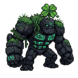
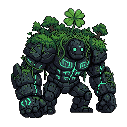
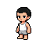
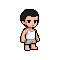
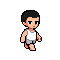
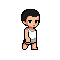
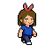
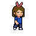

# 크리처·아바타 그래픽 리소스 확보

* **작성일자:** 2026-11-03
---

## 1. 검증 목적
- 횡스크롤 게임에 최적화된 크리처 및 아바타 그래픽 리소스 규격 정립.
- 프론트엔드(Vanilla JS + Vite)와 백엔드(Spring) 환경에서 즉시 구현 가능한 기술적 타당성 검증.
- 다중 캐릭터 겹침 시 가독성 확보 및 렌더링 우선순위(Z-Index) 로직 확립.

---

## 2. 검증 환경 및 방법

### 2.1 검증 도구 및 환경
- **AI 생성 및 편집 툴:** PixelLab (Free Plan 및 사이트 내 기본 편집 기능)
- **기반 모델 라이선스:** CreativeML Open RAIL-M (Stable Diffusion 계열)
- **검증 대상:**
    - 크리처 리소스 (1~5단계 성장 규격)
    - 아바타 리소스 ($60 \times 60\text{ px}$ 통일 규격 및 걷기 모션)
    - 아바타 꾸미기 아이템 레이어 구조 및 위치 정렬 기준

### 2.2 검증 프로세스
1. **크리처 중심 기준점 설정 (3단계 샘플링):**
    - 성장 과정의 중간 단계인 **3단계 크리처 이미지**를 먼저 생성하여 기준 샘플(Master Reference)로 지정.
    - 3단계 샘플의 콘셉트를 바탕으로 1~2단계(소형) 및 4~5단계(대형) 이미지의 시각적 통일성을 유지하며 확장.
2. **아바타 및 모션 리소스 수급:**
    - $60 \times 60\text{ px}$ 규격으로 아바타 캐릭터 크기 통일.
    - PixelLab의 기본 애니메이션 기능(8프레임 걷기 모션)을 활용하되, 한쪽 방향 움직임을 먼저 완성한 뒤 사이트 내 좌우 반전(Flip) 기능을 이용해 반대쪽 방향 모션을 효율적으로 완성.
    - 실제 개발 난이도와 리소스 용량을 낮추기 위해 생성된 8프레임 중 방향별 2프레임씩만 선별하여 활용.
3. **아이템 레이어 및 바닥 정렬 기준 수립:**
    - $60 \times 60\text{ px}$ 캔버스 내 하단에서 $10\text{ px}$ 지점을 아바타가 딛는 바닥(Feet Ground Line)의 기준 위치로 설정.
    - 얼굴 파츠 및 머리/몸통/아이템의 정렬 기준점을 바닥 선에 맞춰 표준화.
4. **다중 아바타 가독성 및 겹침 문제 검토:**
    - 횡스크롤 필드 구역 분할(10개 Zone) 및 부분적 겹침 허용 방식 설계.
    - Z-Index 우선순위 규칙 및 프론트엔드 구현 가능성 검토 완료.

---

## 3. 검증 결과 및 샘플 이미지

### 3.1 리소스 확보 방법 비교 결과

| 구분 | AI 생성 및 웹 편집 (PixelLab Free Plan) | 별도 픽셀 편집 툴 (Aseprite 등) | 외주 / 패키지 구매 |
| :--- | :--- | :--- | :--- |
| **생성 및 편집 속도** | **매우 빠름** (생성 + 사이트 내 좌우 반전 편집) | 느림 (별도 프로그램 이관 및 수작업 필요) | 보통 (외부 스케줄링 필요) |
| **디자인 통일성** | **보통~높음** (3단계 기준 샘플 활용으로 극복) | 매우 높음 | 높음 |
| **비용** | **무료** (Free Plan 및 내장 기능 활용) | 개발자 공수/툴 구매 비용 발생 | 유료 비용 발생 |
| **종합 평가** | **최종 채택** (외부 툴 없이 PixelLab 웹 내 처리) | 사용 안 함 (사이트 기본 기능으로 대체) | 제외 |

### 3.2 성공 및 시행착오 사례

#### 🟢 성공 사례: 3단계 기준 샘플을 통한 크리처 통일성 및 단계별 규격 표준화
- **3단계 기준 샘플링:** 3단계 이미지를 먼저 확정한 후 이를 기준으로 1~5단계 전체의 비주얼 일관성을 확보함.
- **성장 단계별 규격:**
    - **1단계:** $64 \times 64\text{ px}$
    - **2단계:** $64 \times 64\text{ px}$
    - **3단계 (기준 샘플):** $64 \times 64\text{ px}$
    - **4단계:** $128 \times 128\text{ px}$
    - **5단계:** $256 \times 256\text{ px}$

#### 🟢 성공 사례: 아바타 규격 통일 ($60\text{px}$) 및 바닥 기준선·아이템 레이어 정립
- **아바타 규격 및 바닥 기준:** $60 \times 60\text{ px}$ 캔버스로 통일하고, **하단에서 $10\text{ px}$ 높이**를 아바타가 딛는 바닥(Ground Line) 피벗으로 명확히 지정하여 모션 전환 시 흔들림 방지.
- **꾸미기 아이템 레이어 구조 (얼굴 파츠 포함):**
    1. `Layer 0 (Base)`: 기본 캐릭터 바디
    2. `Layer 1 (Face Parts)`: 얼굴 파츠 (눈/입/표정 등)
    3. `Layer 2 (Clothes)`: 의상 (상의/하의/한벌옷 등)
    4. `Layer 3 (Head/Hat)`: 머리장식/모자 (머리띠, 모자 등)
    5. `Layer 4 (Accessory)`: 손/외곽 아이템
- **모션 및 반전 활용:** 한쪽 방향 걷기 모션을 완성한 후 PixelLab의 **좌우 반전(Flip)** 기능으로 반대 방향 모션 제작 공수 절감. 방향별 **2프레임**만 선별 추출하여 구현 최적화.

#### 🔴 시행착오 사례: 아바타 프롬프트 미반영
- **원인:** 초기 아바타 생성 시 프롬프트만으로 원하는 디테일을 구현하려 했으나 의도한 디자인이 반영되지 않아 여러 차례 시행착오 발생.
- **조치:** PixelLab 내 기본 웹 편집 기능을 이용해 수작업으로 직접 디테일을 수정·보정함.

### 3.3 검증용 크리처 및 아바타 샘플 이미지

> **[참고사항]** 본 검증 단계에서 확보한 샘플 이미지는 기술적 가능성 검증 및 리소스 표준(규격, 비율, 픽셀 감성)을 확립하기 위한 목적입니다. 정식 구현 전 일관된 화풍과 품질을 위한 디테일 정제(Polish) 작업이 진행될 예정입니다.

#### ① 크리처 샘플 이미지 (1~5단계)

| 성장 단계 | 해상도 | 샘플 이미지 |
| :---: | :---: | :---: | 
| **1단계 (알)** | $64 \times 64\text{ px}$ |  | 
| **2단계 (유아기)** | $64 \times 64\text{ px}$ |  | 
| **3단계 (기준 샘플)** | $64 \times 64\text{ px}$ |  | 
| **4단계 (성장기)** | $128 \times 128\text{ px}$ |  | 
| **5단계 (완성체)** | $256 \times 256\text{ px}$ |  | 

#### ② 아바타 샘플 이미지 및 상태별 예시 ($60 \times 60\text{ px}$)

| 상태 / 구분 | 해상도 | 샘플 이미지 | 설명                                               |
| :--- | :---: | :---: |:---------------------------------------------------|
| **기본 대기 (좌)** | $60 \times 60\text{ px}$ |  | 기본 바디 상태의 좌측 대기(Idle) 이미지            |
| **기본 대기 (우)** | $60 \times 60\text{ px}$ |  | 기본 바디 상태의 우측 대기(Idle) 이미지            |
| **이동 프레임 1 (기본)** | $60 \times 60\text{ px}$ |  | 기본 바디 상태의 보행(Walk) 프레임 #1              |
| **이동 프레임 2 (기본)** | $60 \times 60\text{ px}$ |  | 기본 바디 상태의 보행(Walk) 프레임 #2              |
| **이동 프레임 1 (파츠 장착)** | $60 \times 60\text{ px}$ |  | 장식, 헤어, 얼굴, 의상 파츠 합성 후 보행 프레임 #1 |
| **이동 프레임 2 (파츠 장착)** | $60 \times 60\text{ px}$ |  | 장식, 헤어, 얼굴, 의상 파츠 합성 후 보행 프레임 #2 |

---

## 4. 필드 배치 및 겹침 처리 규칙 (Z-Index Hierarchy)

### 4.1 구역(Zone) 설계
- 횡스크롤 필드를 **10개 구역 (Zone 1 ~ Zone 10)**으로 분할.
- 구역당 최대 2~3명으로 제한하여 전체 20명의 아바타가 필드에 자연스럽게 분산되도록 유도.
- 구역 내 이동 및 대기 시 캐릭터 간 부분적 겹침 허용.

### 4.2 화면 렌더링 우선순위 (Z-Index Hierarchy)

| 순위 | 조건 (State / Event) | 설명 및 처리 기준 |
| :--- | :--- | :--- |
| **1순위 (최상단)** | **내 아바타 (Local Player)** | 플레이어 자신이 조작 중인 아바타는 상시 최상단에 배치. |
| **2순위** | **이동 중인 아바타 (`State: Walk`)** | 움직임의 가독성을 위해 멈춰 있는 아바타보다 위에 배치. |
| **3순위** | **멈춰 있는 아바타 (`State: Idle`)** | 가만히 대기 중인 아바타 그룹. |

### 4.3 상태별 세부 우선순위 규칙 (Tie-breaker)
- **① 이동 중인 아바타들 (`State: Walk`)끼리 겹칠 때:**
    - **고유 ID 기반 고정 정렬 (Stable ID Sort):** 이동 중 캐릭터들끼리는 위치나 상호작용 여부와 관계없이, 서버에 먼저 입장했거나 고유 ID(Index)가 빠른 아바타를 항상 앞에 렌더링하도록 고정 (Z-fighting 원천 차단 및 연산 부하 최소화).
- **② 멈춰 있는 아바타들 (`State: Idle`)끼리 겹칠 때:**
    - **최근 상호작용(Recency) 순서:** 가장 최근에 상호작용(클릭, 채팅, 이모트 표현, 아이템 사용 등)이 발생한 아바타를 상위에 렌더링.

### 4.4 시각적 가독성 보완
- **진한 외곽선(Dark Outline):** 캐릭터 자체에 진한 테두리가 적용되어 있어, 겹침이 발생하더라도 별도의 반투명(Alpha Blending) 처리 없이 캐릭터 간 형체와 경계가 명확하게 유지됨.

---

## 5. 기술 구현 타당성 검토 및 이미지 출처

### 5.1 기술 구현 타당성 (Spring + Vanilla JS/Vite)
- **백엔드 (Spring Boot):** 10개 구역(Zone)별 정원(2~3명) 관리 및 아바타 고유 ID(Stable ID)와 상태 데이터를 안전하게 동기화.
- **프론트엔드 (Vanilla JS + Vite):** DOM 또는 HTML5 Canvas 렌더링 루프에서 `state`, `isLocalPlayer`, `stableId`, `timestamp` 기반 정렬 로직을 가볍고 빠르게 처리 가능.
- **결론:** 구현 난이도가 낮고 연산 효율이 뛰어나므로 현재 스택으로 즉시 구현 가능.

### 5.2 이미지 출처 및 라이선스·사용 조건

#### 1) 서비스 이용약관 (PixelLab Terms of Service)
- **출처:** [PixelLab Terms of Service](https://www.pixellab.ai/termsofservice)
- **소유권 및 저작권:** 사용자가 입력한 프롬프트 및 이를 통해 생성/편집된 최종 파생물(Generated Assets)에 대한 권리는 기본적으로 사용자에게 귀속됨.
- **사용 조건:** 생성된 리소스가 타인의 지식재산권을 침해하지 않도록 준수할 책임은 사용자에게 있음.

#### 2) 오픈소스 AI 라이선스 (CreativeML Open RAIL-M License)
- **출처:** [Stable Diffusion LICENSE](https://github.com/CompVis/stable-diffusion/blob/main/LICENSE)
- **사용 범위:** 상업적·비상업적 재배포 및 게임 프로젝트 적용 가능.

#### 3) 프로젝트 적용 기준
- **권장 포맷:** `.png` (투명 배경 필히 적용)
- **결론:** 무료 플랜 환경 및 웹 내 편집 기능을 통해 제작된 리소스는 라이선스 조건 내에서 안전하게 활용 가능함.

---

## 6. 실제 구현 시 참고사항

1. **아바타 렌더링 및 바닥 정렬 기준:**
    - 아바타 이미지 전체 크기는 $60 \times 60\text{ px}$.
    - 바닥 착지점(Ground Pivot Point): 이미지 하단에서 $10\text{ px}$ 위 ($y = 50\text{ px}$).
2. **다중 캐릭터 겹침 처리:**
    - 10개 Zone 분할 및 Z-Index 계층 구조(내 아바타 ➔ 이동(ID순) ➔ 대기(최근 상호작용순))를 프론트엔드 렌더링 로직에 반영.
3. **픽셀 렌더링 옵션:**
   ```css
   img, canvas {
     image-rendering: pixelated;
   }
   ```
4. **에셋 파일 저장 및 명명 규칙:**
   ```text
   docs/
   ├── images/
   │   └── sample/
   │       ├── sample_creature_lv1.png
   │       ├── sample_creature_lv2.png
   │       ├── sample_creature_lv3.png
   │       ├── sample_creature_lv4.png
   │       ├── sample_creature_lv5.png
   │       ├── sample_avatar_left_stop.png
   │       ├── sample_avatar_right_stop.png
   │       ├── sample_avatar_right_1.png
   │       ├── sample_avatar_right_2.png
   │       ├── sample_avatar_right_item_1.png
   │       └── sample_avatar_right_item_2.png
   └── spikes/
       └── asset-sourcing.md
   ```