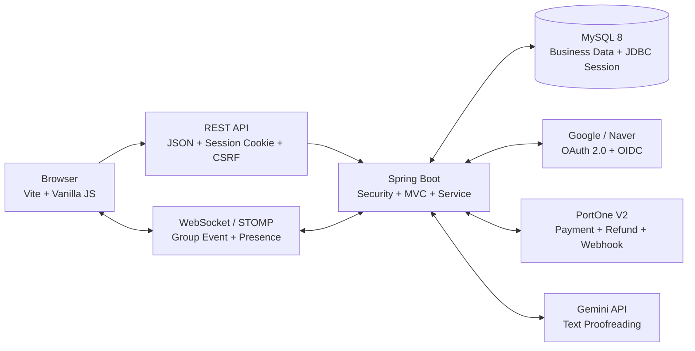
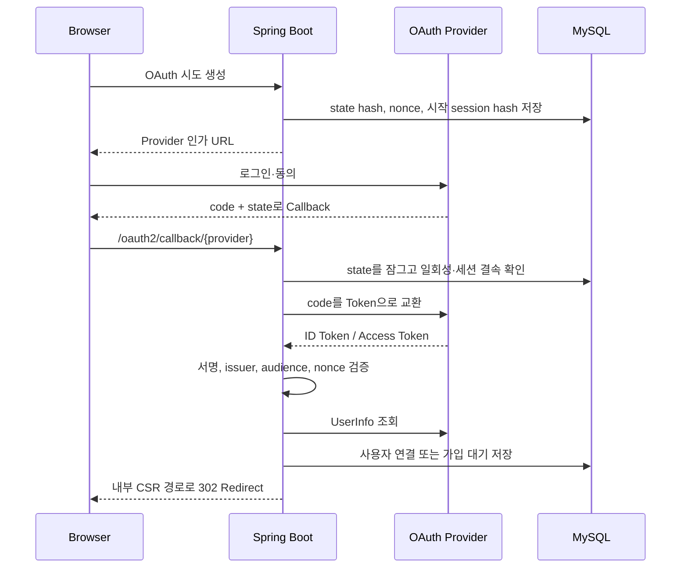
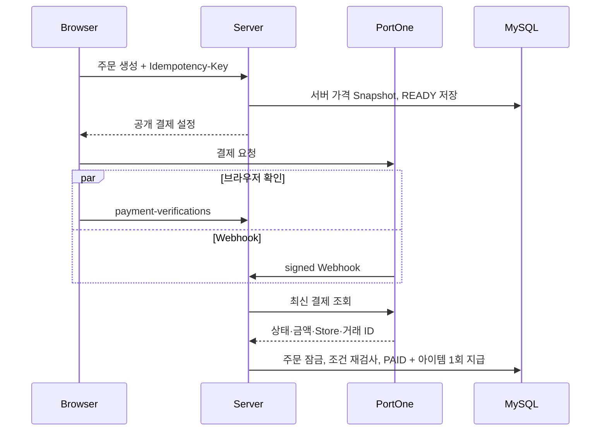

# 기술 스택 및 아키텍처 설계·구현 해설

이 문서는 프로젝트에 사용한 기술을 나열하는 대신, **어떤 문제를 해결하려고 선택했는지**, **요청이 실제로 어느 계층을 지나가는지**, **동시 요청이나 외부 장애가 발생하면 어떻게 일관성을 지키는지**를 설명합니다. 기술을 처음 접하는 팀원은 각 절의 “핵심 개념 → 프로젝트 적용 → 주의사항 → 예상 질문” 순서로 읽으면 됩니다.

설명 근거는 두 종류입니다.

- **코드 근거:** 현재 저장소에서 클래스·설정·테스트로 확인한 내용입니다.
- **확정 설계:** 기능 이슈와 `requirements.md`, `business-rules.md`, `api-design.md`, `class-diagram.md`에 확정된 최종 구조입니다. 통합 전 영역은 발표·배포 전에 코드와 테스트 결과를 다시 대조해야 합니다.

## 1. 전체 아키텍처와 기술 선택 개요

브라우저는 Vite로 개발·빌드하는 Vanilla JavaScript CSR 애플리케이션입니다. 화면 전환은 History API 기반 Router가 담당하며, 서버 화면을 다시 렌더링하는 대신 REST API로 JSON을 받아 DOM을 갱신합니다. 로그인 상태는 브라우저에 JWT를 저장하는 방식이 아니라, Spring Session JDBC가 MySQL에 보관하는 서버 세션으로 유지합니다.

Spring Boot 서버는 인증·인가, 업무 규칙, 트랜잭션, 외부 API 연동을 책임집니다. MySQL의 행 잠금과 UNIQUE 제약은 여러 요청이 동시에 들어와도 하나의 결과만 확정되게 하는 마지막 방어선입니다. WebSocket/STOMP는 DB에서 확정된 결과를 같은 그룹에 빠르게 알리는 통로이며, 소켓 메시지 자체를 최종 데이터로 간주하지 않습니다.



### 1.1 주요 기술과 선택 이유

| 영역 | 선택 | 해결하려는 문제 | 핵심 비용·제약 |
|---|---|---|---|
| 서버 | Java 21, Spring Boot 4.1.1 | REST, 보안, JPA, 검증, Scheduler를 한 생태계에서 구성 | 프레임워크 규칙과 트랜잭션 경계를 학습해야 함 |
| 화면 | Vite 7, Vanilla JS, Bootstrap 5 | 별도 프레임워크 없이 SPA 구조와 ES Modules 학습 | 상태·생명주기·Router를 직접 관리 |
| DB | MySQL 8, Spring Data JPA | 관계형 업무 데이터, 트랜잭션, 락과 제약 | JPA와 실제 SQL·잠금 동작을 함께 이해해야 함 |
| 인증 | Spring Security, Spring Session JDBC | 중앙화된 인증·역할 인가와 재시작에도 유지되는 세션 | 세션 저장소와 CSRF를 운영해야 함 |
| 실시간 | WebSocket, STOMP | 같은 그룹의 상태 변화를 낮은 지연으로 공유 | 재연결·중복·순서 누락·권한 검사가 필요 |
| 결제 | PortOne V2 | 카카오페이 테스트 결제, 조회, 취소, Webhook | 외부 상태와 내부 DB가 한 트랜잭션이 아님 |
| AI | Gemini API | 사용자가 입력한 그룹 소개의 선택적 교정 | 비용·Timeout·비결정적 응답·개인정보 주의 |
| 사진 | Metadata Extractor | 픽셀 디코딩 없이 JPEG GPS·촬영 시각 추출 | EXIF가 없거나 조작될 수 있어 검증 범위가 제한됨 |

### 1.2 한 요청을 읽는 공통 관점

예를 들어 퀘스트 완료 요청은 다음 순서로 이해할 수 있습니다.

1. 브라우저의 공통 Fetch Client가 세션 Cookie와 CSRF Token을 포함해 REST 요청을 보냅니다.
2. Spring Security가 인증과 역할을 검사합니다.
3. Controller가 JSON·경로·파일 입력을 DTO로 받고 Bean Validation을 수행합니다.
4. Service가 사용자, 그룹, 시즌, 배정의 관계를 다시 검사합니다.
5. Repository가 필요한 행을 정해진 순서로 잠그고 JPA Entity를 변경합니다.
6. DB Commit과 UNIQUE 제약이 결과를 확정합니다.
7. Commit 이후 WebSocket 이벤트를 발행합니다.
8. 다른 브라우저는 이벤트를 갱신 신호로 사용하고, 누락이 의심되면 REST Snapshot을 다시 조회합니다.

이 구조에서 REST는 **명령과 조회**, DB는 **확정 상태**, WebSocket은 **확정 결과의 빠른 전달**을 담당합니다.

## 2. 프론트엔드: Vite, Vanilla JavaScript, CSR/SPA

### 2.1 CSR과 SPA의 의미

SSR(Server-Side Rendering)은 요청마다 서버가 완성된 HTML을 만들어 반환합니다. CSR(Client-Side Rendering)은 최초 HTML 이후 브라우저 JavaScript가 API 데이터를 받아 화면을 구성합니다. SPA는 페이지 이동 때 전체 문서를 새로 받지 않고 현재 문서 안에서 화면을 교체하는 애플리케이션 구조입니다.

이 프로젝트는 `frontend/src/app/router.js`에서 `history.pushState`, `popstate`와 Route 표를 사용합니다. 각 Page 함수는 DOM Element와 선택적 `cleanup()`을 반환합니다. Router는 다음 화면을 mount하기 전에 기존 cleanup을 실행하므로 WebSocket 구독, Timer, 이벤트 Listener가 화면 이동 때 누적되지 않게 할 수 있습니다.

```text
URL 변경
  → Route 검색
  → /api/v1/me로 인증·가입·그룹 상태 확인
  → 접근 조건에 따라 Redirect 또는 Page mount
  → 이전 Page의 cleanup 실행
```

브라우저의 화면 접근 검사는 사용자 경험을 위한 1차 가드입니다. 개발자 도구로 JavaScript를 우회할 수 있으므로 실제 보안은 반드시 Spring Security와 Service의 소유권 검사에서 다시 수행합니다.

### 2.2 ES Modules와 화면 책임 분리

`type: module`을 사용해 `import`/`export`로 파일 책임을 나눕니다.

- `app/`: Router와 애플리케이션 시작점
- `pages/`: 화면 DOM, 이벤트 등록, cleanup
- `features/*/api.js`: 기능별 API 호출
- `api/client.js`: Cookie·CSRF·공통 Envelope·오류 변환
- `realtime/`: STOMP 연결과 Snapshot 동기화
- `styles/theme.css`: 공통 색상과 반응형 테마

React처럼 Component 상태와 생명주기를 제공하는 라이브러리가 없으므로, Page가 등록한 Listener·Timer·소켓 구독을 직접 정리해야 합니다. 대신 DOM과 브라우저 API의 동작을 가볍고 직접적으로 학습할 수 있습니다.

### 2.3 공통 Fetch Client

`frontend/src/api/client.js`는 다음 책임을 한곳에 둡니다.

- `credentials: 'include'`로 세션 Cookie 전송
- 상태 변경 요청에 `X-CSRF-TOKEN` 추가
- JSON과 Multipart Body 구분
- `{ "data": ..., "meta": ... }` Envelope 해제
- 서버 오류를 `ApiError(status, code, fieldErrors, traceId)`로 변환
- `CSRF_INVALID`이면 Token을 비우고 한 번만 재발급·재시도

재시도를 무제한으로 하지 않는 이유는 잘못된 설정이나 만료 상태에서 요청이 반복되는 것을 막기 위해서입니다. 결제 같은 업무 명령의 재시도 안전성은 Fetch Client가 아니라 서버의 `Idempotency-Key` 계약이 보장합니다.

### 2.4 Vite Proxy와 Mock API

개발 서버는 `/api`, `/oauth2`, `/ws`를 `localhost:8080`으로 Proxy합니다. 브라우저는 같은 `localhost:5173` Origin에 요청하는 것처럼 사용하므로 개발 중 경로를 단순하게 유지할 수 있습니다. WebSocket 경로는 `ws: true`가 필요합니다.

Mock API는 백엔드가 준비되지 않았을 때 화면 계약을 확인하는 도구입니다. Production Build에서는 Mock을 켤 수 없게 하여 가짜 응답이 배포 결과에 섞이지 않도록 합니다. Mock 성공은 실제 인증·DB·동시성 검증 성공을 의미하지 않습니다.

#### 실제 코드: History API로 화면 이동하기

다음은 `frontend/src/app/router.js`에서 사용하는 실제 코드의 핵심 부분입니다.

```javascript
function navigate(path) {
  history.pushState({}, '', path);
  void render();
}

function replace(path) {
  history.replaceState({}, '', path);
  void render();
}

window.addEventListener('popstate', render);
```

`pushState`는 새 이동 기록을 남기므로 브라우저 뒤로 가기가 가능하고, `replaceState`는 로그인 상태에 따른 자동 이동처럼 현재 기록을 바꿀 때 사용합니다. 두 함수 모두 서버에서 새 HTML을 받지 않고 `render()`를 호출해 현재 URL에 맞는 Page만 다시 mount합니다. `popstate`는 사용자가 뒤로·앞으로 버튼을 눌렀을 때 URL과 화면을 다시 맞춥니다.

#### 실제 코드: 세션 Cookie와 CSRF를 포함한 Fetch

다음은 `frontend/src/api/client.js`의 공통 요청 코드입니다.

```javascript
if (!['GET', 'HEAD', 'OPTIONS'].includes(method)) {
  headers.set('X-CSRF-TOKEN', await getCsrfToken());
}

const response = await fetch(path, {
  method,
  headers,
  body,
  credentials: 'include',
});

if (!response.ok && allowCsrfRetry && payload?.code === 'CSRF_INVALID') {
  clearCsrfToken();
  return executeRequest(path, options, false, includeMeta);
}
```

`credentials: 'include'`가 있어야 브라우저가 세션 Cookie를 보냅니다. GET처럼 상태를 읽는 요청을 제외한 변경 요청에는 CSRF Header를 추가합니다. Token이 만료되었을 때는 새 Token을 받아 **한 번만** 다시 시도합니다. 재귀 호출의 세 번째 인자를 `false`로 바꾸므로 계속 실패해도 무한 반복하지 않습니다.

#### 실제 코드: Vite의 REST·OAuth·WebSocket Proxy

```javascript
proxy: {
  '/api': 'http://localhost:8080',
  '/oauth2': 'http://localhost:8080',
  '/ws': {
    target: 'ws://localhost:8080',
    ws: true,
  },
}
```

브라우저 코드는 백엔드 주소를 하드코딩하지 않고 `/api`처럼 상대 경로를 사용합니다. Vite가 개발 중에만 이를 8080 포트로 전달합니다. `/ws`는 HTTP 요청과 달리 연결을 Upgrade해야 하므로 `ws: true`가 필요합니다.

### 2.5 `spring_blog`와의 전환

비교 기준은 `spring_blog` 저장소 `main`의 `b83b0662d8c753f3e0404b05b62b3ec07bc53af9`입니다.

| 수업 예제 | 이 프로젝트 | 변경 이유 |
|---|---|---|
| Mustache Template을 Controller가 반환 | Vite + Vanilla JS Page가 DOM 구성 | 화면과 REST 서버를 분리하고 SPA 이동을 구현 |
| `Model`에 데이터를 넣어 HTML 렌더링 | Fetch로 JSON Envelope 조회 | 동일 API를 여러 화면·클라이언트에서 재사용 |
| Form Submit 후 Redirect | 비동기 REST 후 필요한 DOM만 갱신 | 로딩·오류·재시도를 화면에서 세밀하게 표현 |
| 서버 경로가 화면 경로와 결합 | `/api/v1`와 CSR Route 분리 | API 계약과 화면 구성을 독립적으로 변경 |

### 2.6 예상 질문

**Q. React 대신 Vanilla JavaScript를 선택한 이유는 무엇인가요?**  
A. 제한된 MVP 범위에서 새 프레임워크 의존성을 늘리지 않고 DOM, History API, Fetch, ES Modules를 직접 학습하기 위해서입니다. 대신 상태 관리와 cleanup을 직접 구현해야 하는 비용이 있습니다.

**Q. 프론트 Router의 권한 검사만으로 충분한가요?**  
A. 아닙니다. 프론트 검사는 잘못된 화면 진입을 줄이는 UX 장치입니다. 실제 권한은 Spring Security와 Service의 리소스 소유권 검사에서 강제합니다.

**Q. 화면을 이동할 때 cleanup이 왜 필요한가요?**  
A. 이전 화면의 Timer나 WebSocket 구독이 남으면 같은 이벤트를 여러 번 처리하고 메모리도 누적됩니다. 새 Page를 mount하기 전에 구독·Listener·Timer를 해제해야 합니다.

## 3. 인증·인가: Spring Security, Session JDBC, OAuth 2.0/OIDC

### 3.1 인증과 인가의 차이

- **인증(Authentication):** “누구인가?”를 확인합니다.
- **인가(Authorization):** 인증된 사용자가 “이 작업을 할 수 있는가?”를 확인합니다.

`SecurityConfiguration`은 공개, 인증 사용자, 그룹 역할, 전체 관리자 경로를 선언합니다. `SessionAuthenticationFilter`는 Spring Session에 저장한 `LoginUser`를 읽고 DB의 현재 사용자·멤버십 역할을 확인한 뒤 `SecurityContext`의 인증 객체를 복원합니다. 세션에 오래된 역할이 남아 있더라도 현재 DB 권한을 기준으로 판단하는 구조입니다.

### 3.2 서버 세션과 Spring Session JDBC

로그인 성공 시 서버는 세션에 최소 인증 정보를 저장하고 브라우저는 세션 ID Cookie만 보냅니다. `spring-session-jdbc`는 세션과 속성을 `spring_session`, `spring_session_attributes` 테이블에 저장합니다.

장점은 서버가 재시작돼도 유효한 세션을 DB에서 복원할 수 있고, 여러 서버 인스턴스로 확장할 때 동일 DB를 공유할 수 있다는 점입니다. 비용은 모든 인증 요청에 세션 저장소 접근이 추가되고, 만료 세션 정리와 DB 가용성이 로그인 상태에 영향을 준다는 점입니다.

이 방식은 JWT 무상태 인증이 아닙니다. Google OIDC의 **ID Token은 외부 공급자가 사용자의 신원을 증명하는 서명된 Token**이고, 우리 서비스의 로그인 상태는 검증 후 생성한 **서버 세션**으로 유지합니다.

### 3.3 OAuth 2.0 Authorization Code와 OIDC

OAuth 2.0은 다른 서비스의 권한을 위임하는 표준이고, OIDC는 OAuth 2.0 위에 사용자 신원 확인을 추가합니다. 프로젝트의 흐름은 다음과 같습니다.



`state`는 Callback 요청이 내가 시작한 로그인인지 확인해 OAuth CSRF를 막습니다. `nonce`는 받은 ID Token이 해당 로그인 시도에 발급된 것인지 확인해 재사용을 막습니다. 시작 세션 Hash까지 묶는 이유는 다른 브라우저나 탈취된 Callback이 로그인 시도를 소비하지 못하게 하기 위해서입니다.

Google Adapter는 Authorization Code 교환, JWK 기반 ID Token 서명, issuer·audience·nonce와 UserInfo를 검증합니다. 공급자 Access Token과 ID Token은 브라우저나 업무 DB에 영구 저장하지 않습니다. Naver는 OIDC ID Token이 아니라 공급자 API 응답 규칙에 맞춘 별도 Adapter 경계로 취급합니다.

### 3.4 CSRF, CORS, 세션 고정 방지

- **CSRF:** 공격 사이트가 사용자의 Cookie를 이용해 상태 변경 요청을 보내는 공격입니다. 상태 변경 REST에는 세션에 묶인 `X-CSRF-TOKEN`이 필요합니다.
- **CORS:** 브라우저가 허용되지 않은 Origin에서 응답을 읽지 못하게 하는 정책입니다. 로컬 Vite Origin과 명시한 ngrok Origin만 Cookie 포함 요청을 허용합니다.
- **Session Fixation:** 로그인 전 공격자가 알던 세션 ID를 로그인 후에도 쓰는 공격입니다. 인증 경계에서 세션 ID를 변경합니다.

PortOne Webhook은 브라우저 세션이 없으므로 CSRF 예외입니다. 대신 Webhook 전용 서명 검증이 인증 경계가 됩니다.

#### 실제 코드: SecurityFilterChain에 권한 규칙 모으기

`SecurityConfiguration`의 일부입니다.

```java
var csrfRepository = new HttpSessionCsrfTokenRepository();
csrfRepository.setHeaderName("X-CSRF-TOKEN");

http
    .csrf(csrf -> csrf
        .csrfTokenRepository(csrfRepository)
        .ignoringRequestMatchers(
            "/oauth2/callback/**",
            "/api/v1/payments/webhooks/portone"
        ))
    .sessionManagement(session -> session
        .sessionCreationPolicy(SessionCreationPolicy.IF_REQUIRED)
        .sessionFixation(fixation -> fixation.changeSessionId()))
    .authorizeHttpRequests(authorize -> authorize
        .requestMatchers("/api/v1/admin/**").hasRole("SUPER_ADMIN")
        .requestMatchers("/api/v1/groups/me/**")
            .hasAnyRole("PRIMARY", "DEPUTY", "MEMBER")
        .requestMatchers("/api/v1/**").authenticated());
```

위 코드는 세 가지를 한곳에서 보여 줍니다.

1. CSRF Token을 HTTP Session에 저장하고 Header 이름을 프론트와 맞춥니다.
2. 브라우저 세션이 없는 OAuth Callback과 서명 기반 Webhook만 CSRF 예외로 둡니다.
3. 더 구체적인 관리자·그룹 경로 규칙을 먼저 쓰고, 마지막에 나머지 API는 로그인 사용자만 허용합니다.

`changeSessionId()`는 로그인 전후의 세션 ID를 바꿔 Session Fixation을 방어합니다. 실제 Callback과 회원가입 완료 시점에도 `request.changeSessionId()`를 호출합니다.

#### 실제 설정: Spring Session JDBC

`src/main/resources/application.yaml`의 실제 설정입니다.

```yaml
spring:
  session:
    store-type: jdbc
    timeout: 7d
    jdbc:
      initialize-schema: never
```

`store-type: jdbc`는 세션을 애플리케이션 메모리가 아니라 DB에 저장합니다. `initialize-schema: never`인 이유는 애플리케이션이 임의로 Session Table을 만들게 하지 않고 `db/special-schema.sql`에서 팀이 확인한 DDL로 관리하기 위해서입니다.

#### 실제 코드: OAuth 외부 호출과 DB 트랜잭션 분리

`AuthService.handleCallback()`의 핵심입니다.

```java
public String handleCallback(String state, String code, HttpSession session) {
    Instant now = Instant.now(clock);
    String stateHash = Hashing.sha256(state);
    String sessionHash = Hashing.sha256(session.getId());

    transactionTemplate.executeWithoutResult(
            status -> validateAttempt(stateHash, sessionHash, now));

    String nonce = (String) session.getAttribute(OAUTH_NONCE);
    SocialLoginClient.SocialProfile profile =
            socialLoginClient.exchange(code, nonce);

    return transactionTemplate.execute(
            status -> completeCallback(
                    stateHash, sessionHash, profile, session, now));
}
```

첫 트랜잭션은 `state`와 시작 세션을 짧게 확인합니다. 그 뒤 Google과 통신하는 동안에는 DB 트랜잭션을 열어 두지 않습니다. 응답을 받은 다음 새 트랜잭션에서 같은 OAuth 시도를 `PESSIMISTIC_WRITE`로 잠그고 다시 검사한 뒤 일회성으로 소비합니다. 외부 통신 전 검사만 믿지 않고 마지막 Commit 직전에 재검사하는 것이 핵심입니다.

### 3.5 `spring_blog`와의 전환

| 수업 예제 | 이 프로젝트 | 차이의 의미 |
|---|---|---|
| `LoginInterceptor`가 세션 속성 존재 검사 | Security Filter Chain이 경로별 인증·역할 규칙 적용 | 보안 규칙을 중앙에서 선언하고 401/403을 일관되게 처리 |
| `AdminInterceptor`가 `isAdmin()` 직접 검사 | `ROLE_SUPER_ADMIN`, 그룹 역할 기반 인가 | 전체 관리자와 그룹 역할의 권한 경계를 분리 |
| Servlet 기본 `HttpSession` | Spring Session JDBC | 재시작·다중 인스턴스에서도 세션 저장소 공유 가능 |
| OAuth Callback에서 바로 자동 가입·로그인 | 공급자 검증 후 가입 대기와 닉네임 확정 분리 | 외부 계정 확인과 내부 회원 생성 시점을 분리 |
| 세션에 OAuth `state` 문자열 저장 | state hash·nonce·시작 세션 결속·일회성 DB 소비 | Callback 탈취·재사용·세션 혼선을 더 엄격히 방어 |

### 3.6 예상 질문

**Q. Spring Security를 쓰는데 왜 세션도 필요한가요?**  
A. Spring Security는 인증·인가 처리 틀이고, 세션은 로그인 상태를 요청 사이에 유지하는 방법입니다. 이 프로젝트는 Security가 JDBC 세션의 인증 정보를 복원하는 상태 기반 구조입니다.

**Q. OIDC ID Token과 서비스 JWT는 무엇이 다른가요?**  
A. ID Token은 Google 같은 공급자가 사용자 신원을 증명하기 위해 서버에 전달합니다. 우리 서비스는 이를 검증한 뒤 자체 JWT를 발급하지 않고 서버 세션을 만듭니다.

**Q. CSRF와 CORS 중 하나만 설정하면 되나요?**  
A. 아닙니다. CORS는 브라우저의 교차 Origin 응답 접근을 제한하고, CSRF는 Cookie가 자동 전송되는 특성을 이용한 상태 변경을 막습니다. 해결하는 위협이 다릅니다.

## 4. 실시간 통신: WebSocket, STOMP, Presence

### 4.1 REST와 WebSocket의 역할 분리

WebSocket은 하나의 연결을 유지하며 서버와 브라우저가 양방향으로 메시지를 보낼 수 있게 합니다. STOMP는 그 위에서 `CONNECT`, `SUBSCRIBE`, `SEND` 같은 명령과 Destination 형식을 제공하는 메시징 규약입니다.

이 프로젝트는 업무 명령을 REST로만 받고, `/ws` STOMP 연결과 `/topic/groups/{groupId}/live` 구독은 서버가 확정한 결과를 전달하는 데 사용합니다. 클라이언트 `SEND`를 거부하는 이유는 소켓과 REST에 두 개의 명령 경로를 만들지 않기 위해서입니다.

### 4.2 연결과 권한 검사

STOMP 인바운드의 기본 정책은 거부입니다.

- `CONNECT`: 인증 세션, 허용 Origin, CSRF 검증
- `SUBSCRIBE`: 현재 사용자의 활성 그룹과 Destination의 `groupId` 일치 확인
- `UNSUBSCRIBE`: 현재 연결이 만든 구독만 허용
- `DISCONNECT`: 정상 연결 정리
- `SEND`, `MESSAGE`, 그 밖의 명령: 거부

단순히 화면에서 다른 그룹 Topic을 만들지 않는 것으로는 보안이 되지 않습니다. 공격자는 STOMP Frame을 직접 보낼 수 있으므로 서버 ChannelInterceptor가 Destination을 검사해야 합니다.

### 4.3 Commit 이후 이벤트

트랜잭션 도중 이벤트를 먼저 보내면 DB Rollback 뒤에도 다른 화면에는 성공처럼 보일 수 있습니다. 따라서 `@TransactionalEventListener(phase = AFTER_COMMIT)` 또는 동등한 Commit 이후 경계를 사용합니다.

```text
REST 명령 → DB 변경 → Commit 성공 → 그룹 Event 발행
                       Rollback → 발행하지 않음
```

이벤트는 `eventId`, 그룹별 증가 `sequence`, 서버 기동을 구분하는 `streamInstanceId`, `occurredAt`, `type`, `payload`를 가집니다. 브라우저는 마지막으로 처리한 식별자를 기억합니다.

### 4.4 중복·누락·서버 재시작 복구

- 같은 `eventId`: 이미 반영한 중복 이벤트이므로 무시
- `sequence`가 예상보다 큼: 중간 이벤트 누락 가능성이 있으므로 REST Snapshot 재조회
- `streamInstanceId` 변경: 서버 재시작이나 Stream 초기화이므로 Snapshot 재조회
- 연결 끊김: 지수 Backoff로 재연결하며 30초 REST Polling으로 보완
- 연결 복구: Snapshot을 한 번 맞춘 뒤 Polling 중단

이 설계가 중요한 이유는 WebSocket이 신뢰 가능한 영구 Queue가 아니기 때문입니다. 브라우저가 잠시 잠들거나 네트워크가 끊기면 이벤트를 놓칠 수 있습니다. 화면의 정답은 언제나 REST Snapshot과 DB입니다.

#### 확정 설계 의사 코드: Commit 뒤 STOMP 발행

아래 코드는 현재 통합 소스의 인용이 아니라 `business-rules.md`와 `class-diagram.md`의 확정 흐름을 Java 형태로 줄인 **설계 의사 코드**입니다. 실제 통합 후 클래스명과 API를 다시 대조해야 합니다.

```java
@Transactional
public void completeQuest(Long assignmentId, Long userId) {
    // 행 잠금, 조건 재검사, 보상과 경험치 반영
    QuestCompleted event = completeAndCreateEvent(assignmentId, userId);
    applicationEventPublisher.publishEvent(event);
}

@TransactionalEventListener(phase = TransactionPhase.AFTER_COMMIT)
public void publish(QuestCompleted event) {
    stompPublisher.publish(
        "/topic/groups/" + event.groupId() + "/live",
        GroupLiveEvent.from(event)
    );
}
```

첫 메서드의 `publishEvent()`는 트랜잭션 중 호출되지만, Listener의 실제 STOMP 발행은 `AFTER_COMMIT`에서만 실행됩니다. Rollback되면 Listener가 발행하지 않으므로 다른 브라우저가 실패한 변경을 성공으로 오해하지 않습니다.

#### 확정 설계 의사 코드: sequence 누락 복구

```javascript
function onGroupEvent(event) {
  if (seenEventIds.has(event.eventId)) return;

  const streamChanged = event.streamInstanceId !== currentStreamInstanceId;
  const sequenceMissing = event.sequence !== lastSequence + 1;

  if (streamChanged || sequenceMissing) {
    void reloadCreatureHomeSnapshot();
    return;
  }

  applyEvent(event);
  seenEventIds.add(event.eventId);
  lastSequence = event.sequence;
}
```

중복은 버리고, 순번이 하나라도 건너뛰거나 서버 Stream이 바뀌면 부분 이벤트를 억지로 적용하지 않고 전체 Snapshot을 다시 받습니다. 이것이 “WebSocket은 힌트, REST Snapshot은 정답”이라는 원칙의 코드 형태입니다.

### 4.5 Presence와 다중 탭

Presence는 사용자가 현재 그룹 화면에 접속했는지 나타냅니다. 연결 하나를 사용자 하나로 계산하면 같은 사용자의 탭 두 개가 아바타 두 개로 보입니다. 서버는 `사용자 + 그룹` 기준 연결 수를 관리하고 다음 규칙을 적용합니다.

1. 첫 연결이 생기면 `PRESENCE_JOINED`를 발행합니다.
2. 추가 탭은 연결 수만 증가시키고 JOIN을 중복 발행하지 않습니다.
3. 한 탭이 닫혀도 다른 연결이 있으면 사용자는 계속 접속 중입니다.
4. 마지막 연결이 끊기면 15초 유예 후에도 재연결이 없을 때 `PRESENCE_LEFT`를 발행합니다.

15초 유예는 새로고침이나 짧은 네트워크 전환을 실제 퇴장으로 오인하지 않기 위한 절충입니다. Presence는 영구적인 회원 상태가 아니라 일시적 UI 정보입니다.

### 4.6 예상 질문

**Q. 모든 요청을 WebSocket으로 처리하지 않은 이유는 무엇인가요?**  
A. REST는 인증, Validation, 멱등성, HTTP 상태와 재시도 경계를 명확히 표현합니다. WebSocket은 Commit된 결과 알림에만 사용해 명령 경로와 데이터 정답을 하나로 유지했습니다.

**Q. WebSocket 이벤트를 받았는데 왜 REST를 다시 호출하나요?**  
A. 이벤트는 연결 장애로 누락될 수 있습니다. sequence 누락이나 서버 Stream 변경을 감지하면 DB의 최신 Snapshot을 다시 읽어 화면을 복구해야 합니다.

**Q. 다중 탭 Presence 중복은 어떻게 막나요?**  
A. 소켓 연결 ID가 아니라 사용자·그룹별 연결 수로 집계합니다. 첫 연결과 마지막 연결에만 JOIN/LEFT를 발생시키며 마지막 종료에는 15초 유예를 둡니다.

## 5. 영속성과 동시성 제어

### 5.1 JPA와 MySQL의 역할

Spring Data JPA는 Entity와 Repository로 반복적인 CRUD와 Query 작성을 줄입니다. 그러나 JPA만 사용한다고 동시성 문제가 자동 해결되지는 않습니다. 최종 정합성은 다음 수단을 조합해 보장합니다.

- Service의 트랜잭션과 업무 조건 재검사
- `PESSIMISTIC_WRITE` 행 잠금
- `@Version` 낙관적 잠금
- DB `UNIQUE`, FK, NOT NULL 제약
- 멱등성 키와 요청 Hash
- 일관된 잠금 순서

`open-in-view: false`이므로 Controller가 응답을 만드는 시점에는 영속성 Context가 끝날 수 있습니다. Service 트랜잭션 안에서 필요한 값을 DTO로 변환하고, 화면 계층에서 지연 로딩에 기대지 않습니다.

### 5.2 비관적 락과 낙관적 락

**비관적 락**은 충돌이 일어날 것이라고 보고 `SELECT ... FOR UPDATE`에 해당하는 배타 잠금을 먼저 얻습니다. 정원 20명, 보상 1회, 시즌 종료처럼 같은 행을 동시에 바꾸면 안 되는 짧은 구간에 사용합니다.

**낙관적 락**은 충돌이 드물다고 보고 Entity의 `@Version` 값을 갱신 조건에 포함합니다. 다른 트랜잭션이 먼저 수정하면 현재 갱신 건수가 0이 되어 충돌을 알립니다. 무작정 재시도하지 않고 업무 의미에 맞게 409 또는 제한된 재시도를 선택해야 합니다.

### 5.3 UNIQUE가 마지막 방어선인 이유

두 요청이 모두 “아직 없음”을 읽은 뒤 동시에 INSERT할 수 있습니다. 애플리케이션의 사전 조회만으로는 이 경쟁을 막을 수 없습니다. 예를 들어 퀘스트 완료의 `(assignment_id, user_id)` UNIQUE, 활성 멤버십의 조건부 UNIQUE가 DB에서 두 번째 Commit을 거부해야 합니다.

MySQL은 조건부 인덱스를 직접 지원하지 않으므로 STORED 생성 컬럼을 사용합니다. 활성 상태일 때만 실제 식별자를 만들고 비활성 상태에는 `NULL`을 반환하면, MySQL UNIQUE의 여러 NULL 허용 특성을 이용해 “활성 레코드에만 유일성”을 적용할 수 있습니다.

### 5.4 잠금 순서와 Deadlock

동일한 행들을 서로 다른 순서로 잠그면 A는 사용자 행, B는 그룹 행을 잡고 서로 기다리는 Deadlock이 생길 수 있습니다. 퀘스트 완료는 다음과 같은 공통 순서를 지킵니다.

```text
Season → User → Group → Active Membership → GroupSeason
→ Completion UNIQUE → Member Contribution → Group Score → Creature
```

락을 얻은 뒤에는 요청 전에 읽은 값을 믿지 않고 시즌 상태, 멤버십 귀속, 배정 기간을 다시 검사합니다. 잠금을 기다리는 동안 조건이 바뀔 수 있기 때문입니다.

### 5.5 멱등성과 원장

멱등성은 같은 명령을 여러 번 실행해도 결과가 한 번 실행한 것과 같아지는 성질입니다. 결제 생성처럼 재시도가 가능한 명령은 `Idempotency-Key`와 요청 Payload Hash를 저장합니다.

- 같은 키 + 같은 Hash + 완료됨: 최초 HTTP 상태와 응답 재사용
- 같은 키 + 다른 Hash: `IDEMPOTENCY_KEY_REUSED`
- 같은 키 + 처리 중: `IDEMPOTENCY_REQUEST_IN_PROGRESS`

보상이나 결제 Transaction 원장은 “현재 합계”만 저장하는 대신 어떤 사건으로 값이 변했는지 남깁니다. UNIQUE와 함께 사용하면 중복 지급 방지와 감사 추적에 유리합니다.

### 5.6 `@Transactional`과 `TransactionTemplate`

`@Transactional`은 메서드 전체를 선언적으로 묶을 때 간결합니다. `TransactionTemplate`은 한 메서드 안에서 “짧은 DB 트랜잭션 → 외부 호출 → 새 DB 트랜잭션”처럼 경계를 명시적으로 나눌 때 유리합니다.

OAuth Code 교환, PortOne 조회·취소, EXIF 파일 처리는 DB보다 훨씬 오래 걸리거나 실패 형태가 다릅니다. 외부 응답을 기다리는 동안 DB 행 잠금을 잡지 않도록 TransactionTemplate로 구간을 분리합니다.

#### 실제 코드: 비관적 락과 낙관적 락

가입 정원을 직렬화하는 `GroupRepository`와 충돌을 감지하는 `OwnedItem`의 일부입니다.

```java
@Lock(LockModeType.PESSIMISTIC_WRITE)
@Query("SELECT group FROM Group group WHERE group.id = :groupId")
Optional<Group> findByIdForUpdate(@Param("groupId") Long groupId);
```

```java
@Version
@Column(name = "version", nullable = false)
private Long version;
```

첫 코드는 조회 시점부터 같은 Group 행의 쓰기를 직렬화합니다. Service는 이 잠금 아래에서 현재 인원을 다시 확인합니다. 두 번째 코드는 UPDATE에 기존 version을 조건으로 사용합니다. 다른 요청이 먼저 갱신하면 version이 달라져 낙관적 락 충돌을 발견합니다.

#### 실제 SQL: 활성 행에만 UNIQUE 적용하기

`db/special-schema.sql`의 핵심 형태를 단순화한 실제 패턴입니다.

```sql
ALTER TABLE group_memberships
    MODIFY COLUMN active_user_id BIGINT
    GENERATED ALWAYS AS (
        CASE WHEN status = 'ACTIVE' THEN user_id ELSE NULL END
    ) STORED;

CREATE UNIQUE INDEX uq_group_memberships_active_user
    ON group_memberships (active_user_id);
```

활성 멤버십에는 `user_id`가 들어가므로 한 사용자가 동시에 두 그룹의 ACTIVE 멤버가 될 수 없습니다. 탈퇴한 행은 `NULL`이 되고 MySQL UNIQUE는 여러 NULL을 허용하므로 과거 이력을 보존할 수 있습니다. 실제 SQL은 재실행 가능한 조건 검사로 감싸져 있습니다.

#### 실제 코드: 멱등 요청 Claim

`ApiIdempotencyService`의 핵심 분기입니다.

```java
String requestHash = sha256(canonicalRequest);
int inserted = repository.insertProcessingIfAbsent(
        actorUserId, operation, idempotencyKey, requestHash, now);

ApiIdempotencyRecord record = repository
        .findByActorUserIdAndOperationAndIdempotencyKey(
                actorUserId, operation, idempotencyKey)
        .orElseThrow();

if (inserted == 0) {
    if (!record.getRequestHash().equals(requestHash)) {
        throw new BusinessException(ErrorCode.IDEMPOTENCY_KEY_REUSED);
    }
    if (!"COMPLETED".equals(record.getStatus())) {
        throw new BusinessException(
                ErrorCode.IDEMPOTENCY_REQUEST_IN_PROGRESS);
    }
    try {
        return Claim.replayed(
                record,
                objectMapper.readValue(
                        record.getResponseSnapshot(), responseType)
        );
    } catch (JacksonException exception) {
        throw new IllegalStateException(
                "저장된 멱등 응답을 읽을 수 없습니다.", exception);
    }
}
```

`insertProcessingIfAbsent`와 DB UNIQUE가 동시에 들어온 두 요청 중 하나만 처리권을 갖게 합니다. 기존 키라면 Payload Hash를 비교하고, 완료된 같은 요청에만 저장해 둔 응답을 재사용합니다. 단순히 “키가 같으면 성공”이 아니라 요청 내용까지 같아야 합니다.

### 5.7 예상 질문

**Q. 비관적 락을 썼는데 UNIQUE도 필요한가요?**  
A. 필요합니다. 잘못된 잠금 경로나 새 코드가 생겨도 DB 제약이 마지막으로 중복 Commit을 막습니다. 락은 업무 흐름 직렬화, UNIQUE는 불변식 보장의 역할입니다.

**Q. 모든 Entity에 `@Version`을 붙이지 않은 이유는 무엇인가요?**  
A. 충돌 처리 전략이 필요한 Entity에만 사용해야 합니다. 무분별하게 적용하면 관계없는 갱신도 충돌하고 재시도 정책이 복잡해집니다.

**Q. 멱등성 키와 DB 트랜잭션은 무엇이 다른가요?**  
A. 트랜잭션은 한 번의 실행 안에서 원자성을 보장합니다. 멱등성 키는 네트워크 재시도로 같은 명령이 여러 번 도착하는 문제를 해결합니다.

## 6. Scheduler, Batch와 복구 작업

### 6.1 Scheduler의 책임

Spring Scheduler는 특정 시각이나 간격에 메서드를 실행합니다. 프로젝트의 정기 업무는 다음과 같습니다.

- KST 자정 일일 퀘스트 기간·배정 갱신
- KST 월요일 자정 주간 퀘스트 갱신
- 4주 시즌 시작·종료와 랭킹 Snapshot
- 그룹별 72시간 크리처 선택 마감과 부화
- 고착된 결제 Webhook·환불 상태 재조회
- 오래된 사진 PENDING과 보존 기한이 지난 파일·좌표 정리

`@Scheduled`는 “호출 기회”를 제공할 뿐 정확히 한 번 실행을 보장하지 않습니다. 서버가 꺼져 있으면 실행이 누락되고, 여러 서버에서는 동시에 실행될 수 있습니다. 따라서 DB 상태와 실행 이력을 기준으로 재실행 가능한 Service를 설계해야 합니다.

### 6.2 KST 업무 경계와 UTC 저장

DB와 API 시각은 UTC `Instant`로 저장·전달하고, 일·주·시즌의 논리 경계 계산은 `Asia/Seoul`에서 수행합니다. `Clock`을 주입하면 테스트에서 자정 직전·직후, 월요일, 시즌 종료 시각을 고정할 수 있습니다.

### 6.3 중복 실행과 Lease

`scheduler_executions`의 `(job_type, scheduled_for)` UNIQUE는 같은 논리 경계가 한 번만 성공하도록 합니다. `scheduled_for`는 실제 실행한 벽시계 시간이 아니라 “2026-11-12 일일 갱신” 같은 업무 경계입니다.

```text
Trigger(Cron / 기동 / 5분 점검)
  → DB 상태로 누락 업무 탐색
  → 실행 이력 Claim 또는 Lease 확보
  → 100건 단위 처리
  → 남은 대상이 있으면 다음 실행에서 계속
  → 전부 완료됐을 때 SUCCESS
```

실행 중 서버가 죽으면 Lease 만료 후 다른 실행이 이어받습니다. 업무 테이블의 UNIQUE와 상태 검사가 있으므로 이미 처리한 대상은 건너뜁니다.

### 6.4 재기동 정상화

서버가 중단됐다고 과거 4주 시즌과 모든 퀘스트를 소급 생성하면 사용자가 참여하지 않은 보상이 생깁니다. 확정 설계는 다음 원칙을 사용합니다.

- 마지막 시즌을 정상 종료하되, 지나간 중간 시즌·퀘스트·보상은 소급 생성하지 않음
- 현재 4주 구간의 시즌 하나만 생성
- 현재 일일·주간 배정만 복구
- 과거에 경험하지 못한 부화를 소급 생성하지 않음
- 현재 시즌 초기화는 100건 단위로 재개 가능하게 처리

이는 “모든 시간을 재현”하는 것보다 “현재 상태를 일관되게 정상화”하는 정책입니다.

### 6.5 사진 정리 Scheduler

현재 코드의 `PhotoSubmissionCleanupScheduler`는 기본 5분 간격으로 최대 100건씩 처리합니다.

- 1시간 넘은 미확정 `PENDING` → `PHOTO_PROCESSING_FAILED`
- 실패 사진·좌표 → 24시간 후 삭제
- 성공 사진·좌표 → 시즌 종료 30일 후 삭제

파일 삭제가 실패하면 DB의 저장 키와 좌표를 지우지 않아 다음 실행에서 재시도할 수 있게 합니다. 파일과 DB는 하나의 ACID 트랜잭션으로 묶을 수 없으므로 처리 순서가 중요합니다.

#### 실제 코드: 5분 간격 사진 정리

```java
@Scheduled(fixedDelayString = "${app.photo.cleanup-interval-ms:300000}")
@Transactional
public void cleanupPhotoSubmissions() {
    Instant now = Instant.now(clock);

    List<PhotoSubmission> stalePending =
            photoSubmissionRepository.findStalePendingSubmissions(
                    now.minusSeconds(PENDING_TIMEOUT_HOURS * 60 * 60),
                    PageRequest.of(0, BATCH_SIZE)
            );

    for (PhotoSubmission submission : stalePending) {
        submission.markPendingTimedOut(now);
    }

    // 이어서 INVALID 24시간, VALID 시즌 종료 30일 보존 기한을 정리합니다.
}
```

`fixedDelay`는 이전 실행이 끝난 뒤 5분을 기다립니다. `PageRequest.of(0, 100)`으로 한 번에 읽는 양을 제한해 데이터가 많아도 한 트랜잭션이 무한히 커지지 않게 합니다. `Clock`을 사용하므로 테스트에서는 한 시간을 실제로 기다리지 않고 고정 시각을 주입할 수 있습니다.

#### 확정 설계 의사 코드: 여러 Trigger가 같은 정상화 Service 호출

```java
@Scheduled(cron = "0 0 0 * * *", zone = "Asia/Seoul")
public void runDailyBoundary() {
    normalizationService.normalize(clock.instant());
}

@EventListener(ApplicationReadyEvent.class)
public void recoverAfterRestart() {
    normalizationService.normalize(clock.instant());
}
```

이 코드는 최종 Scheduler 설계를 설명하는 의사 코드입니다. Cron과 서버 기동이 서로 다른 업무 로직을 갖지 않고 같은 정상화 Service로 들어갑니다. Service가 DB 상태와 `scheduled_for`를 검사하므로 두 Trigger가 가까이 실행되어도 중복 기간을 만들지 않습니다.

### 6.6 예상 질문

**Q. `@Scheduled`만 붙이면 중복 실행이 방지되나요?**  
A. 아닙니다. 다중 서버, 수동 실행, 재기동 점검이 겹칠 수 있습니다. DB 실행 이력 UNIQUE·Lease와 업무 데이터 UNIQUE가 필요합니다.

**Q. 서버가 꺼진 동안의 모든 시즌을 만들지 않는 이유는 무엇인가요?**  
A. 사용자가 경험하지 않은 기간과 보상을 소급 생성하면 서비스 의미가 왜곡됩니다. 현재 기간 하나를 복구하는 정책이 MVP의 일관성과 설명 가능성에 맞습니다.

**Q. Scheduler 테스트에서 Clock 주입이 왜 중요한가요?**  
A. 시스템 시간을 기다리지 않고 KST 자정, 기간 종료, 5분 고착 기준을 재현할 수 있어 빠르고 결정적인 테스트가 됩니다.

## 7. 결제·환불·Webhook

### 7.1 브라우저 결제 성공을 신뢰하지 않는 이유

브라우저의 성공 Callback은 조작되거나 전달 중 유실될 수 있습니다. 서버는 상품 가격과 주문 번호를 먼저 저장하고, 결제 후 PortOne API에서 최신 결제를 조회해 다음을 비교합니다.

- 결제 상태가 지급 가능한 상태인가
- `storeId`가 우리 Store인가
- `paymentId`가 주문 번호와 일치하는가
- 실제 금액과 통화가 서버 주문 Snapshot과 같은가

검증을 통과한 뒤에만 구매를 `PAID`로 만들고 아이템을 한 번 지급합니다.

### 7.2 브라우저 확인과 Webhook의 경쟁

같은 결제에 대해 브라우저 확인과 Webhook이 거의 동시에 올 수 있습니다. 두 경로가 별도 지급 코드를 가지면 중복 지급 위험이 커집니다. 둘 다 `PaymentReconciliationService`라는 동일한 정합화 경계로 모읍니다.



Webhook은 `webhook-id`, `webhook-timestamp`, `webhook-signature`를 원문 Body와 함께 검증합니다. 서명 검증 전에 JSON을 다시 직렬화하면 바이트가 바뀔 수 있으므로 원문을 기준으로 해야 합니다. 미매칭 Webhook도 공급자 식별자를 보존해 주문이 나중에 생성·확인될 때 복구할 수 있게 합니다.

#### 실제 코드: PortOne의 최신 결제 조회

`PortOnePaymentGateway`는 서버 API Secret을 Authorization Header에 넣어 결제를 직접 조회합니다.

```java
JsonNode body = restClient.get()
        .uri(uriBuilder -> uriBuilder
                .path("/payments/{paymentId}")
                .build(paymentId))
        .header(HttpHeaders.AUTHORIZATION,
                "PortOne " + properties.apiSecret())
        .retrieve()
        .body(JsonNode.class);

return new PaymentSnapshot(
        text(body, "id"),
        text(body, "storeId"),
        text(body, "transactionId"),
        status(text(body, "status")),
        body.path("amount").path("total").asLong(-1),
        text(body, "currency"),
        /* 나머지 공급자 Snapshot */
);
```

브라우저가 보내 준 금액을 검증 자료로 사용하지 않고 PortOne 서버에서 `id`, `storeId`, 상태, 실제 금액, 통화를 새로 가져옵니다. 알 수 없는 상태 문자열은 예외로 뭉개지 않고 `UNKNOWN`으로 변환해 결과 불명 복구 흐름으로 보냅니다.

#### 실제 코드: 외부 조회 후 짧은 잠금 트랜잭션

`PaymentReconciliationService`의 핵심입니다.

```java
PaymentSnapshot actual = paymentGateway.getPayment(paymentId);
validate(expected, actual);

ReconciliationResult result = transactionTemplate.execute(status -> {
    Purchase locked = purchaseRepository.findByIdForUpdate(purchaseId)
            .orElseThrow(() ->
                    new BusinessException(ErrorCode.RESOURCE_NOT_FOUND));

    if (actual.status() == PaymentSnapshot.Status.FAILED) {
        return reconcileFailed(locked);
    }
    return reconcilePaid(locked, actual);
});
```

PortOne 조회는 트랜잭션 밖에서 끝냅니다. 응답을 검증한 뒤에만 Purchase를 잠그는 새 트랜잭션을 열고, 잠금 아래 현재 상태를 기준으로 실패 또는 지급을 확정합니다. Webhook과 브라우저 요청이 경쟁해도 같은 Purchase 잠금을 사용하므로 아이템 지급이 직렬화됩니다.

### 7.3 외부 호출과 DB 트랜잭션 분리

PG 조회나 취소 중 DB 잠금을 계속 잡으면 느린 네트워크 동안 다른 요청이 대기합니다. 흐름을 세 구간으로 나눕니다.

1. 짧은 트랜잭션에서 내부 상태를 잠그고 외부 호출 가능한 상태인지 확인
2. 트랜잭션 밖에서 PortOne 조회·취소 호출
3. 새 트랜잭션에서 최신 내부 상태를 다시 잠그고 응답 반영

2번에서 Timeout이 나면 실제 PG에서 성공했는지 실패했는지 모를 수 있습니다. 이때 즉시 실패로 확정하지 않고 `UNKNOWN`, `CANCEL_UNKNOWN` 같은 결과 불명 상태를 기록한 뒤 최신 상태 재조회로 복구합니다.

### 7.4 환불과 아이템 상태

환불은 단순히 결제 취소 API를 한 번 호출하는 기능이 아닙니다. 구매자·결제 완료·전체 취소·아이템 미사용·현재 미장착 조건을 확인하고, 관리자 승인과 PG 취소, 아이템 회수를 연결해야 합니다.

장착과 환불이 동시에 일어나면 둘 다 “미사용”을 읽을 수 있으므로 같은 OwnedItem을 잠그고 상태를 다시 확인합니다. PG 취소 성공 후 DB 반영이 실패한 경우에도 다음 복구가 아이템 회수와 내부 상태를 끝낼 수 있어야 합니다.

고착된 `CANCEL_PENDING`, Webhook `PENDING/FAILED`는 5분 기준으로 PortOne 최신 상태부터 조회하고 동일한 정합화 Service를 재사용합니다. 별도 복구 코드가 다른 판정을 만들지 않게 하는 것이 핵심입니다.

### 7.5 `spring_blog`와의 차이

수업 예제도 PortOne 서버 조회와 DB 트랜잭션 분리를 사용하므로 “결제를 처음 도입했다”가 차이는 아닙니다. 이 프로젝트는 다음 수준을 추가합니다.

| 수업 예제 | 이 프로젝트 |
|---|---|
| 사용자 입력 금액으로 결제 준비 | 상품과 가격을 서버 Snapshot으로 확정 |
| 브라우저 완료 요청 중심 | 브라우저 확인과 서명 Webhook을 동일 Service로 정합화 |
| 이미 PAID면 오류 | 멱등 재응답과 원장·UNIQUE로 중복 요청 안전 처리 |
| 상태·금액 중심 검증 | Store, 통화, 주문 번호, 금액, 상태 전체 비교 |
| 즉시 성공·실패 처리 | 결과 불명 상태와 Scheduler 재조회 복구 |
| 포인트 충전 | 아이템 지급·장착 여부·관리자 환불·회수 연결 |

### 7.6 예상 질문

**Q. Webhook이 있는데 브라우저 결제 확인 API도 필요한가요?**  
A. Webhook은 지연되거나 일시 실패할 수 있고 브라우저는 사용자에게 빠른 결과가 필요합니다. 두 경로를 허용하되 동일한 정합화 Service와 잠금으로 한 번만 확정합니다.

**Q. PG 호출을 `@Transactional` 안에서 하지 않는 이유는 무엇인가요?**  
A. 외부 네트워크 지연 동안 DB Connection과 행 잠금을 오래 점유하기 때문입니다. 호출 전후의 짧은 트랜잭션으로 분리하고 결과 불명 상태는 재조회로 복구합니다.

**Q. Timeout이면 실패 처리하면 안 되나요?**  
A. 응답만 못 받았을 뿐 PG에서는 성공했을 수 있습니다. 실패로 단정하면 외부 취소는 성공했는데 내부 아이템은 남는 불일치가 생길 수 있습니다.

## 8. 사진 업로드, EXIF와 작업량 제한

### 8.1 검증 범위

사진 퀘스트는 최대 10 MiB JPEG만 받습니다. 서버는 브라우저의 파일명이나 MIME만 신뢰하지 않고 다음 순서로 확인합니다.

1. Multipart 크기와 `image/jpeg` 확인
2. JPEG SOI Signature `FF D8 FF` 확인
3. JPEG Segment를 순회해 EXIF APP1 합계가 1 MiB 이하인지 확인
4. Metadata Extractor로 GPS와 `DateTimeOriginal`, 선택적 Offset 추출
5. 위도 `-90..90`, 경도 `-180..180` 검사
6. 촬영 시각이 퀘스트 배정 시작 이상·종료 미만인지 확인

Offset이 없으면 `Asia/Seoul`로 해석합니다. 이 기능은 GPS 존재와 시간 범위를 확인할 뿐, 실제 야외 활동·현재 위치·위변조·사진 재사용을 완전히 증명하지 않습니다.

### 8.2 제한된 Worker와 Timeout

이미지 메타데이터 파싱은 CPU·메모리를 소비하고 악성 파일에서 오래 걸릴 수 있습니다. `PhotoProcessingLimiter`는 고정 4개 Worker, `SynchronousQueue`, 공정한 `Semaphore`, 5초 Timeout을 사용합니다.

- Worker가 모두 사용 중이면 대기열에 쌓지 않고 즉시 429
- 자리를 확보한 요청만 제출 이력 생성 단계로 진행
- Timeout 시 작업을 취소 요청하되 실제 Worker가 끝날 때까지 Permit 유지
- 작업 종료 뒤에만 Permit 반환

Timeout 직후 Permit을 반환하면 중단 신호를 무시한 작업과 새 작업이 겹쳐 실제 동시 실행 수가 4개를 넘을 수 있습니다. 그래서 “Future가 끝난 시점”에 반환합니다.

#### 실제 코드: JPEG Signature와 EXIF 크기 사전 검사

`JpegExifReader`는 Metadata Extractor에 넘기기 전에 바이트를 검사합니다.

```java
if (jpegBytes == null || jpegBytes.length < 3
        || unsignedByte(jpegBytes[0]) != 0xFF
        || unsignedByte(jpegBytes[1]) != 0xD8
        || unsignedByte(jpegBytes[2]) != 0xFF) {
    throw new BusinessException(
            ErrorCode.INVALID_FIELD_VALUE,
            "유효한 JPEG 파일이 아닙니다."
    );
}

Metadata metadata = ImageMetadataReader.readMetadata(
        new ByteArrayInputStream(jpegBytes)
);
```

앞의 세 바이트는 JPEG SOI Marker입니다. 이 검사만으로 모든 JPEG가 안전하다는 뜻은 아니므로, 실제 코드는 Segment 길이가 파일 범위를 벗어나지 않는지와 EXIF APP1 합계가 1 MiB를 넘지 않는지도 검사한 뒤 Metadata Extractor를 호출합니다.

#### 실제 코드: 대기열 없는 고정 Worker

```java
private final ThreadPoolExecutor executor = new ThreadPoolExecutor(
        4,
        4,
        0L,
        TimeUnit.MILLISECONDS,
        new SynchronousQueue<>(),
        workerThreadFactory(),
        new ThreadPoolExecutor.AbortPolicy()
);

private final Semaphore availablePermits = new Semaphore(4, true);

public Permit reserve() {
    if (!availablePermits.tryAcquire()) {
        throw new BusinessException(ErrorCode.RATE_LIMIT_EXCEEDED);
    }
    return new Permit();
}
```

`SynchronousQueue`는 항목을 저장하지 않고 제출자와 Worker를 즉시 연결합니다. 빈 Worker가 없으면 `AbortPolicy`가 거절합니다. Semaphore는 DB에 PENDING 이력을 만들기 **전**에 자리를 예약해, 처리할 수 없는 요청이 제출 횟수와 이력만 소비하지 않도록 합니다.

### 8.3 파일과 DB의 일관성

파일 시스템과 MySQL은 하나의 트랜잭션으로 Commit할 수 없습니다. 처리 단계별 실패를 고려합니다.

1. 입력 사전 검증과 Worker 예약
2. DB에 PENDING 이력 생성
3. 임시·최종 저장 키로 파일 저장
4. EXIF 파싱
5. 새 트랜잭션에서 시즌·멤버십·배정과 제한을 잠금 아래 재검사
6. 보상 원장과 점수를 Commit
7. 제출을 VALID 또는 확정 실패 INVALID로 기록

서버 내부 오류로 보상 결과가 불확실하면 PENDING을 유지할 수 있습니다. 1시간 넘은 PENDING은 Scheduler가 `PHOTO_PROCESSING_FAILED`로 종료합니다. EXIF 5초 Timeout의 `PHOTO_PROCESSING_TIMEOUT`과 구분합니다.

### 8.4 보존 정책

- INVALID 사진과 GPS: 실패 확정 뒤 24시간
- VALID 사진과 GPS: 시즌 종료 뒤 30일
- 이력의 상태·실패 사유: 파일·좌표 삭제 후에도 감사 목적으로 보존

삭제는 파일이 성공적으로 제거된 뒤 DB의 `storageKey`와 좌표를 비웁니다. 파일 삭제가 실패하면 다음 Scheduler가 다시 시도합니다.

### 8.5 예상 질문

**Q. MIME Type만 검사하면 왜 부족한가요?**  
A. MIME은 클라이언트가 보내는 값이라 조작할 수 있습니다. JPEG Signature와 Segment 구조를 서버에서 다시 검사해야 합니다.

**Q. EXIF GPS가 있으면 야외 활동이 증명되나요?**  
A. 아닙니다. EXIF는 누락되거나 수정될 수 있습니다. 이 프로젝트는 GPS 존재·범위와 촬영 시간만 확인하며 위변조 방지는 범위 밖이라고 명시합니다.

**Q. 왜 일반 Executor Queue에 요청을 쌓지 않나요?**  
A. 업로드가 몰릴 때 대기열이 메모리와 응답 시간을 무제한 늘릴 수 있습니다. 수용량을 넘으면 빠르게 429를 반환해 서버 자원을 보호합니다.

## 9. Gemini AI API 연동

### 9.1 선택 기능으로 격리

그룹 소개 교정은 사용자가 버튼을 눌렀을 때만 실행하며 그룹 생성과 독립적입니다. 원문 1~500자를 서버가 Gemini `generateContent`에 보내고, 구조화 JSON의 `correctedText`를 다시 검증해 `originalText`, `suggestedText`, `changed`로 반환합니다.

API Key를 브라우저에 두면 누구나 개발자 도구에서 복사할 수 있으므로 서버 환경변수에만 보관합니다. 사용자 이메일, 세션, 내부 ID는 프롬프트에 포함하지 않습니다. 원문과 제안도 자동 저장하지 않습니다.

### 9.2 Port/Adapter 분리

업무 Service는 `TextProofreader` 인터페이스에 의존하고 실제 Gemini HTTP 코드는 `GeminiTextProofreader` Adapter가 담당하는 구조입니다.

```text
Controller → TextProofreadingService → TextProofreader Port
                                      ├─ Gemini Adapter (실행 환경)
                                      └─ Fake (자동 테스트)
```

이 분리는 외부 모델이 바뀌어도 Controller·업무 규칙을 유지하고, 테스트에서 비용이 드는 실제 API를 호출하지 않게 합니다.

### 9.3 제한, Timeout과 응답 검증

- 사용자당 분당 5회
- 사용자당 KST 하루 30회
- 서버 전체 동시 2회
- 외부 요청 Timeout 10초
- 응답 JSON 구조, 길이, 허용 문자 재검증

모델에게 JSON으로 답하라고 요청해도 항상 올바른 JSON이 온다고 가정할 수 없습니다. Markdown Fence, 빈 값, 500자 초과, 예상하지 못한 필드를 정상 결과로 사용하지 않습니다.

외부 장애, 429, Timeout, 형식 오류가 발생하면 원문 입력을 그대로 유지하고 일반 그룹 생성은 계속 가능해야 합니다. AI 기능은 핵심 저장 기능의 가용성을 낮추지 않는 **선택적 보조 기능**입니다.

#### 확정 설계 의사 코드: Port와 Adapter로 Gemini 격리

Gemini 영역은 아직 통합 코드가 아니므로 아래는 이슈 #26과 클래스 설계에 따른 **의사 코드**입니다.

```java
public interface TextProofreader {
    String proofread(String originalText);
}

@Service
public class TextProofreadingService {
    private final TextProofreader textProofreader;

    public ProofreadingResult proofread(Long userId, String originalText) {
        rateLimiter.acquire(userId);
        String suggested = textProofreader.proofread(originalText);
        validateSuggestedText(suggested);
        return new ProofreadingResult(
                originalText,
                suggested,
                !originalText.equals(suggested)
        );
    }
}
```

Service는 Gemini SDK나 HTTP 형식을 알지 못하고 `TextProofreader`만 호출합니다. 실제 Adapter는 API Key, 10초 Timeout, 구조화 JSON 변환을 담당하고 테스트에서는 Fake를 넣습니다. `validateSuggestedText()`가 모델 출력도 일반 사용자 입력과 똑같이 불신하고 검사합니다.

#### 확정 설계 의사 코드: 실패해도 원문 유지

```javascript
async function requestProofreading(originalText) {
  try {
    const result = await proofreadGroupDescription(originalText);
    showSuggestion(result.originalText, result.suggestedText);
  } catch (error) {
    showProofreadingError(error);
    descriptionInput.value = originalText;
  }
}
```

응답을 받았다고 입력창을 자동 변경하지 않고 별도 제안으로 보여 줍니다. 실패 분기에서도 원문을 다시 넣어 그룹 생성 흐름과 AI 장애를 분리합니다.

### 9.4 예상 질문

**Q. Gemini를 브라우저에서 직접 호출하지 않은 이유는 무엇인가요?**  
A. API Key 노출을 막고 호출량 제한, Timeout, 응답 검증, 개인정보 제거를 서버에서 일관되게 적용하기 위해서입니다.

**Q. AI 응답을 그대로 화면에 쓰면 안 되나요?**  
A. 모델 응답은 비결정적이고 형식이 깨질 수 있습니다. 구조·길이·문자를 서버에서 다시 검증하고 사용자가 선택한 경우에만 입력값을 바꿉니다.

**Q. Gemini 장애가 그룹 생성 장애로 번지지 않게 한 방법은 무엇인가요?**  
A. 교정 API와 그룹 생성 API를 분리하고 교정 결과를 자동 저장하지 않습니다. 실패 시 원문을 유지해 사용자가 그대로 그룹을 생성할 수 있습니다.

## 10. 공통 API, 설계 패턴, 테스트와 운영

### 10.1 DTO와 공통 Envelope

Entity를 API에 직접 반환하지 않고 요청·응답 DTO를 사용합니다. Entity를 노출하면 지연 로딩, 순환 참조, 내부 FK·Token·관리 필드 노출, 스키마 변경의 API 전파 문제가 생길 수 있습니다.

성공 응답은 `data`, 목록은 추가 `meta`를 사용합니다. 오류는 `code`, `message`, `fieldErrors`, `traceId`, `timestamp`를 가집니다. `@RestControllerAdvice`가 Validation, JSON 형식, 업무 예외, 예상하지 못한 오류를 같은 형태로 변환합니다.

`traceId`는 `RequestIdFilter`가 생성하거나 허용된 요청 ID를 이어받아 로그와 오류 응답을 연결합니다. 사용자에게 Stack Trace를 노출하지 않으면서 서버 로그의 같은 요청을 찾을 수 있습니다.

#### 실제 코드: 예외를 공통 오류 Envelope으로 변환

```java
@RestControllerAdvice
public class RestApiExceptionHandler {

    @ExceptionHandler(BusinessException.class)
    public ResponseEntity<ErrorResponse> handleBusiness(
            BusinessException exception,
            HttpServletRequest request
    ) {
        return response(
                exception.errorCode(),
                exception.getMessage(),
                List.of(),
                request
        );
    }

    @ExceptionHandler(MethodArgumentNotValidException.class)
    public ResponseEntity<ErrorResponse> handleValidation(
            MethodArgumentNotValidException exception,
            HttpServletRequest request
    ) {
        List<FieldErrorResponse> fields = exception.getBindingResult()
                .getFieldErrors().stream()
                .map(this::toFieldError)
                .toList();
        return response(ErrorCode.INVALID_FIELD_VALUE, null, fields, request);
    }
}
```

Controller마다 `try/catch`와 JSON 모양을 반복하지 않습니다. 업무 오류는 ErrorCode가 가진 HTTP 상태로, Bean Validation 오류는 필드 배열로 바꿉니다. 예상하지 못한 예외는 별도 Handler에서 전체 Stack Trace를 서버 로그에만 남기고 클라이언트에는 일반화된 500 응답을 보냅니다.

### 10.2 엄격한 입력 검증

Jackson의 `fail-on-unknown-properties: true`와 Query Parameter 검사로 미등록 필드를 거부합니다. 오타 난 필드를 조용히 무시하면 클라이언트는 요청이 적용됐다고 오해할 수 있습니다.

검증은 계층별 책임이 다릅니다.

- DTO: 타입, 필수 여부, 길이, 형식
- Service: 현재 상태, 사용자·그룹 관계, 기간, 소유권
- DB: UNIQUE, FK, NOT NULL과 동시 Commit 불변식
- 외부 Adapter: 공급자 응답 서명·식별자·금액·구조

### 10.3 조건부 구현과 외부 연동 테스트

외부 OAuth, PortOne, Gemini를 자동 테스트에서 직접 호출하면 Secret과 네트워크에 의존하고 비용·불안정성이 생깁니다. Port/Adapter 경계의 Fake·Mock으로 성공, 확정 실패, Timeout, 결과 불명, 잘못된 응답을 테스트합니다. 실제 Sandbox·모바일·Webhook은 별도 수동 통합 검증으로 기록합니다.

#### 실제 코드: 테스트 가능한 Clock 주입

```java
@Configuration
public class TimeConfiguration {

    @Bean
    Clock businessClock() {
        return Clock.systemUTC();
    }
}
```

운영에서는 UTC 시스템 Clock을 Bean으로 제공합니다. 테스트에서는 같은 타입의 `Clock.fixed(...)`를 넣어 OAuth 만료, KST 자정, 5분 복구, 1시간 사진 Timeout을 원하는 시각에 즉시 재현합니다. Service 안에서 `Instant.now()`를 직접 호출하지 않고 `clock.instant()` 또는 `Instant.now(clock)`을 사용하는 이유입니다.

### 10.4 테스트 전략

| 층 | 확인 대상 | 대표 예 |
|---|---|---|
| Domain 단위 테스트 | 상태 전이와 불변식 | PAID 전환, 아이템 회수, 사진 상태 |
| Service 단위 테스트 | 분기, 호출 순서, 외부 실패 | Webhook 중복, OAuth 오류, AI Timeout |
| MVC/Security 테스트 | HTTP 상태·DTO·권한·CSRF | 익명 401, 역할 부족 403, 미등록 필드 400 |
| JPA 통합 테스트 | 실제 MySQL 락·UNIQUE·Query | 동시 가입, 퀘스트 1회 보상, 시즌 잠금 |
| 동시성 테스트 | 둘 이상의 실제 트랜잭션 경쟁 | 결제 확인과 Webhook 동시 처리 |
| 수동 통합 테스트 | 브라우저·모바일·외부 Sandbox | OAuth Redirect, 카카오페이, WebSocket 재연결 |

Mockito 단위 테스트만으로 DB 잠금이 실제로 직렬화되는지는 증명할 수 없습니다. 반대로 모든 경우를 느린 통합 테스트로 만들 필요도 없습니다. 업무 분기는 단위 테스트, DB가 보장해야 하는 경쟁은 통합 테스트로 나눕니다.

### 10.5 현재 검증 자료를 읽는 법

`docs/test-results/QA-01`부터 `QA-06`은 수동·통합 검증 결과를 기록하는 책임 문서입니다. 체크되지 않은 항목이나 빈 요약을 성공으로 해석하지 않습니다. 이 해설서의 확정 설계와 실제 발표 문구는 최종 통합 뒤 해당 QA 결과와 다시 대조해야 합니다.

### 10.6 운영상 제약

- Docker, Redis, H2, Flyway, Liquibase를 사용하지 않습니다.
- 일반 스키마는 로컬 `ddl-auto=update`, 테스트 `create-drop`을 사용합니다.
- Spring Session과 MySQL 생성 컬럼·조건부 UNIQUE는 멱등 SQL로 관리합니다.
- 세션과 업무 데이터가 같은 MySQL에 있어 DB 장애는 인증과 기능 모두에 영향을 줍니다.
- 단일 인스턴스 MVP 기준이며, 다중 인스턴스에서는 Scheduler Lease와 WebSocket Broker·Presence 공유 방식을 추가 검토해야 합니다.
- WebSocket Simple Broker를 사용하는 경우 메시지 내구성과 인스턴스 간 전달을 제공하지 않으므로 REST Snapshot 복구가 필수입니다.

### 10.7 예상 질문

**Q. Entity를 API 응답으로 직접 반환하지 않은 이유는 무엇인가요?**  
A. 내부 스키마와 공개 계약을 분리하고 Lazy Loading·순환 참조·민감 필드 노출을 막기 위해 DTO를 사용했습니다.

**Q. 단위 테스트와 통합 테스트를 어떻게 나눴나요?**  
A. 상태 분기와 외부 실패는 빠른 단위 테스트로, MySQL의 잠금·UNIQUE·트랜잭션 경쟁은 실제 DB 통합 테스트로 검증합니다.

**Q. Request ID는 어떤 문제를 해결하나요?**  
A. 사용자가 받은 오류의 `traceId`와 서버 로그를 연결해 여러 동시 요청 중 같은 요청의 처리 흐름을 추적하게 합니다.

## 11. 발표 전에 기억할 핵심 요약

1. **로그인은 세션 기반입니다.** OIDC ID Token을 검증하지만 내부 JWT 무상태 인증은 사용하지 않습니다.
2. **DB Commit이 정답입니다.** WebSocket은 결과 전달과 갱신 신호이며 누락 시 REST Snapshot으로 복구합니다.
3. **동시성은 한 도구로 해결하지 않습니다.** 잠금, `@Version`, UNIQUE, 멱등성 키, 원장을 업무별로 조합합니다.
4. **외부 API와 DB는 한 트랜잭션이 아닙니다.** 외부 호출 전후로 짧은 트랜잭션을 나누고 결과 불명 상태를 재조회합니다.
5. **Scheduler는 정확히 한 번을 보장하지 않습니다.** 실행 이력·Lease·업무 UNIQUE로 재실행 가능하게 만듭니다.
6. **AI와 EXIF의 한계를 과장하지 않습니다.** AI 응답은 재검증하고, EXIF는 GPS·촬영 시각 확인 범위만 보장합니다.
7. **프론트 권한 검사는 보안이 아닙니다.** 서버 Security와 소유권 검사가 최종 경계입니다.

## 12. 근거 자료

### 저장소 문서

- [요구사항](requirements.md)
- [사용자 시나리오와 업무 규칙](business-rules.md)
- [REST API 및 WebSocket 계약](api-design.md)
- [데이터베이스 설계](database-design.md)
- [클래스 다이어그램](class-diagram.md)
- [코드 컨벤션](convention.md)
- [구현 시작 안내서](implementation-guide.md)
- [기술 결정 기록](decision-log.md)
- [테스트 결과 문서](test-results/QA-06-e2e.md)

### 주요 코드

- `build.gradle`, `frontend/package.json`, `frontend/vite.config.js`
- `frontend/src/app/router.js`, `frontend/src/api/client.js`
- `src/main/java/com/team/sharedcreature/_core/security/`
- `src/main/java/com/team/sharedcreature/auth/`
- `src/main/java/com/team/sharedcreature/payment/`
- `src/main/java/com/team/sharedcreature/quest/application/`
- `src/main/resources/db/special-schema.sql`

### 기능 이슈와 비교 자료

- [#21 PG 결제·검증·Webhook](https://github.com/heebaek200/shared-creature-game/issues/21)
- [#22 환불 승인·취소·상태 복구](https://github.com/heebaek200/shared-creature-game/issues/22)
- [#23 WebSocket·Presence](https://github.com/heebaek200/shared-creature-game/issues/23)
- [#24 시즌·퀘스트 Scheduler](https://github.com/heebaek200/shared-creature-game/issues/24)
- [#26 Gemini 그룹 소개 교정](https://github.com/heebaek200/shared-creature-game/issues/26)
- [#38 WebSocket 세션·동기화 검증](https://github.com/heebaek200/shared-creature-game/issues/38)
- [`spring_blog` 비교 저장소](https://github.com/heebaek200/spring_blog/tree/b83b0662d8c753f3e0404b05b62b3ec07bc53af9)
